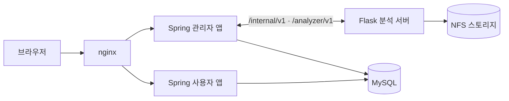

<a id="readme-top"></a>

<div align="center">

# 👁️ White Eyes Docs

**드론·CCTV 영상으로 군중을 분석하는 White Eyes 프로젝트의 명세 저장소**

이 저장소가 명세의 **원본**입니다. 코드는 이 문서를 기준으로 구현합니다.


[문서 목차](INDEX.md) · [프로젝트 개요](overview.md) · [수정 규칙](CLAUDE.md) · [이슈 등록](https://github.com/white-eyes1/white-eyes-docs/issues)

</div>

<details>
<summary>목차</summary>

1. [소개](#소개)
2. [저장소 구성](#저장소-구성)
3. [문서 지도](#문서-지도)
4. [빠르게 찾아보기](#빠르게-찾아보기)
5. [ID 규칙](#id-규칙)
6. [문서 수정하기](#문서-수정하기)
7. [화면 시안](#화면-시안)
8. [결정 기록](#결정-기록)
9. [시험 보고서](#시험-보고서)
10. [소유자](#소유자)

</details>

## 소개

**White Eyes**는 높은 고도에서 찍은 드론·CCTV 영상에서 사람을 탐지·추적해 **인원 수, 유입/유출량과 방향, 체류 시간, 혼잡 단계**를 집계하고, 누적된 데이터를 시간대별·계절별 통계로 시각화하는 서비스입니다.

- **사용자**: 구역별 통계(지도·그래프·대시보드)를 보고 엑셀로 내려받습니다. 영상은 볼 수 없습니다.
- **관리자**: 구역·캠 관리, 사용자 승인, 이벤트 처리, 실시간 화면·다시보기를 맡습니다.
- **최고 관리자**: 관리자 계정을 관리하고 작업 기록(히스토리)을 확인합니다.

> 이 프로젝트는 취업 포트폴리오 용도입니다. 실무 프로세스를 따르되 과하게 설계하지 않는다는 원칙으로 작성했습니다.

<p align="right">(<a href="#readme-top">맨 위로</a>)</p>

## 저장소 구성

White Eyes는 네 개의 저장소로 이루어져 있고, 이 저장소는 그 기준 문서입니다.

| 저장소 | 역할 |
|---|---|
| **white-eyes-docs** (여기) | 명세 원본: 요구사항·기능·화면·API·테이블·컨벤션 |
| white-eyes-spring | 사용자 앱 · 관리자 앱 · 공통 모듈 (Java 17, Spring Boot) |
| white-eyes-flask | 분석 서버 (Python 3.12, Flask, YOLOv8 + PointTracker) |
| white-eyes-deploy | 배포 설정 |



> 명세와 코드가 다르면 **명세를 먼저 고치고 PR로 남깁니다.**

<p align="right">(<a href="#readme-top">맨 위로</a>)</p>

## 문서 지도

| 문서 | 내용 |
|---|---|
| [overview.md](overview.md) | 프로젝트 개요, 서비스 구성, 기술 스택, 실행 흐름, 이벤트 규칙, 알려진 한계 |
| [conventions.md](conventions.md) | 포트, nginx 경로, 공통 API 규칙, 세션, 입력값 규칙, 코드 값, 환경변수 |
| [requirements.md](requirements.md) | 요구 명세 (영역별 표) |
| [features/](features/index.md) | 기능 목록과 상세 (`common` · `user` · `admin` · `analyzer`) |
| [api/](api/) | `public.md` 브라우저 ↔ 앱 API, `analyzer.md` spring ↔ flask 계약 |
| [screens.md](screens.md) | 화면 기능 명세 (화면 ID별) |
| [tables.md](tables.md) | 테이블·칼럼 명세 |
| [backlog-p2.md](backlog-p2.md) | 2순위 기능과 테이블 초안 |
| [code-conventions.md](code-conventions.md) | Java · Python · JavaScript 코드 컨벤션, 로깅(Log4j2) |
| [package-structure.md](package-structure.md) | spring 멀티모듈 · flask 패키지 구조와 의존 규칙 |
| [commit-convention.md](commit-convention.md) | 커밋 메시지 규칙 (세 저장소 공통) |
| [design/](design/README.md) | 화면 시안 (정적 HTML · PNG · 공통 CSS) |
| [decisions/](decisions/) | 결정 기록 (ADR) |
| [test-reports/](test-reports/) | 날짜별 시험 보고서 |

전체 안내는 **[INDEX.md](INDEX.md)** 에 있습니다.

<p align="right">(<a href="#readme-top">맨 위로</a>)</p>

## 빠르게 찾아보기

**하려는 일에 따라 어디부터 볼지**

| 하려는 일 | 먼저 볼 문서 |
|---|---|
| 프로젝트가 무엇인지 알고 싶다 | [overview.md](overview.md) |
| 기능을 구현한다 | [features/](features/index.md) → [api/](api/) → [screens.md](screens.md) |
| 테이블을 만든다 | [tables.md](tables.md) → [conventions.md](conventions.md) |
| 코드를 쓴다 | [code-conventions.md](code-conventions.md) · [package-structure.md](package-structure.md) |
| 화면 모양을 확인한다 | [design/](design/README.md) |
| 왜 이렇게 정했는지 궁금하다 | [decisions/](decisions/) |
| 커밋한다 | [commit-convention.md](commit-convention.md) |

<p align="right">(<a href="#readme-top">맨 위로</a>)</p>

## ID 규칙

| 종류 | 형식 | 예 | 위치 |
|---|---|---|---|
| 요구사항 | `{영역}-{3자리}` | `evtdet-001` | requirements.md |
| 기능 | `FNC-{C/U/A/S}-{3자리}` | `FNC-A-020` | features/ |
| 화면 | `SCR-{C/U/A}-{3자리}` | `SCR-A-008` | screens.md |
| 결정 | `{4자리}-{짧은-영문}.md` | `0001-yolo-crowd.md` | decisions/ |

- 접두사 **C** 는 두 앱 공용, **U** 는 사용자 앱, **A** 는 관리자 앱, **S** 는 분석 서버·운영입니다.
- ID는 한 번 쓰면 바꾸거나 다시 쓰지 않습니다. 지운 ID는 빈 번호로 남깁니다.

<p align="right">(<a href="#readme-top">맨 위로</a>)</p>

## 문서 수정하기

1. 어떤 내용이 어느 파일에 있는지 [INDEX.md](INDEX.md)에서 찾습니다.
2. [CLAUDE.md](CLAUDE.md)의 **'고칠 때 함께 바꿀 문서'** 표에 따라 연관 문서를 함께 고칩니다.
3. 바꾼 ID·경로·칼럼 이름으로 `grep -rn`을 돌려 남은 참조가 없는지 확인합니다.
4. 커밋 타입은 `docs`를 씁니다. 관련 ID는 본문에 적습니다.

```
docs: 결과 끊긴 혼잡·급증 이벤트 종료 규칙 추가

관련: FNC-A-033, evtdet-001
```

5. PR을 올립니다. spring ↔ flask API가 바뀌면 **두 코드 저장소를 같은 시점에** 고칩니다.

> 비밀번호·키·토큰 값은 쓰지 않습니다. 환경변수 **이름**만 적습니다.

<p align="right">(<a href="#readme-top">맨 위로</a>)</p>

## 화면 시안

화면마다 정적 HTML과 PNG 캡처가 있습니다. **모양(배치·색·간격·문구)** 의 기준은 시안, **동작·데이터** 의 기준은 명세입니다. 자세한 읽는 법은 [design/README.md](design/README.md)를 보세요.

<p align="right">(<a href="#readme-top">맨 위로</a>)</p>

## 결정 기록

중요한 결정의 이유는 `decisions/`에 남기고, 명세 본문에는 결과만 씁니다. 결정이 바뀌면 기존 기록을 지우지 않고 상태를 `대체됨(→ 새 번호)`으로 바꿉니다.

| 번호 | 결정 |
|---|---|
| 0006 | 혼잡 3단계 |
| 0008 | 명세 원본을 md로 |
| 0011 | 개발 단계(1·2·3단계) |
| 0015 | VisDrone YOLOv8m + PointTracker |
| 0016 | 통계 그래프 개편, 기간 비교 화면 삭제 |
| 0020 | 작업 모드(`--job`) 제거 |

전체 목록은 [INDEX.md](INDEX.md#결정-기록)에 있습니다.

<p align="right">(<a href="#readme-top">맨 위로</a>)</p>

## 시험 보고서

기능을 구현한 뒤 화면 캡처와 함께 [test-reports/](test-reports/)에 날짜별로 남깁니다. 폴더마다 `README.md`와 번호 붙은 PNG가 들어 있습니다.

<p align="right">(<a href="#readme-top">맨 위로</a>)</p>

## 소유자

[CODEOWNERS](.github/CODEOWNERS): `@white-eyes1/leads`

<p align="right">(<a href="#readme-top">맨 위로</a>)</p>
