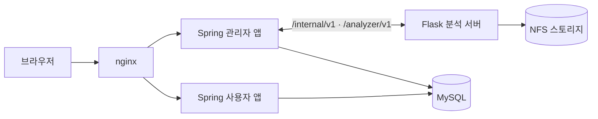

<a id="readme-top"></a>

<div align="center">

# White Eyes Docs

**드론·CCTV 영상 기반 군중 분석 서비스, White Eyes의 명세 저장소**

이 저장소가 명세의 원본이며, 코드는 이 문서를 기준으로 구현한다.


[프로젝트 소개](https://github.com/white-eyes1/white-eyes-introduce) · [문서 목차](INDEX.md) · [프로젝트 개요](overview.md) · [수정 규칙](CLAUDE.md) · [이슈](https://github.com/white-eyes1/white-eyes-docs/issues)

</div>

<details>
<summary>목차</summary>

1. [프로젝트 소개](#프로젝트-소개)
2. [저장소 구성](#저장소-구성)
3. [문서 구성](#문서-구성)
4. [목적별 참고 문서](#목적별-참고-문서)
5. [ID 규칙](#id-규칙)
6. [문서 수정 방법](#문서-수정-방법)
7. [화면 시안](#화면-시안)
8. [의사결정 기록](#의사결정-기록)
9. [테스트 리포트](#테스트-리포트)
10. [코드 오너](#코드-오너)

</details>

## 프로젝트 소개

White Eyes는 높은 고도에서 촬영한 드론·CCTV 영상으로 사람을 탐지하고 추적해 인원 수, 유입/유출량과 방향, 체류 시간, 혼잡 단계를 집계하는 서비스다. 누적된 데이터는 시간대별·계절별 통계로 시각화해 구역의 활성도를 한눈에 볼 수 있게 한다.

| 권한 | 할 수 있는 일 |
|---|---|
| 사용자 | 구역별 통계(지도·그래프·대시보드) 조회, 엑셀 다운로드. 영상은 조회할 수 없다. |
| 관리자 | 구역·캠 관리, 사용자 승인, 이벤트 처리, 실시간 영상·다시보기 |
| 최고 관리자 | 관리자 계정 관리, 작업 기록(히스토리) 조회 |

> 취업 포트폴리오용 프로젝트라서 실무 프로세스는 따르되 과설계는 피한다.

<p align="right">(<a href="#readme-top">맨 위로</a>)</p>

## 저장소 구성

프로젝트는 다섯 개의 공개 저장소로 나뉘며, 이 저장소는 나머지 저장소가 따르는 기준 문서다.

| 저장소 | 역할 |
|---|---|
| **white-eyes-docs** (현재) | 명세 원본: 요구사항, 기능, 화면, API, 테이블, 컨벤션 |
| white-eyes-spring | 사용자 앱, 관리자 앱, 공통 모듈 (Java 17, Spring Boot) |
| white-eyes-flask | 분석 서버 (Python 3.12, Flask, YOLOv8 + PointTracker) |
| white-eyes-deploy | local 전체 실행 설정 (docker compose, nginx, MySQL) |
| [white-eyes-introduce](https://github.com/white-eyes1/white-eyes-introduce) | 프로젝트 소개 (화면, 시스템 구성, 일하는 방식) |



> 명세와 코드가 다르면 명세를 먼저 수정하고 PR을 남긴다.

<p align="right">(<a href="#readme-top">맨 위로</a>)</p>

## 문서 구성

| 문서 | 내용 |
|---|---|
| [overview.md](overview.md) | 프로젝트 개요, 서비스 구성, 기술 스택, 실행 흐름, 이벤트 규칙, 알려진 한계 |
| [conventions.md](conventions.md) | 포트, nginx 경로, 공통 API 규칙, 세션, 입력값 규칙, 코드 값, 환경변수 |
| [requirements.md](requirements.md) | 요구사항 명세 (영역별) |
| [features/](features/index.md) | 기능 목록과 상세 (`common`, `user`, `admin`, `analyzer`) |
| [api/](api/) | `public.md`: 브라우저 ↔ 앱 API, `analyzer.md`: spring ↔ flask 연동 규격 |
| [screens.md](screens.md) | 화면 명세 (화면 ID별) |
| [tables.md](tables.md) | DB 테이블·칼럼 명세 |
| [backlog-p2.md](backlog-p2.md) | 2순위 기능과 테이블 초안 |
| [code-conventions.md](code-conventions.md) | Java, Python, JavaScript 코드 컨벤션, 로깅(Log4j2) |
| [package-structure.md](package-structure.md) | spring 멀티모듈, flask 패키지 구조와 의존성 규칙 |
| [commit-convention.md](commit-convention.md) | 커밋 메시지 컨벤션 (세 코드 저장소 공통) |
| [design/](design/README.md) | 화면 시안 (정적 HTML, PNG, 공통 CSS) |
| [decisions/](decisions/) | 의사결정 기록 |
| [test-reports/](test-reports/) | 날짜별 테스트 리포트 |

전체 안내는 [INDEX.md](INDEX.md)를 참고한다.

<p align="right">(<a href="#readme-top">맨 위로</a>)</p>

## 목적별 참고 문서

| 하고 싶은 일 | 먼저 볼 문서 |
|---|---|
| 프로젝트 전반을 파악한다 | [overview.md](overview.md) |
| 기능을 구현한다 | [features/](features/index.md) → [api/](api/) → [screens.md](screens.md) |
| 테이블을 설계한다 | [tables.md](tables.md) → [conventions.md](conventions.md) |
| 코드를 작성한다 | [code-conventions.md](code-conventions.md), [package-structure.md](package-structure.md) |
| 화면 디자인을 확인한다 | [design/](design/README.md) |
| 의사결정 배경을 확인한다 | [decisions/](decisions/) |
| 커밋 메시지를 작성한다 | [commit-convention.md](commit-convention.md) |

<p align="right">(<a href="#readme-top">맨 위로</a>)</p>

## ID 규칙

| 종류 | 형식 | 예시 | 위치 |
|---|---|---|---|
| 요구사항 | `{영역}-{3자리}` | `evtdet-001` | requirements.md |
| 기능 | `FNC-{C/U/A/S}-{3자리}` | `FNC-A-020` | features/ |
| 화면 | `SCR-{C/U/A}-{3자리}` | `SCR-A-008` | screens.md |
| 의사결정 | `{4자리}-{짧은-영문}.md` | `0001-yolo-crowd.md` | decisions/ |

- 접두사 `C`는 두 앱 공용, `U`는 사용자 앱, `A`는 관리자 앱, `S`는 분석 서버·운영이다.
- 한 번 부여한 ID는 변경하거나 재사용하지 않는다. 삭제한 ID는 빈 번호로 남긴다.

<p align="right">(<a href="#readme-top">맨 위로</a>)</p>

## 문서 수정 방법

1. [INDEX.md](INDEX.md)에서 수정할 내용이 어느 파일에 있는지 확인한다.
2. [CLAUDE.md](CLAUDE.md)의 '고칠 때 함께 바꿀 문서' 테이블을 보고 연관된 문서를 같이 수정한다.
3. 변경한 ID·경로·칼럼명으로 `grep -rn`을 실행해 남은 참조가 없는지 확인한다.
4. 커밋 타입은 `docs`를 사용하고, 관련 ID는 본문에 적는다.

```
docs: 결과 끊긴 혼잡·급증 이벤트 종료 규칙 추가

관련: FNC-A-033, evtdet-001
```

5. PR을 올린다. spring ↔ flask API를 변경했다면 두 코드 저장소도 같은 시점에 수정한다.

> 비밀번호, 키, 토큰 값은 문서에 쓰지 않고 환경변수 이름만 적는다.

<p align="right">(<a href="#readme-top">맨 위로</a>)</p>

## 화면 시안

화면별로 정적 HTML과 PNG 캡처가 있다. 레이아웃·색상·간격·문구는 시안을, 동작과 데이터는 명세를 기준으로 한다. 시안을 읽는 방법은 [design/README.md](design/README.md)에 정리되어 있다.

<p align="right">(<a href="#readme-top">맨 위로</a>)</p>

## 의사결정 기록

주요 결정의 배경은 `decisions/`에 기록하고, 명세 본문에는 결과만 적는다. 결정이 바뀌면 기존 기록을 삭제하지 않고 상태를 `대체됨(→ 새 번호)`으로 변경한다.

| 번호 | 결정 |
|---|---|
| 0006 | 혼잡 3단계 |
| 0008 | 명세 원본을 md로 관리 |
| 0011 | 개발 단계(1·2·3단계) |
| 0015 | VisDrone YOLOv8m + PointTracker |
| 0016 | 통계 그래프 개편, 기간 비교 화면 삭제 |
| 0020 | 작업 모드(`--job`) 제거 |

전체 목록은 [INDEX.md](INDEX.md#결정-기록)를 참고한다.

<p align="right">(<a href="#readme-top">맨 위로</a>)</p>

## 테스트 리포트

기능 구현 후 화면 캡처와 함께 [test-reports/](test-reports/)에 날짜별로 기록한다. 폴더마다 `README.md`와 번호가 붙은 PNG가 들어 있다.

<p align="right">(<a href="#readme-top">맨 위로</a>)</p>

## 코드 오너

[CODEOWNERS](.github/CODEOWNERS)에 따라 `@white-eyes1/leads`가 리뷰를 담당한다.

<p align="right">(<a href="#readme-top">맨 위로</a>)</p>
