# 1단계 화면 확인 — 2026-10-21

spring #136(공통 틀)·#137(구역 관리)·#138(캠 관리)·#139(통계 메인)을 합친 빌드를 로컬 docker(MySQL·관리자 앱·분석 서버)에 올리고, 실제 브라우저(Playwright Chromium, 1440×900)로 조작하며 캡처했다. 시안은 `design/png/`.

- 결과: 아래 흐름이 모두 동작했고 콘솔·페이지·HTTP 오류 0건. 합친 빌드 `./gradlew build` 테스트 483개 통과
- 데이터는 시험용(대전 중구 행정구역, 더미 영상 캠). 영상 파일 이름은 시험용 이름으로 바꿔 찍었다

| 화면 | 시안 | 구현 |
|---|---|---|
| SCR-C-001 로그인 | 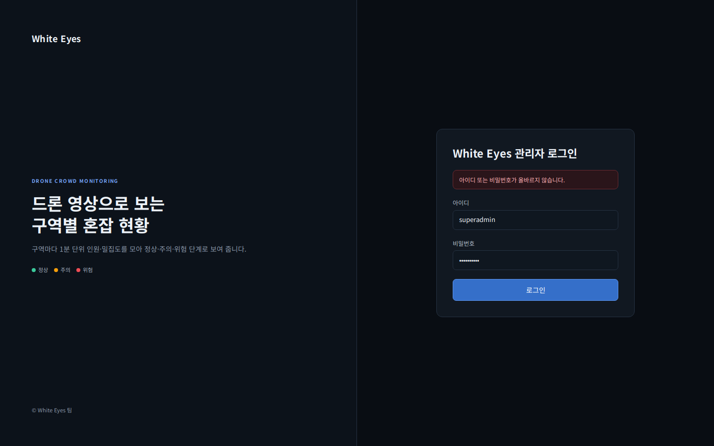 | 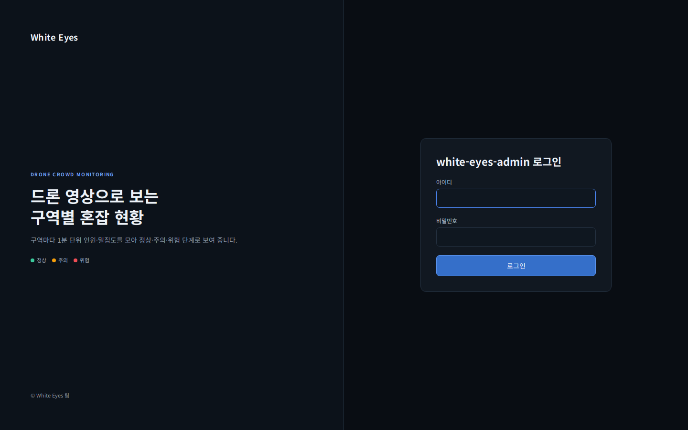 |
| SCR-C-003 통계 메인(동) |  | 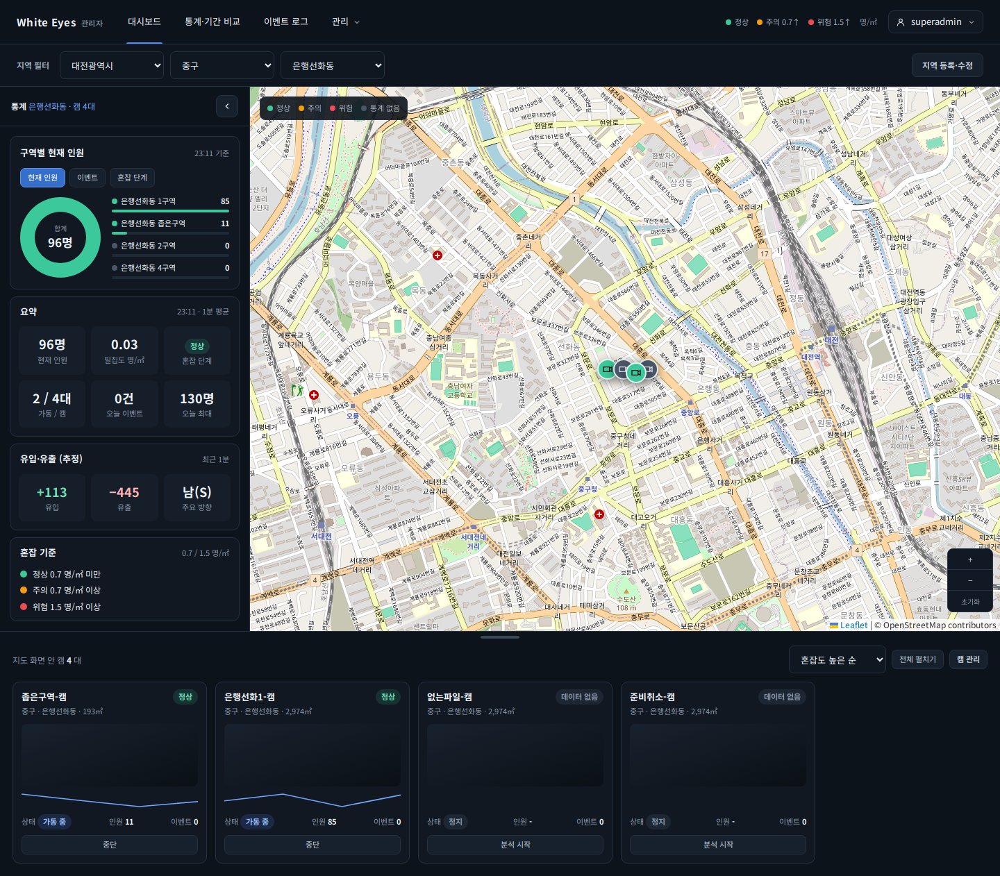 |
| SCR-C-003 통계 메인(구) | - | 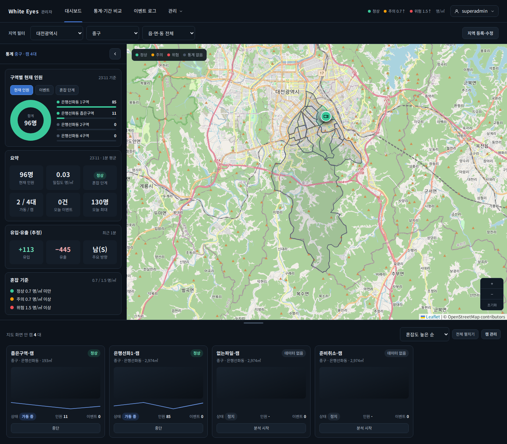 |
| SCR-C-003 캠 패널 펼침 | 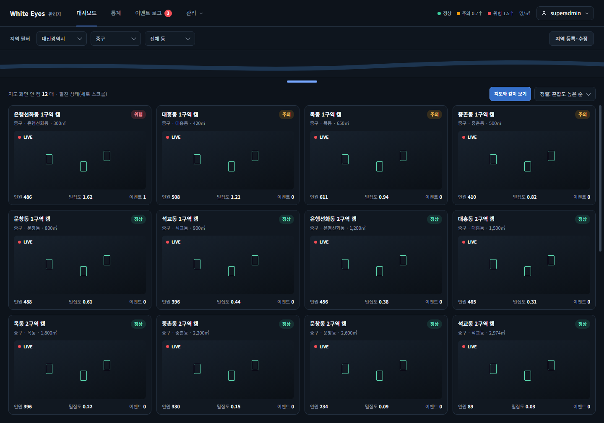 | 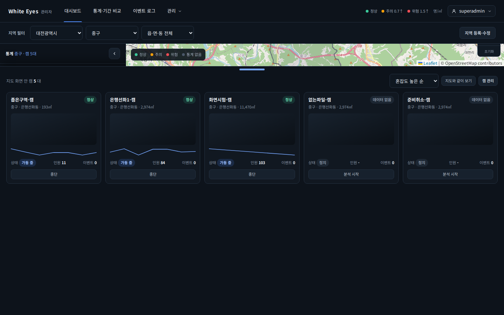 |
| SCR-A-004 구역 관리(동 선택) |  | 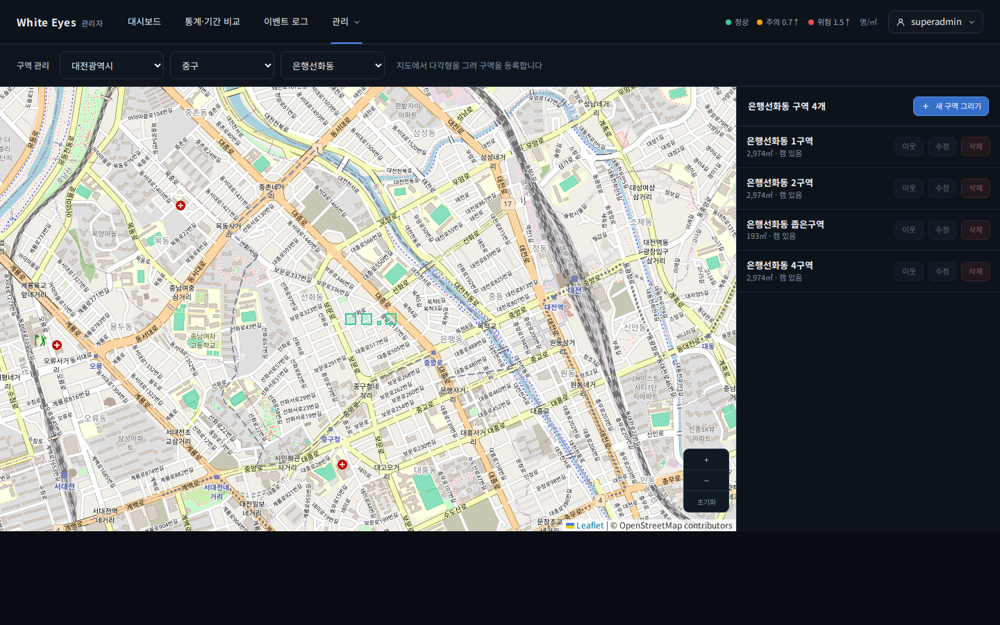 |
| SCR-A-004 그린 뒤 미리보기 | - | 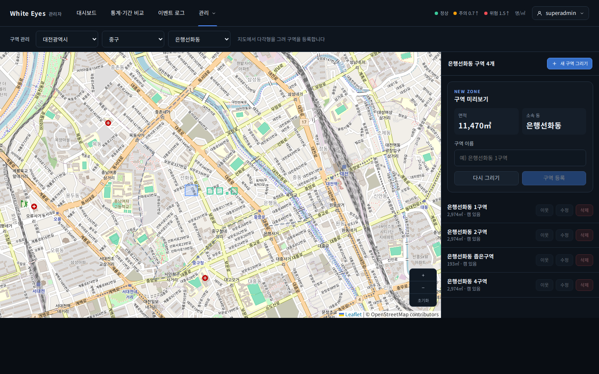 |
| SCR-A-004 등록 뒤 | - | 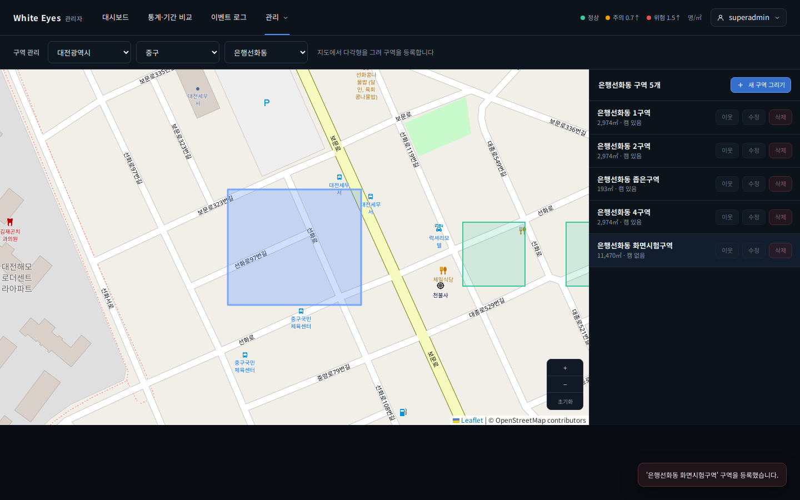 |
| SCR-A-006 캠 관리 | 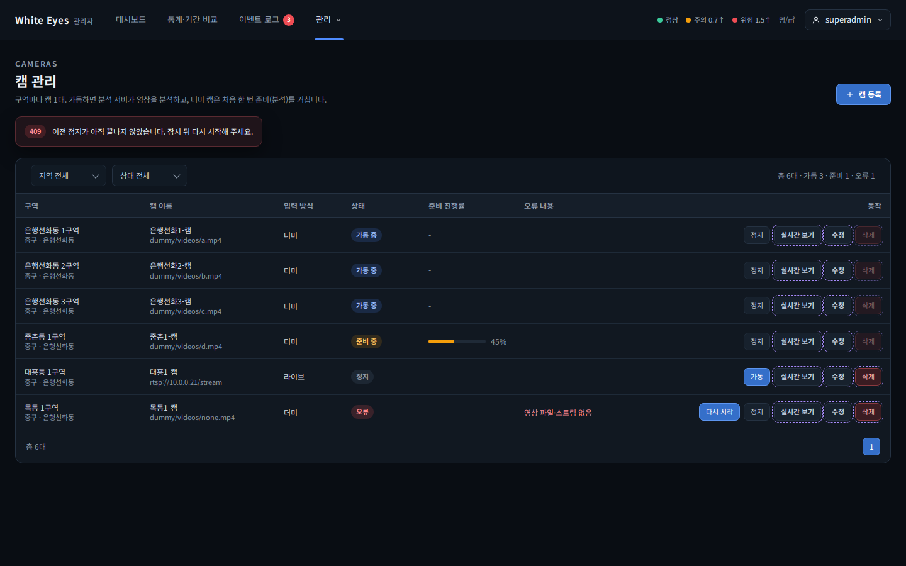 |  |
| SCR-A-007 캠 등록 창(오류) | 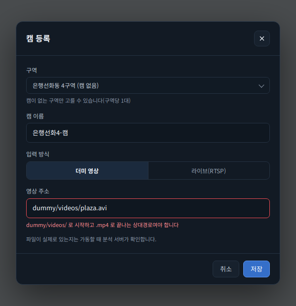 | 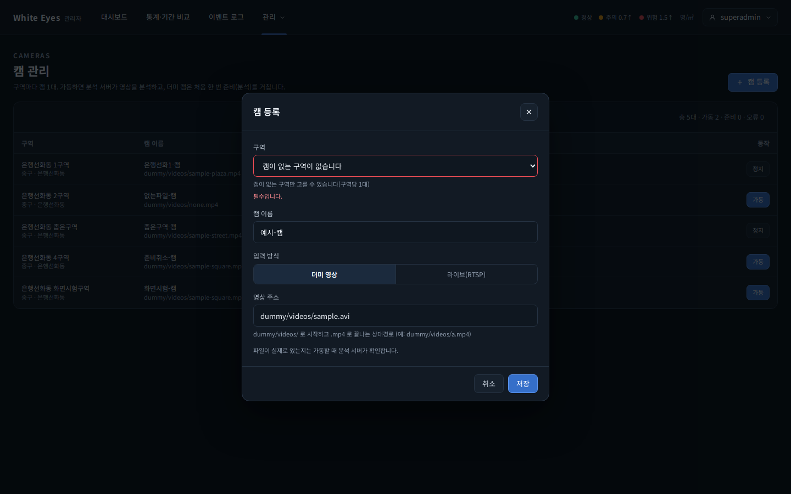 |
| SCR-A-006 가동 → 준비 중 | - | 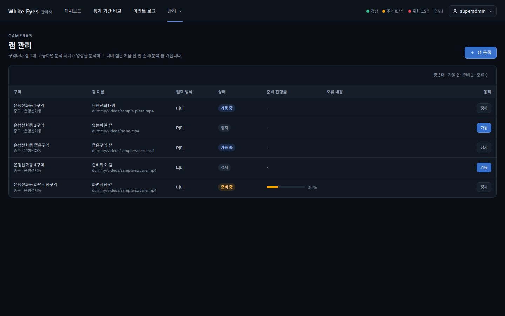 |
| SCR-A-006 준비 끝 → 가동 중 | - | 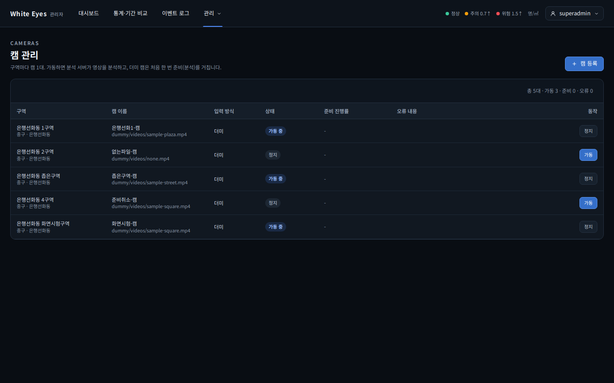 |
| SCR-A-006 정지 | - | 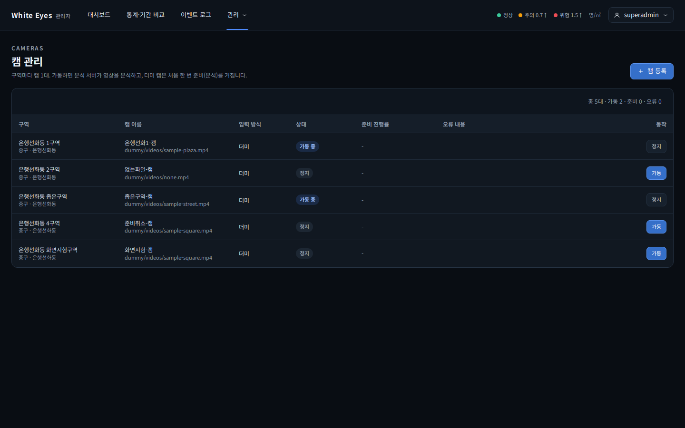 |

## 시안과 다른 점(의도)
- 구역 관리: 구역 목록은 명세(SCR-A-004)대로 오른쪽, 미리보기 카드는 지도 위가 아니라 오른쪽 패널 안(Leaflet 컨트롤과 겹침 방지)
- 캠 관리: 시안의 지역·상태 필터와 페이지 넘김은 1단계 범위 밖이라 뺌. 실시간 보기(2단계)·수정·삭제(3단계) 버튼 없음
- 통계 메인: 2·3단계 접기 영역과 캠 카드 스냅샷(2단계)은 빈 자리. 사용자 앱 화면은 사용자 앱 로그인(#122·#126) 뒤
- 지도·그래프·영상은 시안의 자리 그림 대신 실제 Leaflet + OSM

## 확인 중 고친 것
- 시·구·동 선택 칸이 화면 폭 전체로 늘어남 → 공통 CSS 수정(#136)
- 지도 안 글자 깨짐(Leaflet 글꼴) → 공통 CSS 수정(#136)
- 캠 패널을 펼치면 '지도 화면 안 캠'이 0대로 바뀜 → 펼친 동안 직전 범위 유지(#139)
