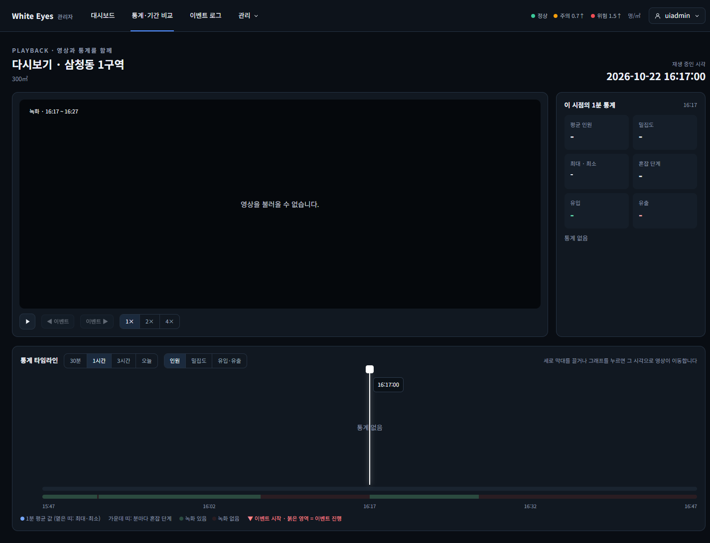

# 다시보기 녹화 띠 확인 — 2026-10-22

spring #160(다시보기 녹화 구간 조회와 시간축 녹화 띠)을 실제 브라우저(Chrome 155 헤드리스, 1440×900)로 조작하며 캡처했다. 시안은 `design/png/`.

- 환경: 이 PC에 Docker·MySQL이 없어 **H2에 시험 데이터를 넣고 관리자 앱을 띄워** 확인했다. 시드는 시험용이며 커밋하지 않았다.
- 구역 1개에 녹화 3건을 넣었다: A(15분 구간) → 10초 틈 → B(14분 50초) → 10분 틈 → C(10분). 다시보기는 가장 최근 녹화 C의 시작을 가운데로 1시간 창을 연다.
- **통계(`/stats/series`)·이벤트(`/events`) API가 이 빌드에 없어 그래프 영역은 비어 있다(404).** 이번 확인 대상이 아니다. 영상 파일을 내줄 nginx도 없어 영상 칸은 '영상을 불러올 수 없습니다'로 보인다.

| 화면 | 시안 | 구현 |
|---|---|---|
| SCR-A-009 다시보기 시간축의 '단계·녹화 띠'(아래 줄)와 범례 |  |  |

## 확인한 것
- 띠는 분마다 혼잡 단계 띠 바로 아래에 그려지고 '녹화 있음/없음' 범례가 붙는다. 시안과 같은 위치·색이다.
- 1시간 창(15:47~16:47)에서 구간 3개: A는 창 시작에 맞춰 잘려 0~8.33%, B는 8.61%부터 24.72%, C는 50%부터 16.67%. **A와 B 사이 10초 틈이 보이고(2초 이하 틈은 서버가 하나로 잇는다), C 뒤 녹화 없는 구간은 어두운 색**이다.
- 범위를 3시간·오늘로 바꾸면 그 범위로 `GET /api/v1/playback/ranges?zoneId=&from=&to=`를 다시 부르고(요청 3번: 1시간·3시간·오늘, 오늘은 24시간) 띠가 새 범위에 맞게 다시 그려진다.
- 구간 조회 요청이 실패하면 '녹화 없음'으로 오해하지 않도록 띠와 범례를 숨긴다.

## 시안과 다른 점(의도)
- 없음. 시안의 띠 2줄(분마다 혼잡 단계 / 녹화 구간)과 범례를 모두 구현했다.

## 확인하지 못한 것
- 실제 분석 서버가 만든 녹화의 구간(더미 반복 녹화의 진행 중 `ended_at` 없음)과 통계 그래프가 같이 있는 모습(통계 API #25 대기).
- nginx 경유 영상 재생.
