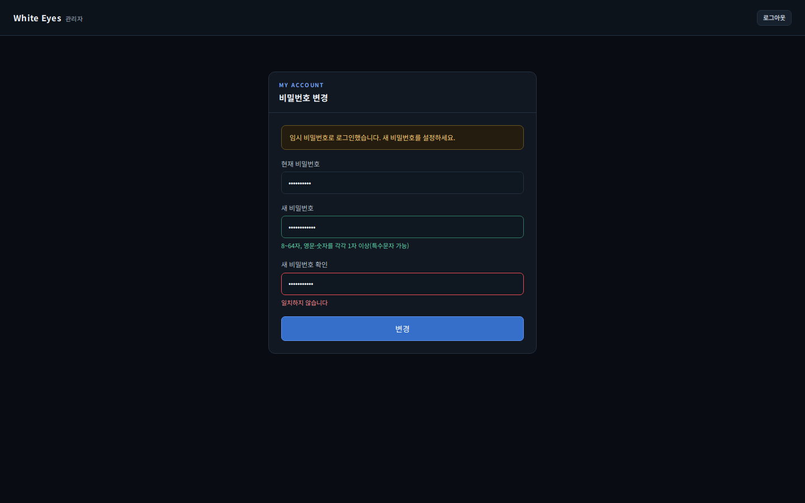
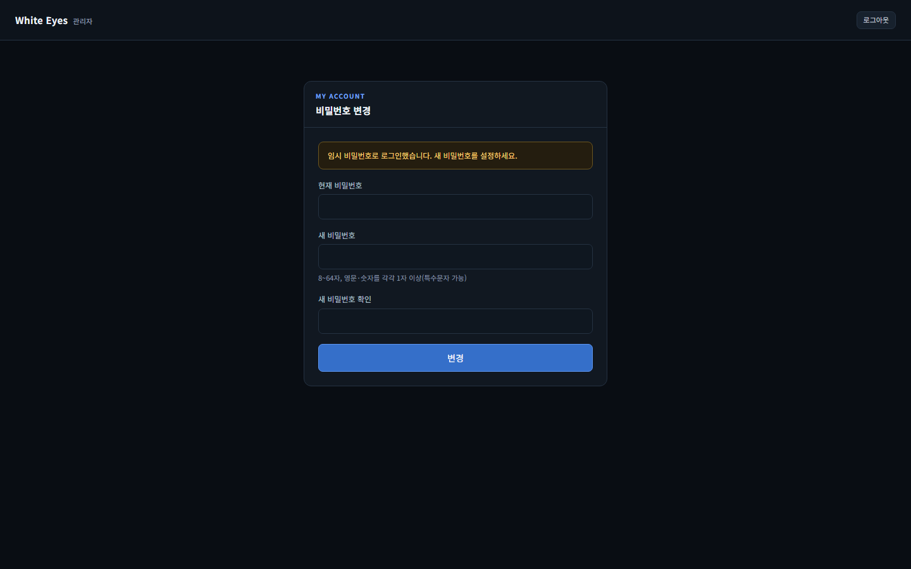
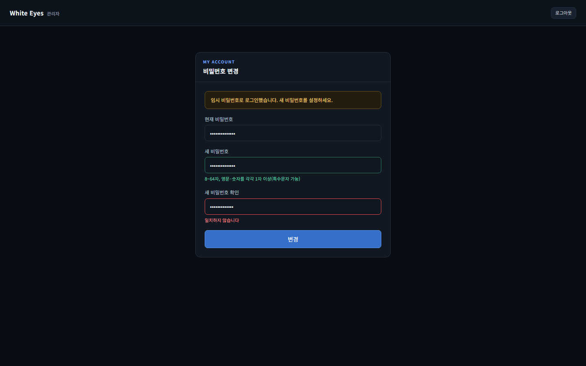
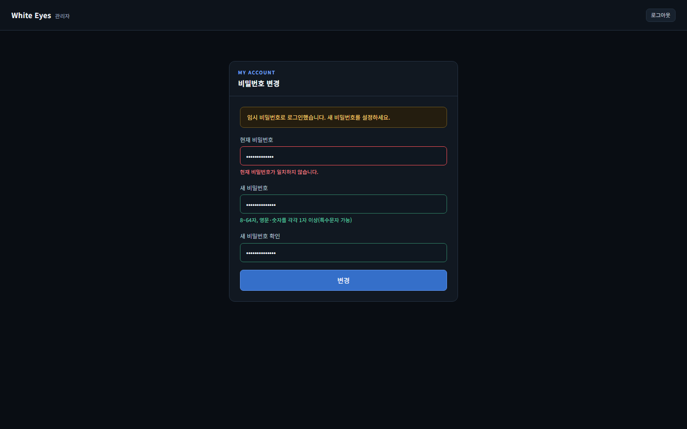
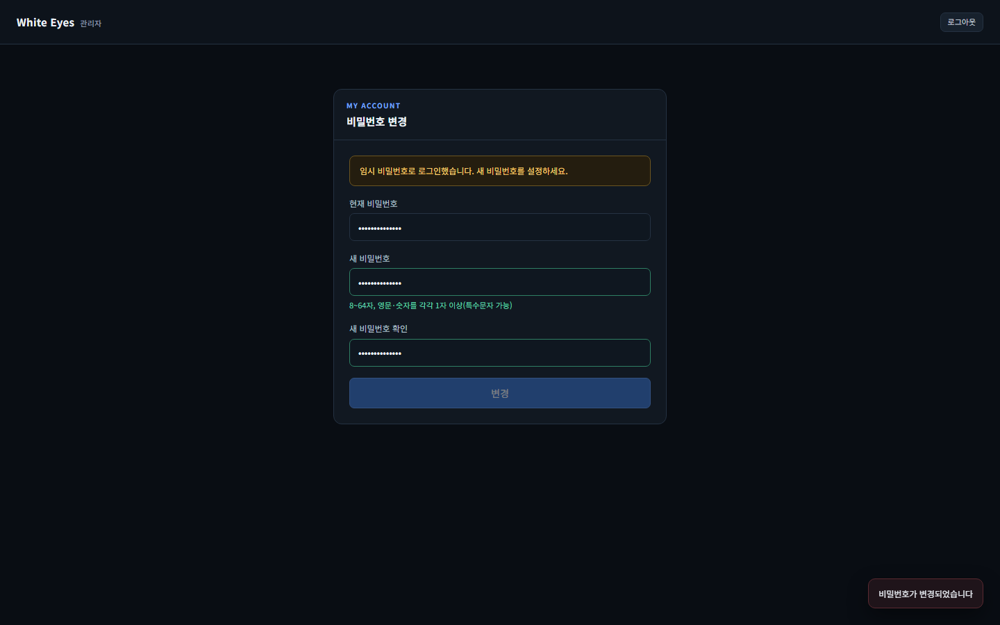
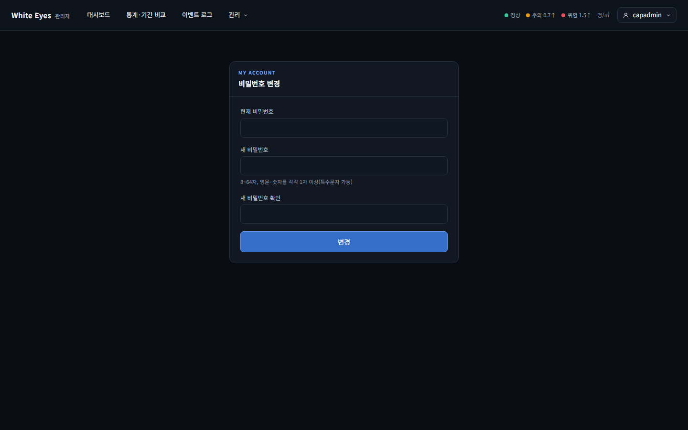
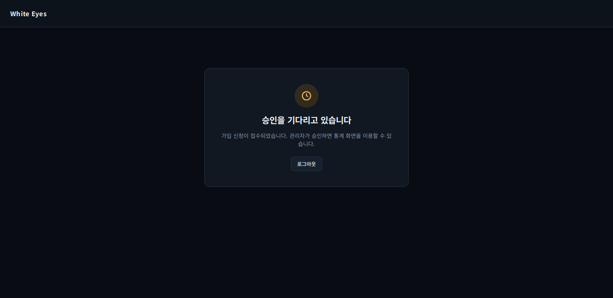
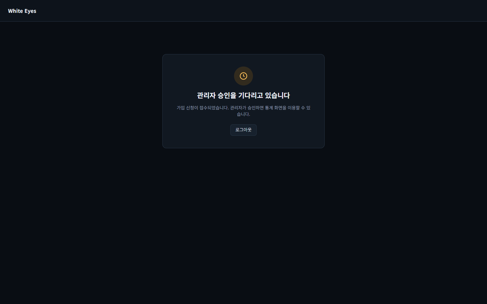

# 2단계 화면 확인: 비밀번호 변경(#24)·로그아웃(#22) — 2026-10-22

white-eyes-spring #24 FNC-C-007 비밀번호 변경(브랜치 feature/24-password-change)과 #22 FNC-C-002 로그아웃(PR #156) 화면의 구현 캡처다. 시안은 `design/png/`. 같은 날 다른 2단계 화면 캡처는 `../2026-10-22-stage2-screens/`.

## #24 SCR-C-002 비밀번호 변경
로컬 MySQL 8.4와 관리자 앱을 실제로 띄우고 실제 로그인으로 캡처했다(Playwright Chromium, 1440×900, 시험용 가짜 계정). 새 비밀번호 칸의 규칙 안내와 확인 불일치 문구는 입력 중 바로 나타난다.

| 상태 | 시안 | 구현 |
|---|---|---|
| 강제 변경 기본(안내 문구, 로그아웃만 표시) |  |  |
| 새 비밀번호 통과 + 확인 불일치(시안 상태) | (위 시안과 같은 상태) |  |
| 현재 비밀번호 틀림(서버 400 WRONG_PASSWORD) | - |  |
| 변경 성공 토스트(약 1.2초 뒤 통계 메인으로 이동) | - |  |
| 강제가 아닐 때(일반 헤더, 안내 문구 없음) | - |  |

확인한 흐름(MySQL, 브라우저 3개): 임시 비밀번호로 로그인 → `/admin/me/password`로 이동 → 변경 → 같은 세션이 `/admin/stats`로 들어감 → 다른 브라우저 세션은 `/admin/login`으로 돌아감 → 옛 비밀번호 로그인 실패, 새 비밀번호 로그인 성공.

### 시안과 다른 점
- 입력 칸 위치·간격, 안내 문구, 색(통과 초록·불일치 빨강), 버튼 위치는 같다. 변경 버튼 글자 굵기만 시안이 더 가늘다(확인 필요).
- 시안에 없는 상태(03·04·05)는 screens.md 처리 규칙대로 만들었다.
- 사용자 앱 화면은 사용자 앱 로그인(#126)이 없어 캡처하지 못했다(검증 불가). 같은 템플릿이라 헤더의 부제만 '혼잡 현황'으로 다르다.

## #22 SCR-U-002 승인 대기(로그아웃 버튼)
| 시안 | 구현 |
|---|---|
|  |  |

- 구현은 **실제 로그인이 아니라 렌더 HTML**이다. 사용자 앱 로그인이 없어(#126) MockMvc로 가짜 PENDING 사용자의 `/pending`을 렌더한 HTML에 `we.css`를 붙여 1440×900으로 캡처했다.
- 로그아웃 버튼의 위치·크기·배색은 같고 글자 굵기만 시안이 더 굵다(시안은 링크, 구현은 폼 버튼). 확인 필요.
- 제목 문구: 시안 '승인을 기다리고 있습니다', 구현 '관리자 승인을 기다리고 있습니다'. FNC-U-003 몫이라 #22에서 고치지 않았다. 확인 필요.
- SCR-U-004(사용자 공통 헤더)는 이 헤더를 쓰는 사용자 앱 화면이 아직 없어 검증 불가.
