# 2단계 화면 확인 — 2026-10-22

spring #35(구역 이웃 설정), #50(다시보기 화면), #27(실시간 통계 갱신), #49(실시간 화면·카드 미리보기)를 합친 빌드를 실제 브라우저(Chrome 155 헤드리스, 1440×900)로 조작하며 캡처했다. 시안은 `design/png/`.

- 환경: 이 PC에 Docker·MySQL이 없어 **H2에 시험 데이터를 넣고 관리자 앱을 띄워** 확인했다(삼청동 구역 16개, 캠 16대 중 15대 가동). 시드는 시험용이며 커밋하지 않았다.
- **nginx·분석 서버·통계/이벤트 API가 없어 아래는 임시 대체물(커밋하지 않음)을 붙였다**: `/live/{id}`·`/live/{id}/snapshot`은 숫자를 그린 가짜 이미지, `GET /api/v1/stats/series`·`/api/v1/events`는 명세 형식의 가짜 응답, 서버가 25초마다 새 1분 통계를 저장.
- 영상 재생·구간 이동은 로컬 mp4를 Range 응답으로 내주는 임시 설정으로 따로 확인했다(영상 내용은 캡처하지 않았다).

| 화면 | 시안 | 구현 |
|---|---|---|
| SCR-A-005 구역 이웃 설정 창 | 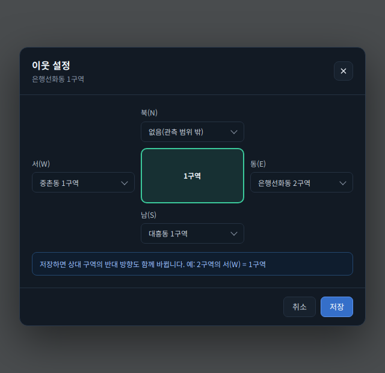 | 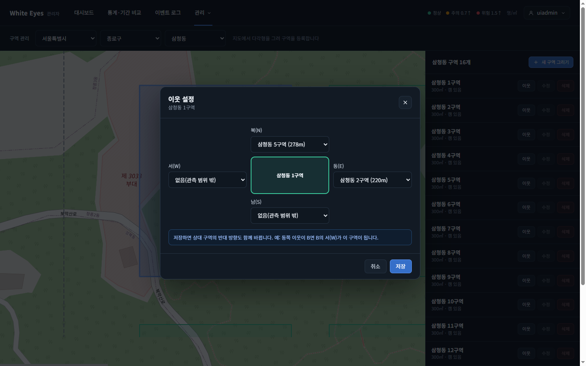 |
| SCR-A-005 저장 뒤 상대 구역의 반대 방향 자동 반영(2구역의 서쪽 = 1구역) | - | 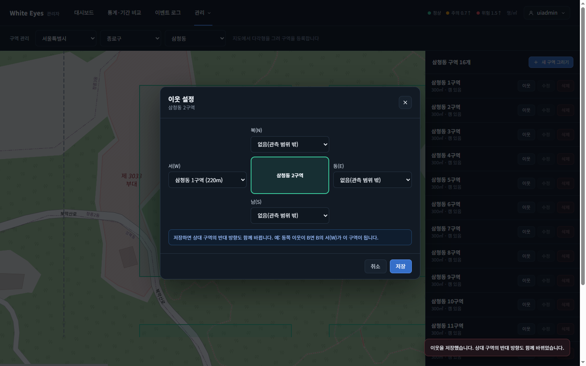 |
| SCR-C-003 캠 패널(카드 영상 칸에 최신 화면) |  | 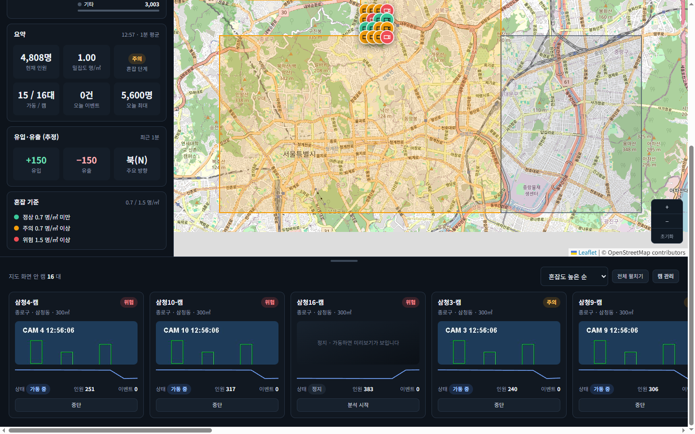 |
| SCR-C-003 캠 패널 펼침(16장) |  | 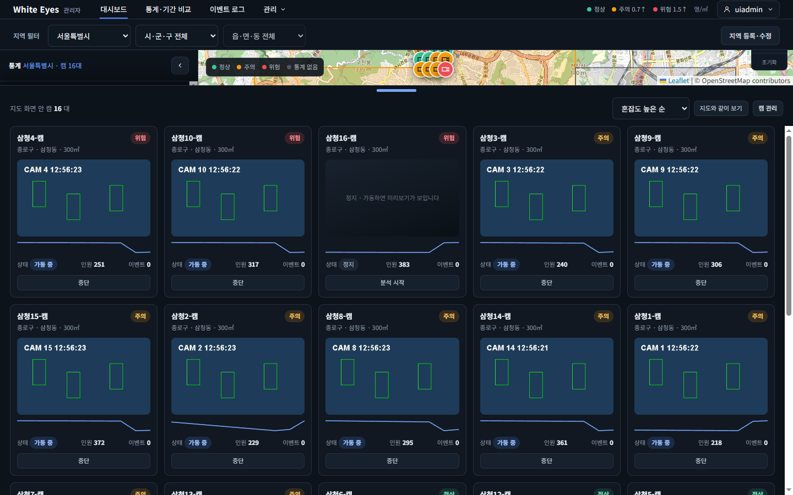 |
| SCR-A-008 실시간 보기 창 | 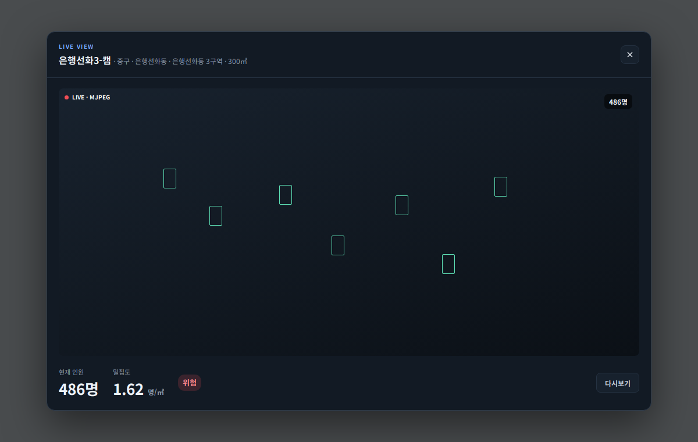 | 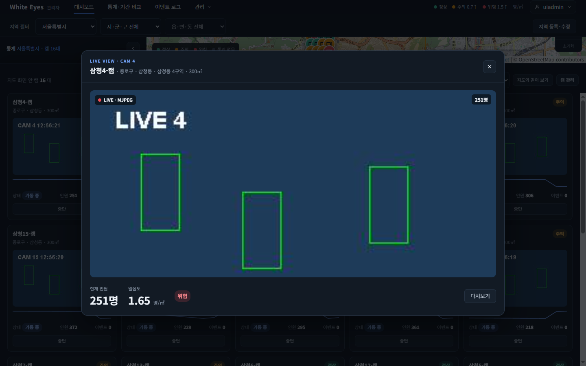 |
| SCR-A-006 캠 관리('실시간 보기' 버튼) |  | 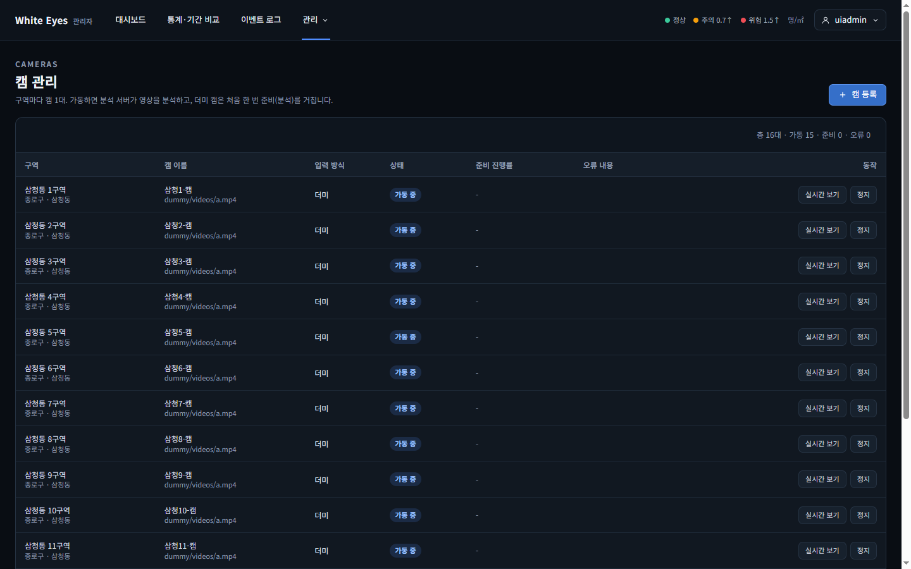 |
| SCR-A-009 다시보기(영상 없이, 시간축은 가짜 통계) | 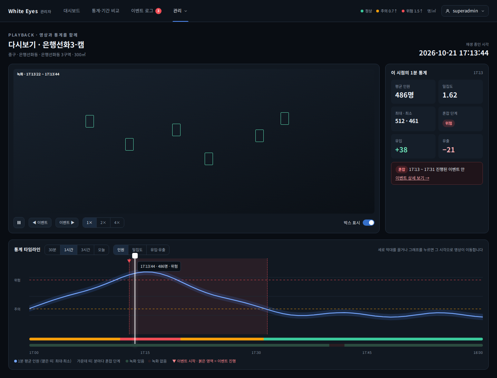 | 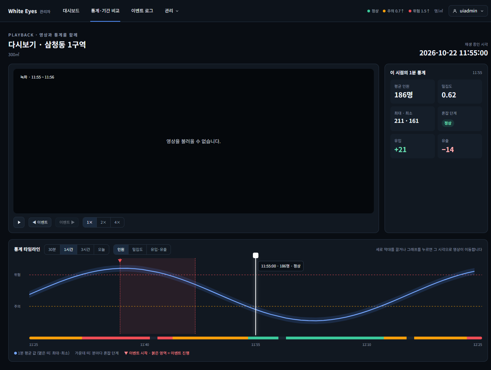 |
| SCR-C-003 서버를 끈 뒤 '연결 끊김' 표시 | - | 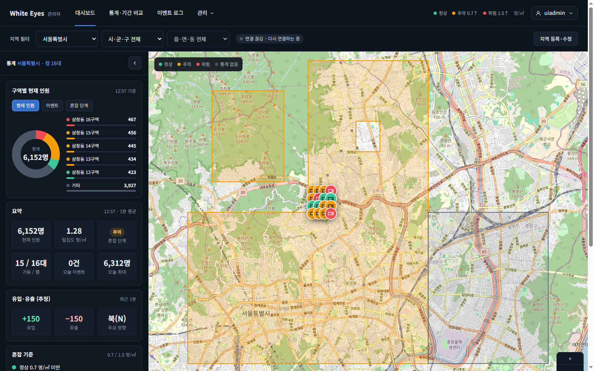 |

## 확인한 것
- **#35**: 구역 관리에서 동을 고르면 구역 4개 이상이 나오고 '이웃' 창이 열린다. 후보는 현재 구역에서 가까운 순(220m·278m…)이고 자기 자신은 없다. 동쪽·북쪽을 저장하면 안내 토스트가 뜨고 API로 상대 구역의 서쪽·남쪽이 자동 반영된 것을 확인했다. 다시 열면 값이 유지된다.
- **#27**: 서버가 25초마다 새 분을 저장하는 동안 대시보드가 새로고침 없이 갱신된다(요약 조회 65초에 2번, '기준' 시각이 분마다 바뀜). **브라우저 탭 두 개를 같이 열면 같은 초(13·38·63초)에 같은 시각(12:54·12:55·12:56)으로 갱신**된다. **서버를 끄면 '연결 끊김 · 다시 연결하는 중'이 뜬다**(08).
- **#49**: 캠 패널이 화면 아래에 있을 때 스냅샷 요청 0건 → 보이면 가동 중인 캠만 요청, 정지한 캠은 0건. **카드 16장을 펼쳐도 스냅샷 동시 요청은 최대 2개**이고, 화면에 보이는 카드(9~10장)만 요청하며, 실시간 보기 창은 0.03초 안에 뜨고 통계 갱신도 계속 온다. 영상 칸·구역 핀을 누르면 실시간 보기 창이 열리고 Esc로 닫으면 이미지 요청을 끊는다. 정지한 캠의 핀은 안내 토스트. 캠 관리의 '실시간 보기'는 가동 중 행만 켜진다.
- **#50**: 그래프를 누르거나 세로 막대를 끌면 그 시각으로 이동(같은 녹화 안이면 영상 위치만 바뀌고 녹화 찾기를 다시 부르지 않음, 녹화가 없는 시각은 '영상 없음'). 이벤트 이전·다음 버튼, 범위 30분/1시간/3시간/오늘, 항목 인원/밀집도/유입·유출, 재생 속도, 재생·일시정지가 동작한다. 최대·최소 띠, 분마다 혼잡 단계 띠, 이벤트 구간, 주의·위험 경계선이 그려진다.

## 시안과 다른 점(의도)
- SCR-A-009: '박스 표시' 토글은 탐지 박스(FNC-A-046, 3단계)와 함께, '녹화 있는 구간' 띠는 범위의 녹화 구간을 주는 API가 명세에 없어 뺐다. 영상이 끝난 뒤 이어 재생(FNC-A-045)도 3단계.
- SCR-A-009: 제목은 캠 이름 대신 구역 이름·면적(구역 목록 API에 구·동 경로가 없음).
- SCR-C-003: 카드 영상 칸에 시안의 'LIVE' 표시는 없다(실시간 보기 창에는 있음). 필터 줄에 시안에 없는 '연결 끊김' 표시가 추가됐다(명세 screens.md '화면 공통 실시간 갱신').

## 확인 중 고친 것
- 다시보기 시간축에 **주의·위험 경계선이 빠져 있었다** → 추가(#50).
- 캠 패널을 펼치면 카드 영상 칸이 90px에서 4px로 쪼그라들고, 이어서 격자 행이 화면 높이를 나눠 가져 **카드 내용이 잘렸다** → 카드 안쪽 칸이 줄지 않게 하고 행을 내용 높이로, 펼친 모양의 영상 칸은 시안대로 140px(#49).
- 최대·최소 인원이 소수로 표시됨 → 정수(#50).

## 확인하지 못한 것
- 실제 nginx 경유 영상·스냅샷 전달, 분석 서버가 만든 녹화 파일·실제 MJPEG(임시 이미지로 대신 확인).
- 통계 시간축·이벤트는 통계 API(#25)·이벤트 API(#40)가 dev에 없어 가짜 응답으로만 확인.
- 연결이 끊긴 뒤 EventSource의 자동 재연결(서버를 껐다 켜면 세션이 사라져 로그인부터 다시 해야 해서 확인하지 못함).
- Chrome에서 H.265 계열 영상을 읽으려면 GPU 옵션이 필요했다. 실제 분석 서버의 녹화 코덱이 브라우저 재생이 되는 H.264인지는 flask #9에서 확인이 필요하다.
