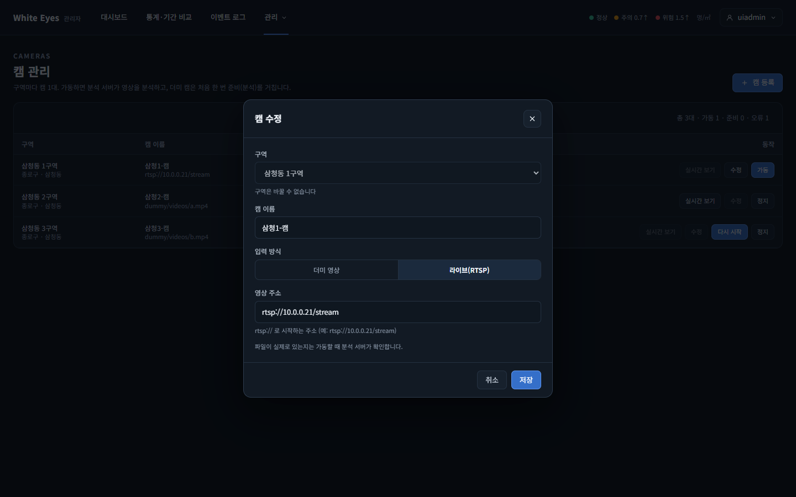
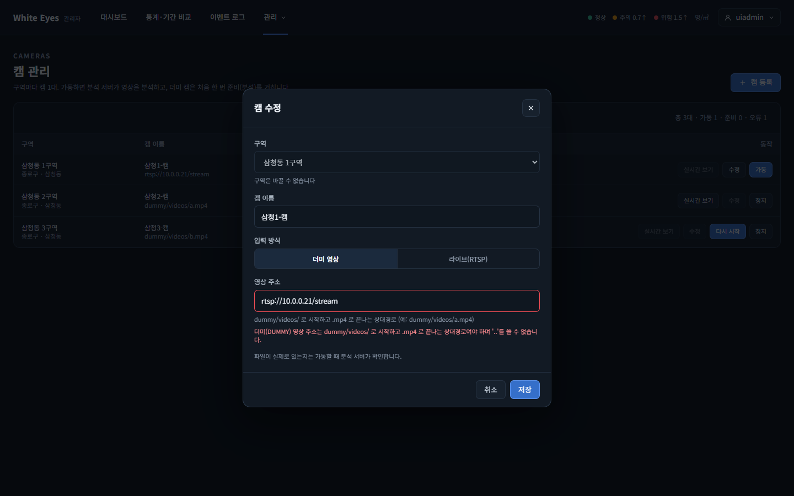

# 캠 정보 수정 화면 확인 — 2026-10-23

spring #72(캠 정보 수정, FNC-A-019)를 실제 브라우저(Chrome 155 헤드리스, 1440×900)로 조작하며 캡처했다. 시안은 `design/png/`.

- 환경: 이 PC에 Docker·MySQL이 없어 **H2에 시험 데이터를 넣고 관리자 앱을 띄워** 확인했다(캠 3대: 정지 LIVE / 가동 중 / 오류). 시드는 시험용이며 커밋하지 않았다.

| 화면 | 시안 | 구현 |
|---|---|---|
| SCR-A-006 목록 '수정' → SCR-A-007 캠 수정 창(구역은 읽기 전용, 값이 채워져 열림) |  |  |
| SCR-A-007 영상 주소가 입력 방식 규칙을 어길 때 | - |  |

## 확인한 것
- 목록 행에 '수정' 버튼이 생겼다. **정지 상태이고 가동 요청이 없을 때만 켜지고**, 가동 중·준비 중·오류 캠은 꺼지며 마우스를 올리면 '정지 상태에서만 고칠 수 있습니다. 먼저 정지해 주세요.'가 보인다. 정지 상태여도 가동 요청 처리 중인 캠은 삭제 버튼(#73)과 같은 안내('가동 요청 처리 중입니다. 잠시 뒤 다시 시도하거나 정지해 주세요')가 보인다(리뷰 반영: dev의 #172를 합친 뒤 같은 기준으로 맞춤).
- '수정'을 누르면 등록 창이 '캠 수정'으로 열리고 이름·입력 방식·영상 주소가 채워진다. 구역은 읽기 전용(드롭다운 비활성, '구역은 바꿀 수 없습니다').
- 입력 방식을 더미로 바꾸고 rtsp 주소 그대로 저장하면 서버 규칙 문구('더미(DUMMY) 영상 주소는 dummy/videos/ 로 시작하고 .mp4 로 끝나는…')가 영상 주소 아래에 나오고 창이 열려 있다(400).
- 이름과 주소를 바르게 고쳐 저장하면 창이 닫히고 목록의 이름과 주소(`dummy/videos/c.mp4`)가 바뀐다. **바뀐 필드만 PATCH로 보내며**, 바뀐 것이 없으면 요청 없이 창만 닫힌다.
- '캠 등록'은 그대로 '캠 등록' 제목, 구역 선택 가능, 빈 칸으로 열린다.
- 가동 중 캠에 PATCH를 직접 보내면 409 `CAMERA_NOT_STOPPED`(공용 문구 '정지 상태에서만 처리할 수 있습니다. 먼저 캠을 정지해 주세요.', #172와 같은 예외·상수를 씀)가 온다(화면은 이 코드를 받으면 창 안에 문구를 보이고 목록을 다시 받아 수정 버튼을 끈다).
- 정지 확인·주소 규칙·작업 기록(이전·이후 값)·404·401은 서버 시험 8개(`CameraUpdateTest`)로 확인했다.

## 시안과 다른 점(의도)
- 시안의 목록 '수정'은 SCR-A-007로 가는 링크(3단계 표시)이고, 명세는 '수정은 STOPPED일 때만 활성'이라고 한다. 별도 화면으로 이동하지 않고 등록 창을 같은 화면에서 '캠 수정'으로 열도록 만들었다(시안 SCR-A-007이 등록·수정 창 하나).

## 리뷰 반영 뒤 캡처
- 이 보고서의 캡처 2장(수정 창, 주소 규칙 오류)은 #172를 합친 뒤에도 같은 모양이다. 바뀐 것은 비활성 '수정' 버튼의 안내 문구와 409 공용 문구인데, 이 둘은 캡처에 나오지 않아 글로만 갱신했다. 합친 뒤 화면을 다시 띄워 캡처하지는 않았다(빌드와 서버 시험만 돌림).

## 확인하지 못한 것
- 수정 창을 연 사이 다른 곳에서 캠이 가동되어 저장이 409로 막히는 모습(화면 코드만 만들고 직접 재현하지 못했다. 서버 응답은 위 PATCH로 확인).
- 실제 MySQL·실제 분석 서버(시험은 H2).
