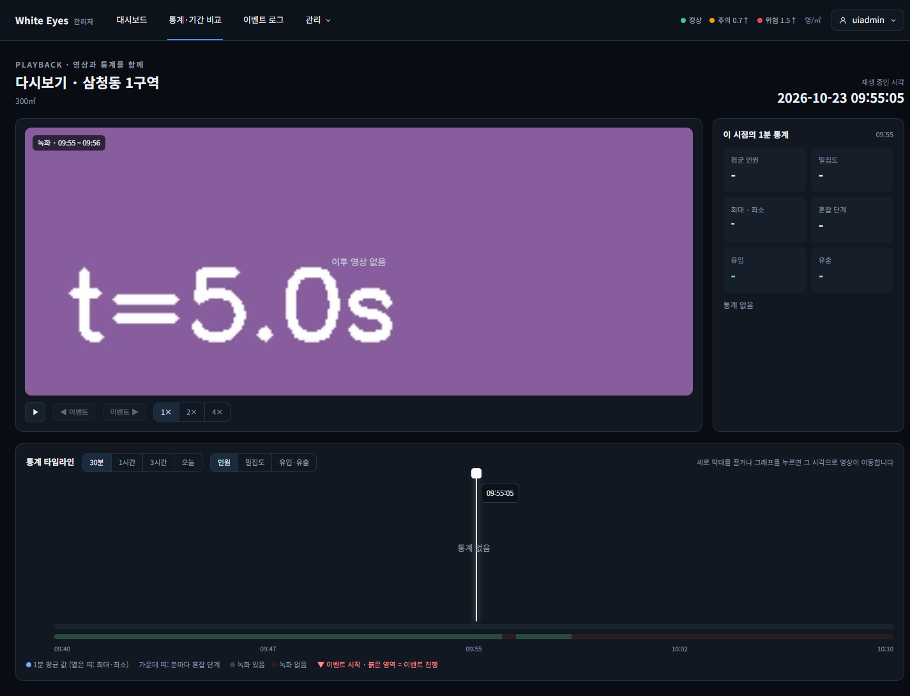

# 다시보기 이어 재생 확인 — 2026-10-23

spring #77(이어 재생, FNC-A-045)을 실제 브라우저(Chrome 155 헤드리스, 1440×900)로 조작하며 캡처했다. 시안은 `design/png/SCR-A-009-playback.png`(이어 재생은 화면 모양이 아니라 영상이 끝났을 때의 동작이라 시안에 따로 그려진 요소는 없다).

- 환경: 이 PC에 Docker·MySQL·nginx가 없어 **H2에 시험 데이터를 넣고 관리자 앱을 띄워** 확인했다. 영상 파일은 실제 녹화가 아니라 **OpenCV로 만든 6초짜리 시험용 영상**(`t=0.0s`…를 그린 VP8 webm)이고, nginx 대신 임시 설정(커밋하지 않음)이 Range 응답으로 내준다.
- 시험 데이터: 같은 캠의 녹화 3건 — A(30분) → B(A 바로 뒤 1분) → 30초 비움 → C(2분). 영상은 6초라 `ended`가 빨리 와서 A 끝에서 B로, B 끝에서 '이후 영상 없음'을 볼 수 있다.

| 화면 | 시안 | 구현 |
|---|---|---|
| SCR-A-009 B 녹화가 끝난 뒤(C까지 30초 비어 '이후 영상 없음'). 시간축은 B 시작이 창을 벗어나 가운데로 다시 맞춰짐(09:40~10:10) |  |  |

## 확인한 것
- **A가 끝나면 B로 이어진다**: 라벨이 `녹화 · 09:25 ~ 09:55`에서 `녹화 · 09:55 ~ 09:56`으로, 영상 주소가 `/recordings/1/video`에서 `/recordings/2/video`로 바뀌고 0초부터 재생된다. 재생 시각은 B 시작(09:55:00)에서 이어서 흐른다.
- **끝나기 3초 전에 다음 녹화를 미리 받는다**: `GET /api/v1/recordings/1/next`가 영상이 끝나기 전에 한 번 나가고, 끝났을 때는 그 응답을 쓴다(추가 호출 없음).
- **B가 끝나면 '이후 영상 없음'**: C는 B가 끝나고 30초 뒤에 시작해(10초 초과) 서버가 404를 주고, 화면이 영상 위에 '이후 영상 없음'을 보인다. 다시 재생을 누르면 안내가 걷히고, 다시 끝나면 안내가 다시 뜬다.
- **재생이 시간축 창 밖으로 나가면 창을 다시 맞춘다**(#50 리뷰에서 넘어온 일): 30분 범위에서 B 시작이 창 끝(09:40)을 벗어나자 시간축·통계·녹화 구간을 재생 위치 가운데(09:40~10:10)로 다시 읽었다(녹화 구간 조회 요청이 새 범위로 한 번 더 나감).
- 1분 경계 판정(겹침 2초·틈 10초)·가장 이른 녹화 선택·같은 캠만·끝나지 않은 녹화·권한은 서버 시험 9개(`RecordingNextTest`)로 확인했다.

## 시안과 다른 점(의도)
- 없음(시안에는 영상이 끝났을 때의 모습이 없다). '이후 영상 없음' 문구는 명세(FNC-A-045, API `404 이후 영상 없음`)의 문구를 그대로 썼다.

## 확인하지 못한 것
- 실제 분석 서버가 만든 1분 단위 파일과 nginx를 거친 영상에서의 끊김(시험 영상은 6초 짜리라 '1분 경계에서 자연스럽게'를 실제 1분 파일로는 보지 못했다. 다음 영상의 로딩 지연은 미리 받는 것이 주소 조회뿐이라 영상 파일 자체는 끝난 뒤에 받는다).
- 통계 그래프·이벤트(통계 API가 이 빌드에 없어 시간축 그래프는 비어 있다).
