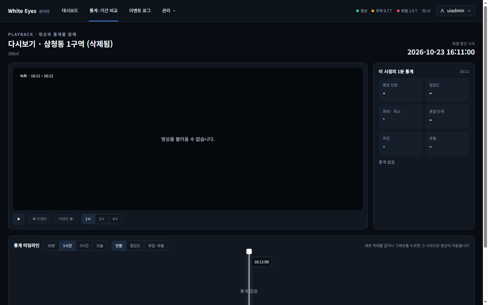
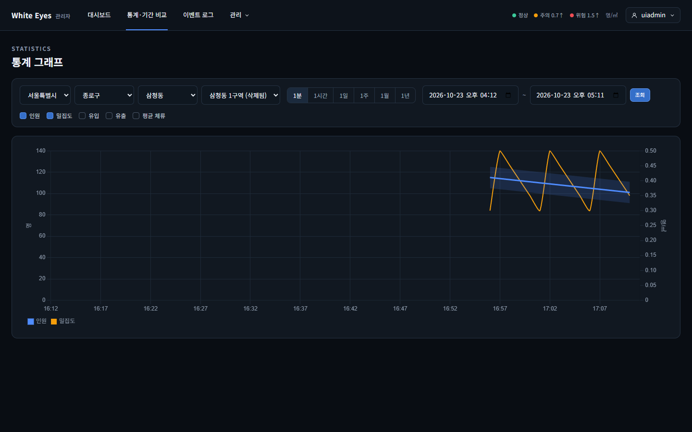

# 삭제된 구역 '(삭제됨)' 표시 확인 — 2026-10-23

spring #183(통계·다시보기의 삭제된 구역 표시, FNC-A-017 업무 규칙)을 실제 브라우저(Chrome 155 헤드리스, 1440×900)로 확인했다.

- 환경: 이 PC에 Docker·MySQL이 없어 **H2에 시험 데이터를 넣고 관리자 앱을 띄워** 확인했다. 구역 16개 중 '삼청동 1구역'을 삭제 표시(deleted_at)하고, 1분 통계는 삭제 전과 같이 남아 있다. 시드는 시험용이며 커밋하지 않았다.
- 이 화면들은 시안에 삭제된 구역 표시가 없어(명세 문구만 있음) 시안과 나란히 비교하지 않았다.

| 화면 | 구현 |
|---|---|
| SCR-A-009 삭제된 구역으로 다시보기를 열면 제목에 '(삭제됨)'(`/playback?zoneId=1`). 영상 칸은 시험 서버가 영상을 주지 않아 '영상을 불러올 수 없습니다' |  |
| SCR-C-004 삭제된 구역을 주소로 열면(`/stats/graph?targetType=ZONE&targetId=1`) 구역 선택 칸에 '삼청동 1구역 (삭제됨)'이 골라지고 지난 1분 통계가 그려진다 |  |

## 확인한 것
- `GET /api/v1/zones`(목록)에는 삭제된 구역이 없고, `GET /api/v1/zones/1`(단건)은 `deleted: true`와 이름을 준다. 없는 구역(`/zones/99999`)은 404.
- 다시보기 제목: 삭제된 구역은 '다시보기 · 삼청동 1구역 (삭제됨)', 보통 구역은 '다시보기 · 삼청동 2구역'(표시 없음).
- 통계 그래프: 삭제된 구역도 대상으로 받아 통계를 준다(이전에는 404). 구역 선택 칸에 그 구역이 '(삭제됨)'으로 더해지고, 다른 구역을 고르면 그 항목이 사라진다. 선택 칸 폭은 '(삭제됨)'이 잘리지 않게 넓혔다.
- 서버 시험: 단건 조회(보통·삭제·없음), 삭제된 구역의 통계 조회, 없는 구역 404.

## '그 밖의 지난 기록 화면' 조사 (이슈 #183 완료 기준 3)
- 이벤트 목록·상세는 #40·#41 범위(이슈 범위 밖).
- 통계 메인·지도·카드 패널·캠 관리 목록: **현재** 상태를 보는 화면이라 삭제된 구역이 나오지 않는다(`GET /api/v1/zones`·캠 목록이 삭제된 구역을 뺌). 표시할 일이 없다.
- 기간 비교(SCR-C-005), 현재 현황 요약: 구역 대상이 삭제된 구역이면 지금처럼 404(`CompareService`·`DashboardSummaryService`). 지난 기록을 보는 화면이지만 구역 선택 칸으로만 대상을 고르는 흐름이라 이번에는 바꾸지 않았다. 필요하면 후속 이슈.
- 엑셀 다운로드(SCR-C-006): 아직 구현되지 않아 해당 없음.

## 확인하지 못한 것
- 실제 MySQL, 실제 영상이 있는 삭제 구역의 다시보기(영상은 시험 서버가 주지 않음).
- 사용자 앱(8080)에서 같은 주소를 열어 보는 것(같은 공통 코드지만 열어 보지 않았다).
