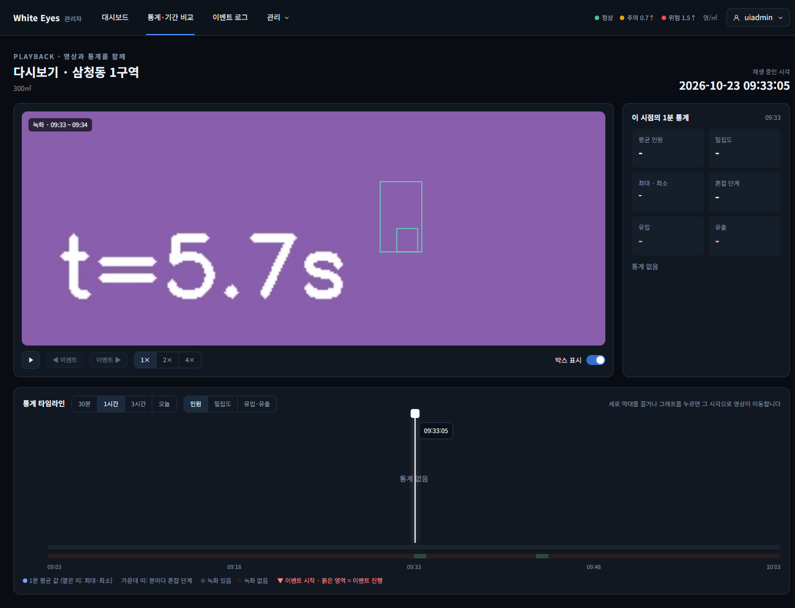
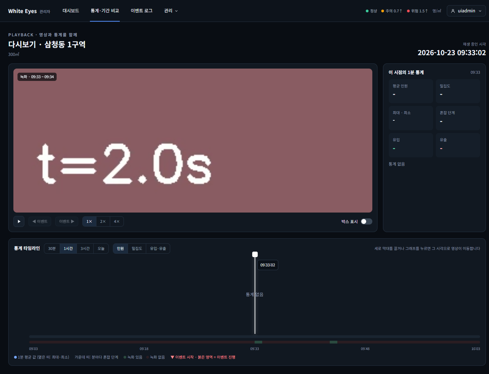
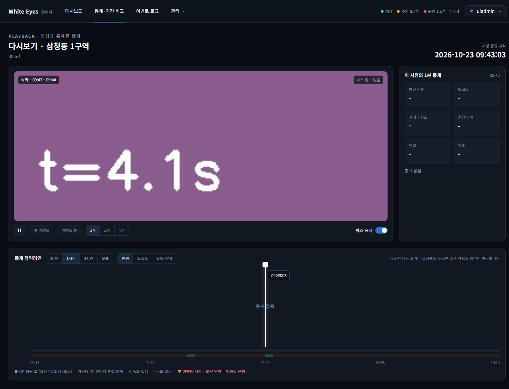

# 다시보기 탐지 박스 표시 확인 — 2026-10-23

spring #78(탐지 박스 표시, FNC-A-046)을 실제 브라우저(Chrome 155 헤드리스, 1440×900)로 조작하며 캡처했다. 시안은 `design/png/SCR-A-009-playback.png`.

- 환경: 이 PC에 Docker·MySQL·nginx가 없어 **H2에 시험 데이터를 넣고 관리자 앱을 띄워** 확인했다. 영상은 실제 녹화가 아니라 OpenCV로 만든 6초짜리 시험 영상이고, **좌표 파일도 시험용**(5fps, 30프레임, 프레임마다 박스 2개: 추적 번호 17이 오른쪽으로 움직이는 박스 + 추적 번호가 `null`인 고정 박스, 일부 프레임에는 모양이 틀린 항목을 섞음). nginx 대신 임시 설정(커밋하지 않음)이 영상·좌표 파일을 내준다. 2번 녹화는 좌표 파일이 404다.

| 화면 | 시안 | 구현 |
|---|---|---|
| SCR-A-009 박스 표시 켬(5.7초 위치). 오른쪽 아래에 '박스 표시' 스위치 |  |  |
| 박스 표시 끔(캔버스 숨김, 스위치 꺼짐) | - |  |
| 좌표 파일이 없는 녹화('박스 정보 없음', 영상은 그대로 재생) | - |  |

## 확인한 것
- **구간 이동 직후에도 박스 위치가 맞다**: 멈춘 영상을 2.0초, 3.9초, 되돌려 1.0초, 5.7초로 옮긴 직후마다 캔버스를 읽어, 그 위치에서 `t ≤ 재생 위치`인 마지막 프레임의 박스 왼쪽 변이 계산한 자리(영상 비율 칸 기준)에 있고 앞 프레임 자리에는 없음을 확인했다. 재생 중에도 박스가 따라 움직인다.
- 영상은 칸 안에 비율을 지켜 그려져 위아래에 빈 띠가 생기므로, 박스를 칸 전체가 아니라 **영상이 실제로 그려진 영역 기준**으로 그린다(영역 값으로 확인).
- 첫 프레임(0.2초)보다 앞인 0.1초에서는 박스를 그리지 않는다.
- **추적 번호가 `null`인 박스도 그린다**(flask #9 리뷰에서 넘어온 일): 추적 번호가 없는 고정 박스가 정상으로 보이고, 모양이 틀린 항목(`['bad']`)은 건너뛴다.
- '박스 표시' 스위치를 끄면 캔버스가 숨겨지고 켜면 다시 보인다(기본 켬).
- 좌표 파일을 받지 못하면(404) 영상만 재생하고 영상 위에 '박스 정보 없음'을 보인다.

## 시안과 다른 점(의도)
- 시안은 박스를 고정 위치의 `div`로 보였고 스위치는 모양만 있다. 구현은 명세(FNC-A-046)대로 캔버스에 프레임별 박스를 그리고, 스위치는 같은 모양(34×18, 켬 파랑)으로 실제로 동작한다.

## 확인하지 못한 것
- 실제 분석 서버가 만든 좌표 파일(`dummy/boxes/*.json.gz`)과 nginx가 내주는 `Content-Encoding: gzip` 응답에서의 동작(시험 파일은 압축 없는 JSON).
- 박스가 수백 개인 프레임에서의 그리기 성능.
