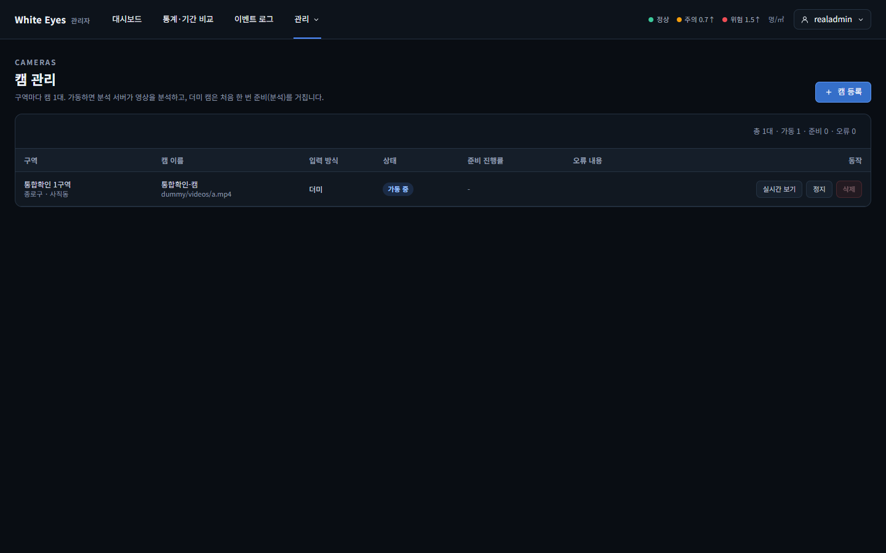
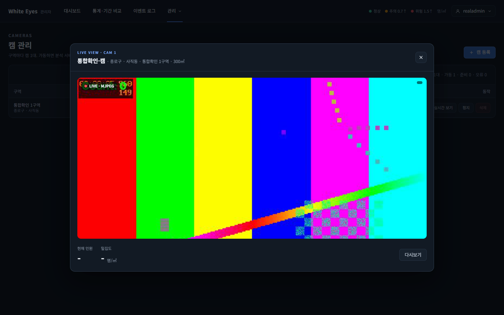
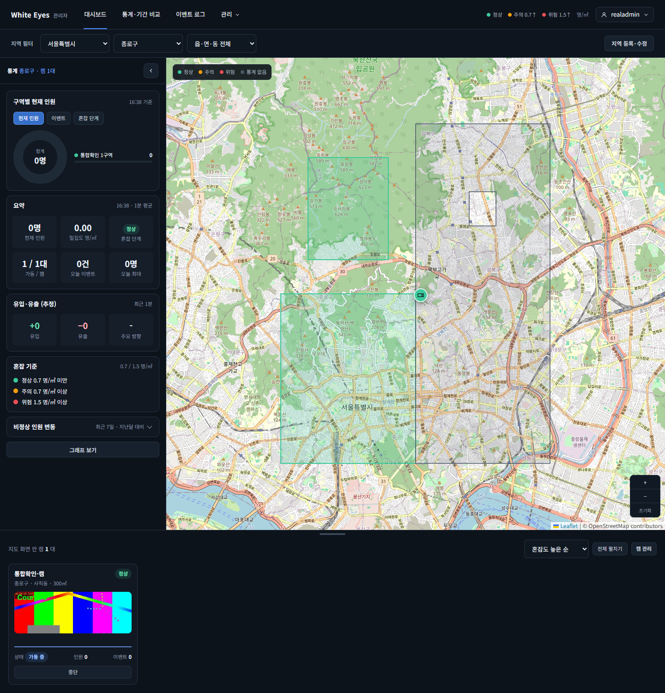

# 실제 앱·분석 서버·nginx 통합 확인 — 2026-10-23

spring #159(nginx 설정)의 마지막 완료 기준("더미 캠을 가동하고 브라우저에서 캠 카드 미리보기와 실시간 보기 창에 실제 영상이 나온다")을 확인했다. 관련 PR: white-eyes-spring #177(nginx 설정), #189(헤더 정리와 이 결과 기록).

## 환경
모두 WSL(Docker·Java 17) 안, 브라우저는 Windows의 Chrome(헤드리스, 1440×900)이 nginx(80)로 접속했다.
- MySQL 8.0 컨테이너(실제 MySQL). 행정구역은 관리자 앱의 `--job=load-regions`로 적재(시험용 경계 파일).
- 관리자 앱: white-eyes-spring `dev`의 jar를 그대로 실행.
- 분석 서버: white-eyes-flask `dev`(a575d49)를 python:3.12-slim 이미지(CPU torch)에 올려 실행. VisDrone 가중치는 flask README의 SHA-256과 일치함을 확인(저장소에는 올리지 않음).
- nginx: spring `deploy/nginx/`의 설정(nginx:alpine).
- 영상: 합성 시험 영상(`testsrc2`, 640×360, 30초). 사람이 찍힌 영상이 아니라 탐지 수는 0이다.

## 순서와 캡처
| 단계 | 캡처 |
|---|---|
| 캠 관리 화면에서 '가동'을 누르면 분석 서버가 준비(진행률 0→90%)한 뒤 '가동 중'으로 바뀐다. 아래는 가동 중 |  |
| '실시간 보기' 창에 분석 서버가 그린 MJPEG이 나온다(왼쪽 위 'Count: 0' 표시, LIVE · MJPEG 배지) |  |
| 대시보드 아래 캠 카드에 미리보기(JPEG 프레임)가 나온다. 상태 '정상', 요약은 분석 서버가 보낸 결과로 1분 통계가 저장되어 '0명'으로 표시 |  |

시안 대조: 카드 미리보기·실시간 보기 창의 모양은 spring #154 / docs #47의 시안 대조 캡처를 따른다. 이번 캡처는 모양이 아니라 **실제 분석 서버의 영상이 nginx를 거쳐 나오는지** 보는 것이다.

## 확인한 것
- 관리자 로그인부터 가동, 상태 보고(진행률), 실시간 보기, 카드 미리보기, 결과 전달→1분 통계 저장→대시보드 표시까지 이어진다.
- `curl`로 확인: 쿠키 없음 401, 분석 서버에 토큰 없이 직접 요청 401, 클라이언트가 보낸 `X-Internal-Token`은 nginx가 덮어씀, 작업 없는 캠 404, 스냅샷의 `Cache-Control: no-store`는 한 번(이 확인에서 중복을 발견해 spring #189에서 고침).

## 확인하지 못한 것
- 사람이 찍힌 영상, 라이브(RTSP) 입력, 박스가 있는 화면. 운영 환경의 nginx. 분석 성능(이 PC의 CPU가 오래됨).
- 실제 MySQL에서 관리자 앱이 시작되지 않는 문제를 발견했다: `ddl-auto: validate`가 `zone_stat_hourly`·`zone_stat_daily`의 `is_demo`(TINYINT)와 boolean 필드(`ZoneStatRollup.demo`)의 타입 차이로 멈춘다(시험은 H2라 통과). 이 확인에서는 `SPRING_JPA_HIBERNATE_DDL_AUTO=none`으로 우회했다. 별도 이슈로 알려야 한다.
