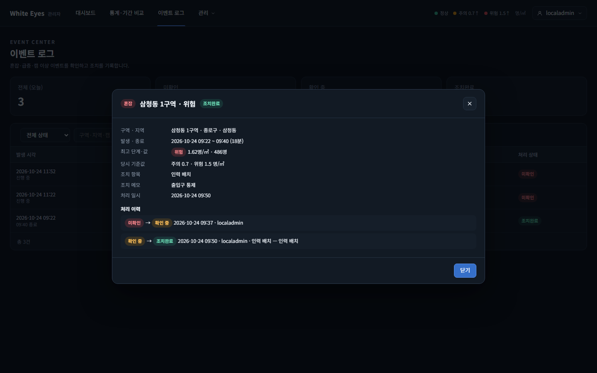
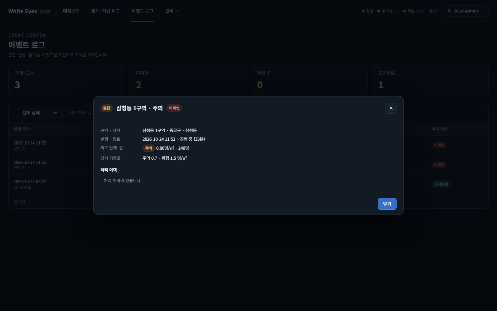
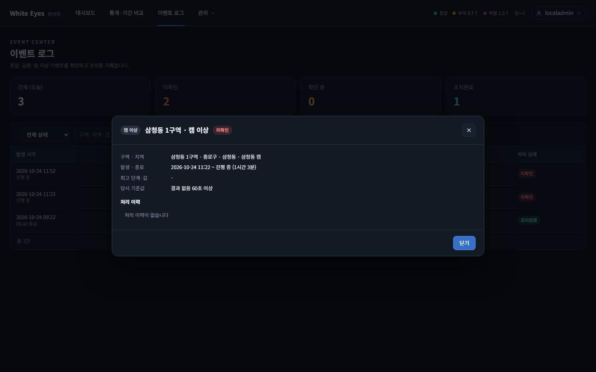

# 이벤트 상세 창(SCR-A-011) 확인 — 2026-10-23

spring #41(FNC-A-037 이벤트 상세)을 실제 브라우저(Playwright Chromium, 1440×900)로 캡처했다. 시안은 `design/png/SCR-A-011-event-detail.png`.

- 환경: WSL Ubuntu의 Docker MySQL 8.4에 관리자 앱(local 프로필)을 붙여 확인했다. 구역·캠·이벤트 3건·처리 이력 2건은 시험용 SQL로 넣었고 커밋하지 않았다. 이 PC에서 Hibernate 스키마 검증이 `zone_stat_daily.is_demo`(tinyint ↔ boolean)로 실패해 캡처 실행에서만 `ddl-auto`를 끄고 띄웠다(이번 변경과 무관, spring #40 보고서와 같음).
- 이 창의 FNC-A-037 부분(이벤트 정보·처리 이력)만 만들었다. 발생 시점 영상·다시보기 이동(FNC-A-040), 조치 창·조치하기 버튼(FNC-A-038)은 각 이슈 몫이다. 창은 이벤트 로그(SCR-A-010)의 행을 눌러 연다.

| 상태 | 시안 | 구현 |
|---|---|---|
| 혼잡 위험, 조치완료, 처리 이력 2건(확인 중 → 조치완료) |  |  |
| 혼잡 주의, 진행 중, 미확인, 처리 이력 없음 | - |  |
| 캠 이상, 진행 중, 당시 기준값 = 결과 없음 허용 시간 | - |  |

## 시안과 다른 점
**의도**
- 발생 시점 영상 영역·발생 앞뒤 30분 인원 띠·'다시보기 화면에서 크게 보기' 버튼: FNC-A-040의 몫(시안에서 `data-fnc="FNC-A-040"`).
- 시안 머리의 처리 이력 줄 "조치완료 … 인력 배치 — 메모" 모양은 그대로 따랐고, 조치하기 버튼은 FNC-A-038의 몫이라 만들지 않았다.
- 시각은 공통 형식 `yyyy-MM-dd HH:mm`(시안은 시:분). 같은 날 끝나면 종료는 시각만 쓴다.
- 이벤트 정보 칸을 시안(발생·종료, 최고 단계·값, 당시 기준값)에 더해 구역·지역(구·동·캠), 처리 정보(조치 항목·메모·처리 일시: evt-003)를 보인다.
- 캠 이상의 최고 단계·값은 `-`(screens.md SCR-A-010과 같게).
- 혼잡·급증 이벤트는 캠 이름을 보이지 않는다(spring #166 리뷰 반영: `cameraName`은 캠 이상만 값이 있다). 캡처 01·02를 이에 맞춰 다시 찍었다.
- 처리 이력 한 줄은 `이전 상태 → 이후 상태` 칩을 먼저 보인다(screens.md SCR-A-011, 리뷰 반영).
- 처리 이력은 이력이 없으면 '처리 이력이 없습니다'를 보인다(시안에 없는 상태).

**확인 필요**
- 이력 한 줄에 조치 항목·메모를 담으려고 API 응답 `histories`에 `actionCode`·`actionNote`를 더했다(명세 예시는 `at, loginId, from, to`). 명세에 한 줄 추가가 필요한지 리뷰어 확인 필요.
- `playbackAvailable`은 "혼잡·급증이고 발생이 30일 이내"로 계산했다(명세에 계산 기준이 없음). 녹화 파일이 있는지는 다시보기(FNC-A-040·043)가 안내한다.

## 확인하지 못한 것
- 급증(SURGE) 이벤트 상세: 급증 판정(FNC-A-034)이 아직 없어 기준값 키(`window`·`rate`·`minDensity`)를 명세 문장대로 가정했다(자동 테스트에서 급증 행의 다른 필드만 확인).
- 실제 분석 서버가 만든 이벤트와, 실제 조치 처리(FNC-A-038)로 쌓인 이력(시험용 SQL로 넣은 값으로 확인).
