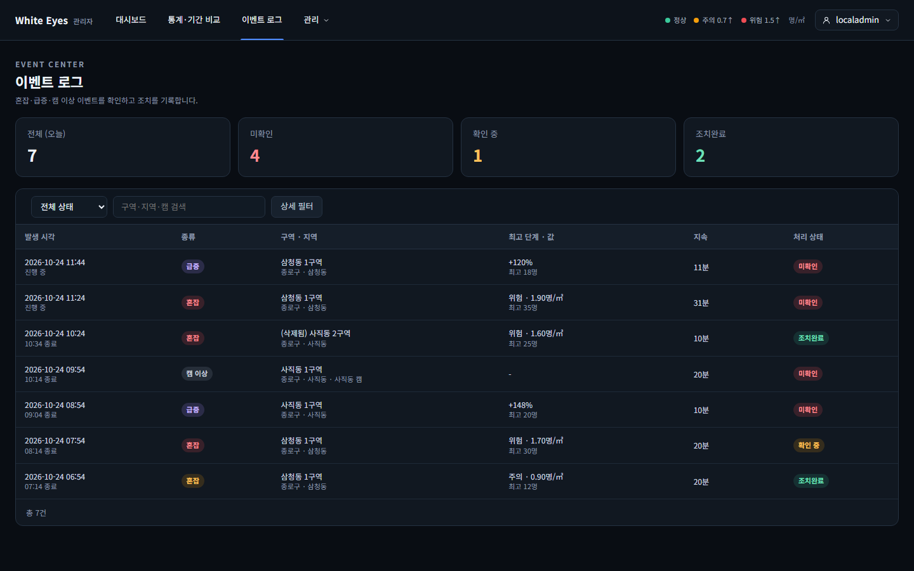
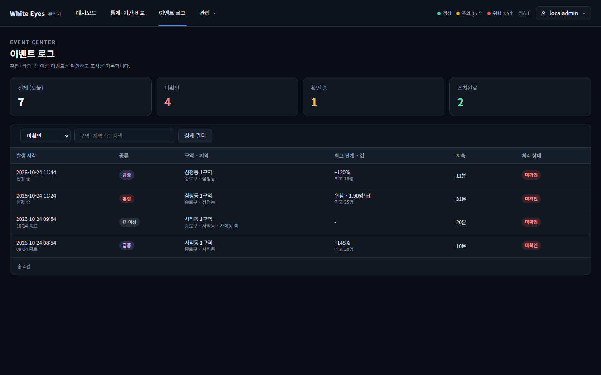
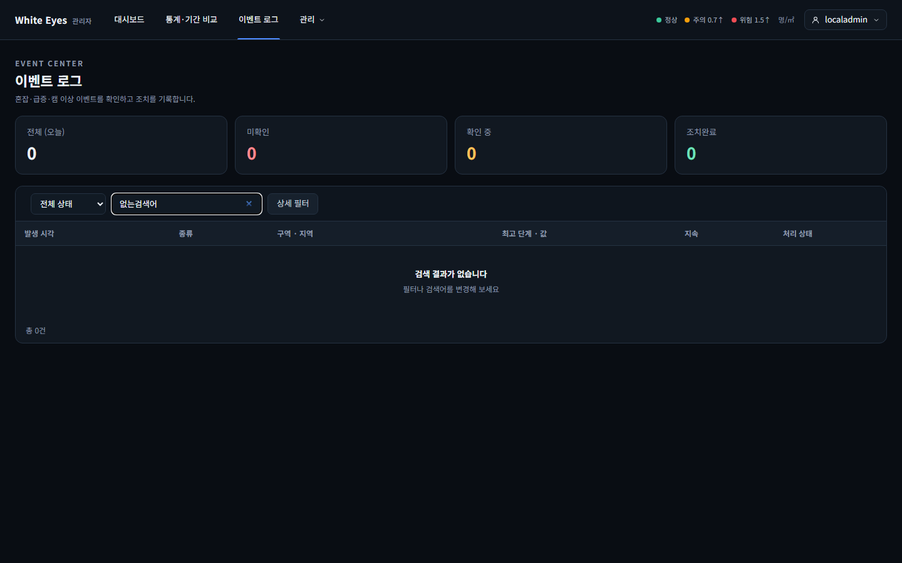
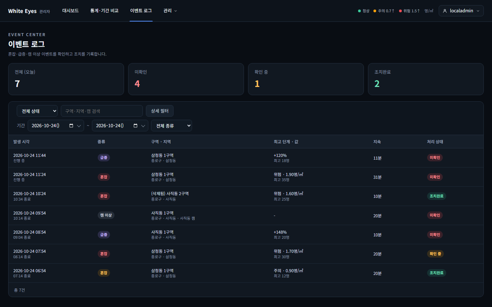

# 이벤트 로그(SCR-A-010) 목록 확인 — 2026-10-23 (2026-10-24 리뷰 반영 재캡처)

spring #40(FNC-A-036 이벤트 목록)을 실제 브라우저(Playwright Chromium, 1440×900)로 캡처했다. 시안은 `design/png/SCR-A-010-events.png`.

- 환경: WSL Ubuntu의 Docker MySQL 8.4에 관리자 앱(local 프로필)을 붙여 확인했다. 구역·캠·이벤트 7건은 시험용 SQL로 넣었고 커밋하지 않았다. 이 PC에서 Hibernate 스키마 검증이 `zone_stat_daily.is_demo`(tinyint ↔ boolean)로 실패해 캡처 실행에서만 `ddl-auto`를 끄고 띄웠다(이번 변경과 무관, dev에서도 나는지는 확인하지 않음).
- 2026-10-24 리뷰 반영: 기간·종류는 screens.md SCR-A-010대로 '상세 필터' 버튼을 눌러 펼쳐야 보인다(기본은 접힘). 혼잡·급증 이벤트의 캠 이름은 null이라 위치 칸에 구·동 경로만 나오고, 캠 이상만 캠 이름이 붙는다. 시험용 데이터는 이번에 다시 넣어 7건의 시각·구역이 전과 다르다.
- 이 화면의 FNC-A-036 부분(요약 카드·필터·이벤트 표)만 만들었다. 상세(FNC-A-037)·조치(FNC-A-038)·내려받기(FNC-A-039)·헤더 배지와 새 이벤트 토스트(FNC-A-048)는 각 이슈 몫이다.

| 상태 | 시안 | 구현 |
|---|---|---|
| 오늘 이벤트 7건(혼잡 주의·위험, 급증, 캠 이상, 진행 중·종료, 삭제된 구역, 미확인·확인 중·조치완료) |  |  |
| 처리 상태 '미확인' 필터 | - |  |
| 검색 결과 없음 | - |  |
| '상세 필터' 펼침(기간·종류) | - |  |

## 시안과 다른 점
**의도**
- 조치 열·내려받기 버튼·헤더 미확인 배지·새 이벤트 토스트·'행을 누르면 상세 창' 안내: 다른 기능(FNC-A-038·039·048, FNC-A-037)의 몫.
- 급증 값은 screens.md대로 증가율 `+148%`(시안은 예시 문구 `+148명/5분`), 캠 이상 값은 `-`(시안은 `결과 수신 끊김`).
- 발생 시각은 공통 형식 `yyyy-MM-dd HH:mm`(시안은 시:분:초). 두 번째 줄에 구·동 경로와 캠 이름, 둘째 줄 값 아래에 최고 인원을 보인다(screens.md 열 설명).
- 기간 입력은 시작일·종료일 두 칸(시안은 날짜 한 칸). 기간·종류는 '상세 필터'를 펼쳐서 고른다(screens.md).
- 한 페이지뿐이면 페이지 번호 버튼을 숨긴다(시안은 `1` 표시). 확인 필요.

## 확인하지 못한 것
- 이벤트 행 클릭 이동, 조치 버튼, SSE로 맨 위에 행 추가(다른 이슈).
- 실제 분석 서버가 만든 이벤트(시험용 SQL로 넣은 값으로 확인).
