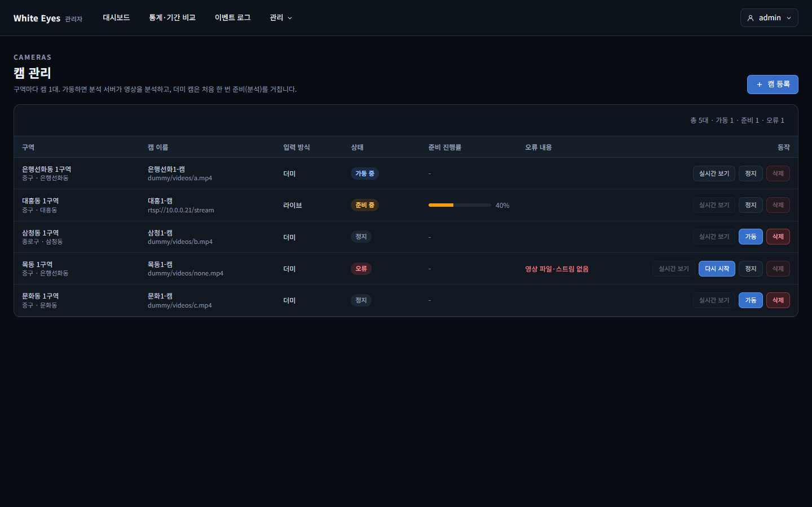
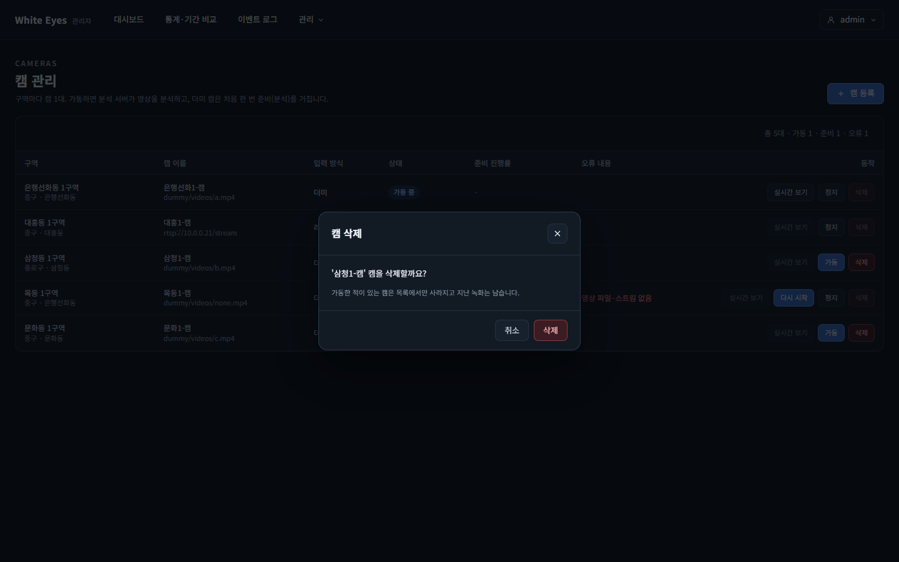
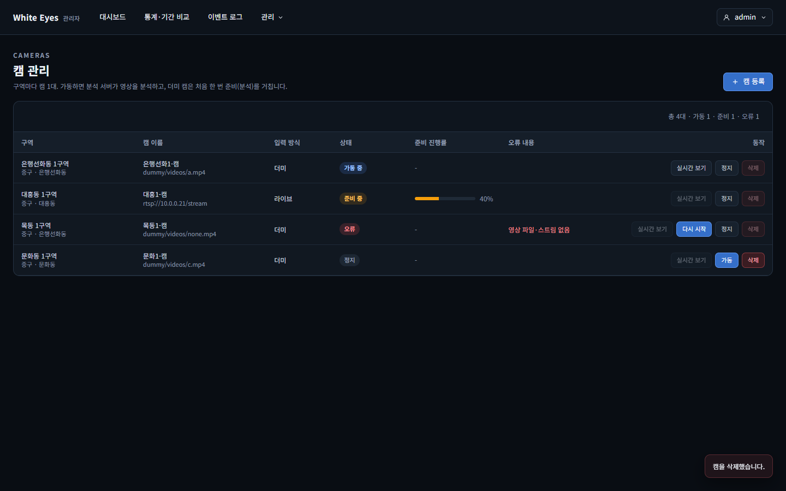
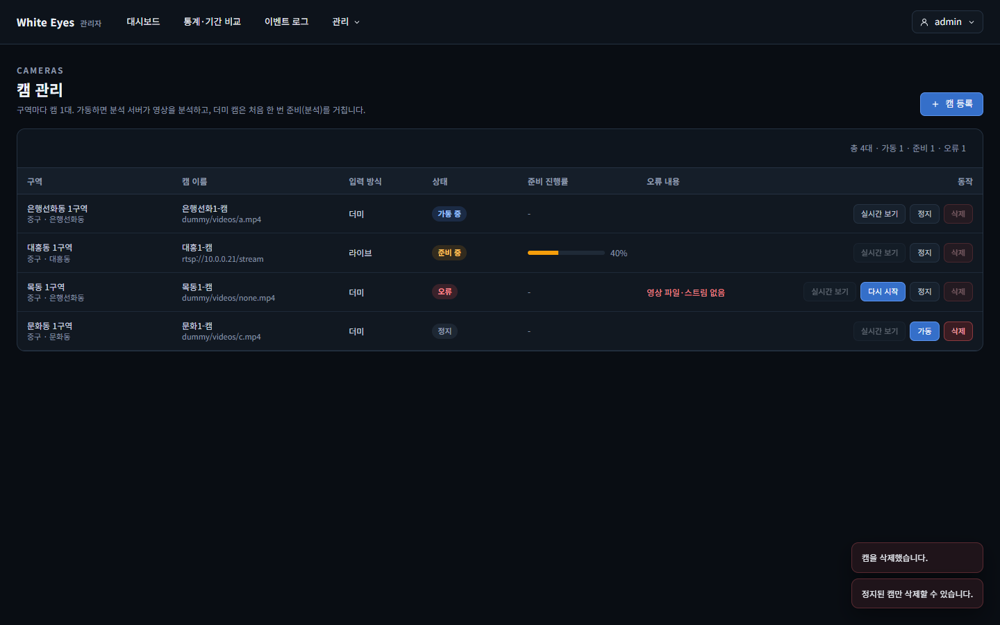

# 캠 삭제 화면 확인 — 2026-10-23

spring #73(FNC-A-023 캠 삭제)의 캠 관리 화면(SCR-A-006)을 실제 브라우저(Edge 헤드리스, 1440×900)로 조작하며 캡처했다. 시안은 `design/png/`.

- 환경: 이 PC에 Docker·MySQL이 없어 **관리자 앱 전체를 띄우지 않았다.** 대신 `cameras.html` 본문, 공통 틀의 헤더·모달 조각, `cameras.js`·`cameras.css`·`we.css` 같은 **구현 파일을 그대로** 서빙하는 임시 서버(커밋하지 않음)에 `GET /api/v1/manage/cameras`와 `DELETE …/{id}`만 명세대로 흉내 냈다(삭제는 정지가 아니면 409 `CAMERA_NOT_STOPPED`, 가동 이력 있으면 `SOFT`). 헤더의 혼잡 단계 범례(`/api/v1/meta/levels`)는 흉내 내지 않아 비어 있다.
- 서버 쪽 동작(HARD/SOFT 분기, 409, 404, 작업 기록, 롤백)은 이 캡처가 아니라 spring `CameraDeleteTest`(9개)로 확인했다.
- 캠 5대(가동 중·준비 중·정지·오류·정지)는 시안 모양에 맞춘 시험 값이다.

| 화면 | 시안 | 구현 |
|---|---|---|
| SCR-A-006 캠 관리: 행마다 삭제 버튼(정지 행만 켜짐) |  |  |
| FNC-A-023 삭제 확인 창(정지 행에서 '삭제' 누름) | - |  |
| 확인 뒤 목록에서 제거, 요약 5대 → 4대 | - |  |
| 정지가 아닌 캠을 서버가 거부(409)할 때 토스트 | - |  |

## 확인한 것
- 삭제 버튼은 모든 행에 있고 **STOPPED 행에서만 켜진다**(가동 중·준비 중·오류 행은 꺼짐). 화면 명세(screens.md '목록 / 삭제')의 "STOPPED일 때만, 확인 창"을 따랐다.
- 삭제를 누르면 확인 창이 뜨고 캠 이름이 들어간다. '취소'·닫기·바깥 클릭·Esc로 닫으면 서버 요청이 없다(서버 로그 0건). '삭제'를 누르면 `DELETE /api/v1/manage/cameras/3`이 한 번 나가고 목록에서 그 행이 빠지며 요약이 갱신된다.
- 요청이 끝나기 전에는 창을 닫거나 다시 누를 수 없다(중복 요청 방지).
- 서버가 409를 주면 서버 메시지('정지된 캠만 삭제할 수 있습니다.')가 토스트로 뜬다(`api.js` 공통 처리).
- 캠 이름은 `textContent`로만 넣는다(code-conventions 5-3).

## 시안과 다른 점
- 시안의 '오류' 행은 삭제 버튼이 켜져 있지만, 명세(screens.md, FNC-A-023 처리 순서 1: STOPPED 확인, 아니면 409)는 정지일 때만이라 **명세를 따라 오류 행은 꺼 두었다.** 오류 캠을 지우려면 먼저 '정지'를 누른다. 시안을 고치는 PR이 필요하면 따로 올린다.
- 시안의 '수정' 버튼(FNC-A-019, 3단계 다른 이슈)·필터·페이지 번호·실시간 보기 위치는 이 이슈 범위가 아니라 건드리지 않았다.
- 삭제 확인 창은 시안에 없다(명세는 '확인 창'만 요구). 등록 창과 같은 모달 모양(`we.css`)으로 작게 만들었다.

## 확인하지 못한 것
- 실제 관리자 앱·DB로 화면 → API → DB까지 이어서 누르는 확인. 서버 동작은 `CameraDeleteTest`(H2)로 따로 확인했다.
- 로그인 권한(관리자 이상) 화면 확인.
