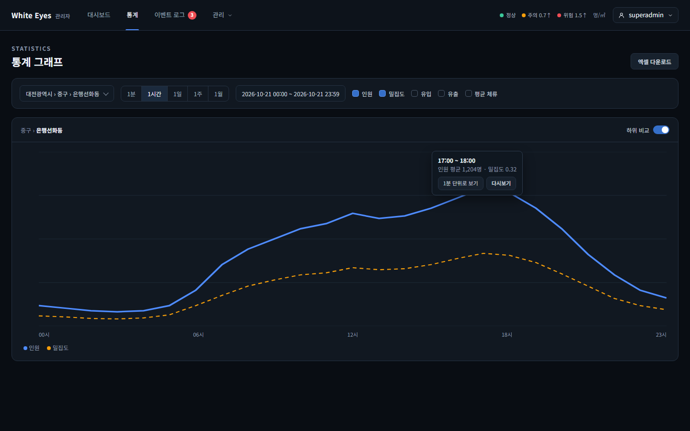
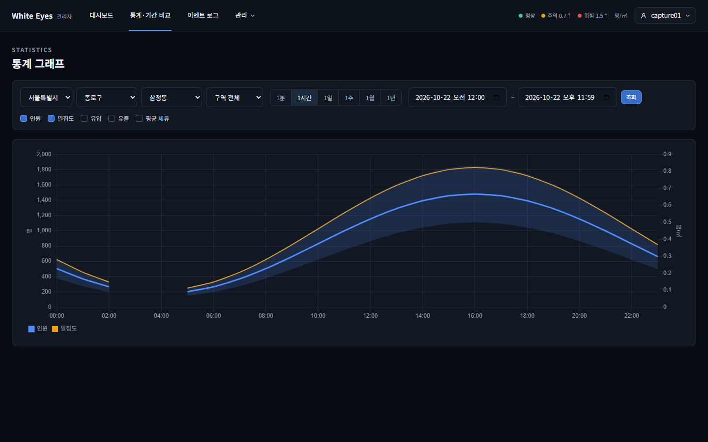
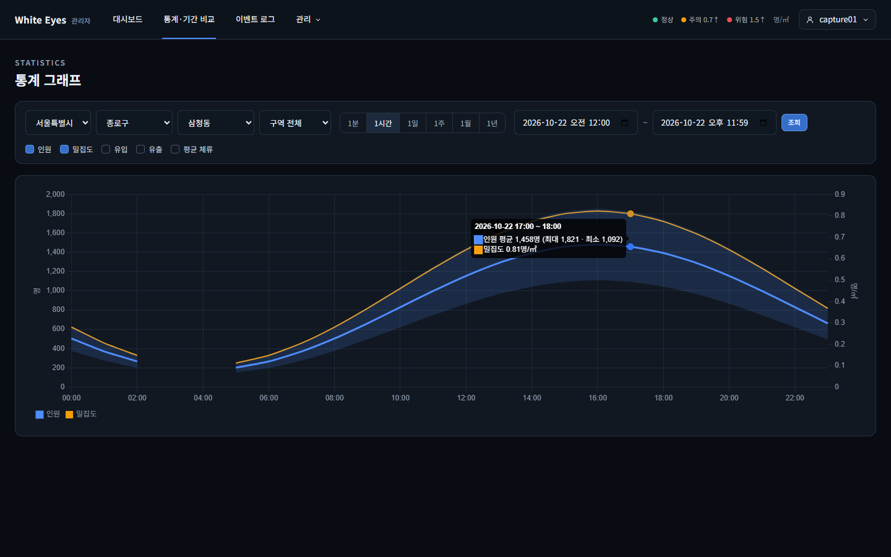
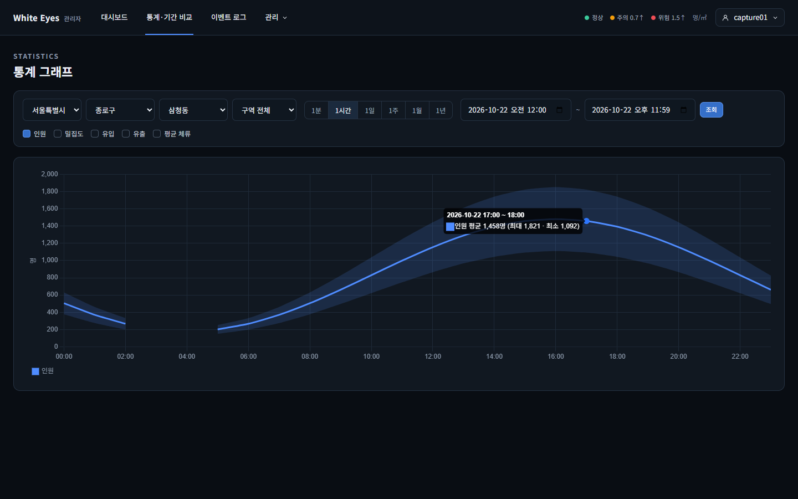
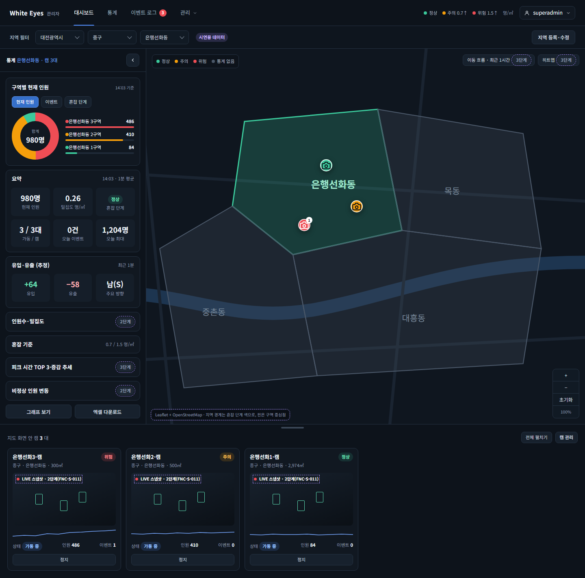
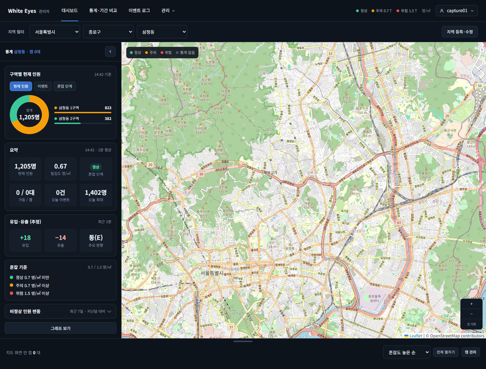

# 통계 그래프 화면 확인: #25 FNC-C-012 — 2026-10-23

white-eyes-spring #25 FNC-C-012 통계 그래프 조회(PR #163, 브랜치 `25-fnc-c-012-통계-그래프-조회`)의 구현 캡처다. PR #163 리뷰 요청 3(인원 체크박스 하나 + 최대·최소 띠)과 참고 7(밀집도 실선)을 반영한 뒤(a0e3e52) 찍었다. 시안은 `design/png/`.

- 환경: 이 PC에 Docker·MySQL이 없어 **H2에 시험 데이터를 넣고 관리자 앱을 띄워** 실제 로그인으로 캡처했다(Chrome 헤드리스, 1440×900). 그래프 값은 가짜 응답이 아니라 `GET /api/v1/stats/series`가 H2의 시간별 통계로 계산한 값이다.
- 시험 데이터(커밋하지 않음): 서울 종로구 삼청동에 구역 2개, 어제(2026-10-22) 시간별 통계 22시간분. **03:00·04:00은 행이 없어 빈 구간**이다. 대시보드용으로 최근 15분의 1분 통계.
- 앱을 테스트 설정으로 띄워 주소에 `/admin` 접두어가 없다(실제 관리자 앱은 `/admin/stats/graph`).

| 화면 | 시안 | 구현 |
|---|---|---|
| SCR-C-004 통계 그래프(삼청동 합산, 1시간, 인원 + 밀집도) |  |  |
| SCR-C-004 툴팁(17:00 점) | (위 시안의 툴팁) |  |
| SCR-C-004 인원만 켬(평균 선 + 최대~최소 띠) | - |  |
| SCR-C-003 통계 패널 아래 '그래프 보기' 버튼 |  |  |

## 확인한 것
- **인원 체크박스는 하나**다(인원·밀집도·유입·유출·평균 체류 5개, 시안과 같음). 켜면 평균은 파란 선, 최대~최소는 옅은 파란 띠로 함께 그린다(다시보기 시간축과 같은 색 `rgba(79, 140, 255, .16)`). 띠 가장자리는 범례·툴팁에 나오지 않는다.
- 툴팁은 한 줄: **"인원 평균 1,458명 (최대 1,821 · 최소 1,092)"**, 밀집도는 "밀집도 0.81명/㎡". 제목은 구간("2026-10-22 17:00 ~ 18:00").
- **밀집도는 실선**이다(점선은 시연용 구간 표시용, screens.md SCR-C-004). 색(주황)과 오른쪽 축(명/㎡)으로 인원과 구분한다.
- **빈 구간(03·04시)에서 선과 띠가 함께 끊긴다**(sampleSec=0 끊김 규칙).
- 대시보드 '그래프 보기' 버튼은 시안처럼 통계 패널 맨 아래, '비정상 인원 변동' 다음에 있다(dev의 #167과 합친 뒤 위치).

## 시안과 다른 점
- **단위 탭에 '1년'이 더 있다**(시안은 1분~1월). API가 1y 단위를 지원해 #25에서 더했다(PR #163 본문).
- **대상은 시·구·동·구역 선택 칸 4개**다. 시안은 '대전광역시 › 중구 › 은행선화동' 한 칸으로 그렸다.
- **기간은 시작·끝 날짜·시각 입력 2칸 + 조회 버튼**이다. 끝 칸은 to에서 1분 뺀 시각(23:59)을 보인다.
- **시안의 이동 경로·하위 비교 토글·'기간 비교'·'엑셀 다운로드' 버튼은 없다.** FNC-C-013·014, SCR-C-005·006 이슈 몫이다. 대시보드의 '엑셀 다운로드' 버튼도 #28 몫이라 '그래프 보기'만 있다.
- 대시보드 지도는 시험용 행정구역 경계가 단순한 사각형이라 동 경계가 그려지지 않고 서울 전체가 보인다(브라우저 콘솔 'Invalid GeoJSON object'). 시험 데이터 문제로 보며 #25 범위가 아니다(미확인).
