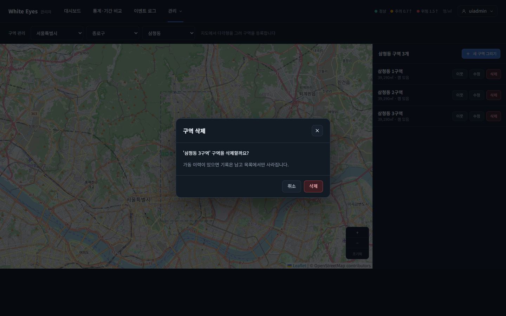
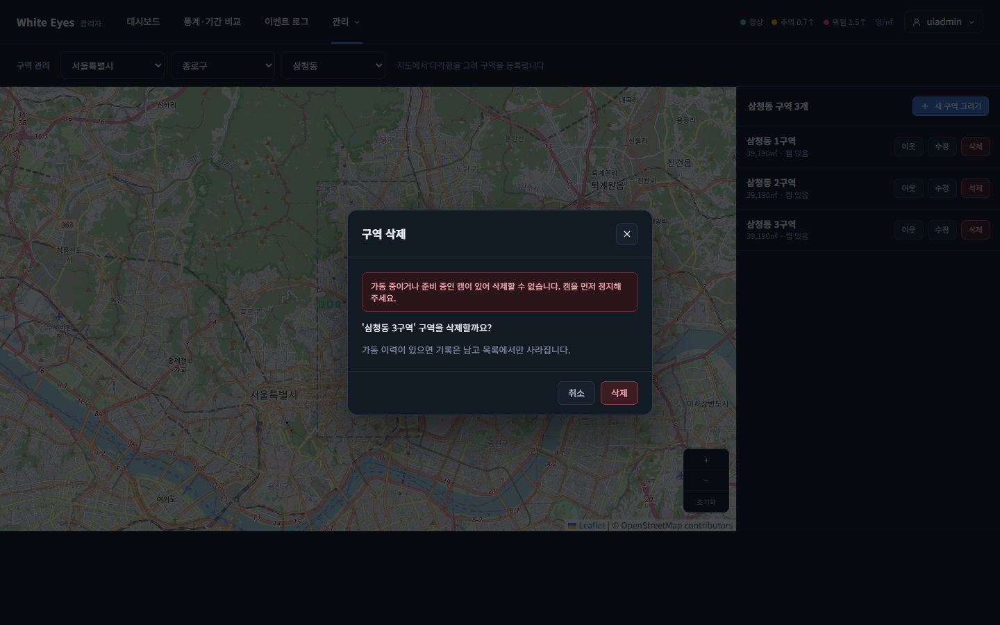

# 구역 삭제 화면 확인 — 2026-10-23

spring #71(구역 삭제, FNC-A-017)을 실제 브라우저(Chrome 155 헤드리스, 1440×900)로 조작하며 캡처했다. 시안은 `design/png/SCR-A-004-zones.png`.

- 환경: 이 PC에 Docker·MySQL이 없어 **H2에 시험 데이터를 넣고 관리자 앱을 띄워** 확인했다. 삼청동에 구역 3개: 1구역(한 번도 가동하지 않은 캠), 2구역(가동 이력이 있는 정지 캠, 1·2구역은 서로 동·서 이웃), 3구역(가동 중 캠). 시드는 시험용이며 커밋하지 않았다.

| 화면 | 시안 | 구현 |
|---|---|---|
| SCR-A-004 목록 '삭제' → 확인 창('가동 이력이 있으면 기록은 남고 목록에서만 사라집니다') |  |  |
| SCR-A-004 가동 중 캠이 있는 구역을 지우려 할 때(409 CAMERA_RUNNING 문구) | - |  |

## 확인한 것
- 행의 '삭제'(3단계 자리였음)를 누르면 확인 창이 열리고 구역 이름과 명세의 안내 문구가 보인다. '취소'·닫기 버튼·Esc로 닫힌다.
- **가동 중 캠이 있는 3구역**: 확인을 누르면 '가동 중이거나 준비 중인 캠이 있어 삭제할 수 없습니다. 캠을 먼저 정지해 주세요.'가 창 안에 나오고 구역은 그대로 남는다(서버 409 `CAMERA_RUNNING`).
- **가동 이력이 있는 2구역(SOFT)**: 삭제하면 목록에서 사라지고 '가동 기록은 남아 있습니다.' 토스트가 뜬다. 1구역의 이웃 조회에서 2구역(동쪽) 행이 지워진 것을 API로 확인했다.
- **가동 이력이 없는 1구역(HARD)**: 삭제하면 목록에서 사라지고 '구역을 삭제했습니다.' 토스트가 뜬다. 남은 것은 3구역뿐이다.
- 이력 있음/없음·이웃 행 정리·삭제된 캠 처리·작업 기록은 서버 시험 10개(`ZoneDeleteTest`)로 확인했다.

## 시안과 다른 점(의도)
- 시안에는 '삭제' 버튼 자리만 있고(3단계 표시) 확인 창은 없다. 명세(screens.md '확인 창')대로 확인 창을 추가했다.

## 통계·이벤트가 있는 구역(리뷰 반영)
- 캠을 가동한 적이 없어도 그 구역의 통계(1분·시간·일)나 이벤트 행이 하나라도 있으면 '이력 있음'으로 보아 삭제 표시(SOFT)만 한다(명세 수정: docs PR #57). 이 경우는 화면이 아니라 서버 시험(`ZoneDeleteTest`, 4종류)으로 확인했고 브라우저로 따로 캡처하지는 않았다.

## 확인하지 못한 것
- 지운 구역의 지난 통계·녹화·이벤트가 '(삭제됨)'으로 표시되는 부분(FNC-A-017 업무 규칙)은 이 이슈 범위가 아니며 해당 화면(통계·다시보기·이벤트)에서 확인이 필요하다.
- 실제 MySQL에서의 동작(시험은 H2).
