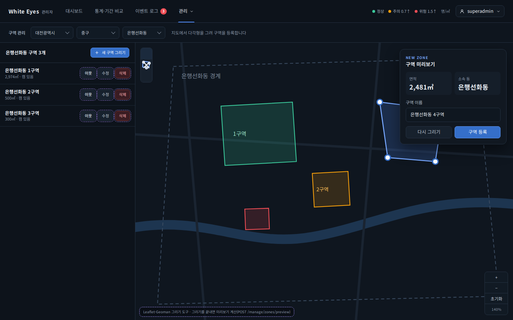
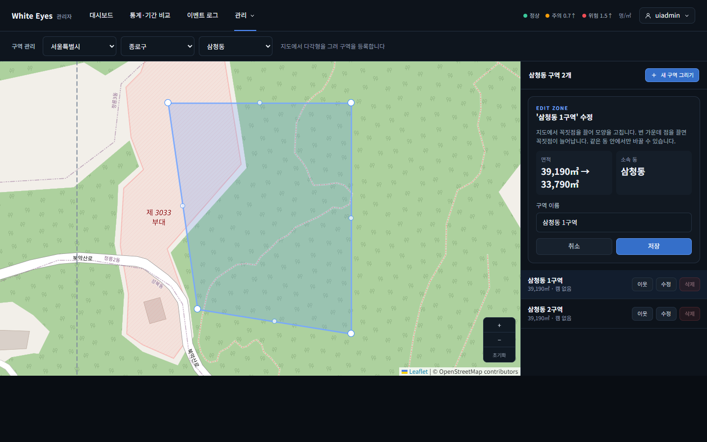
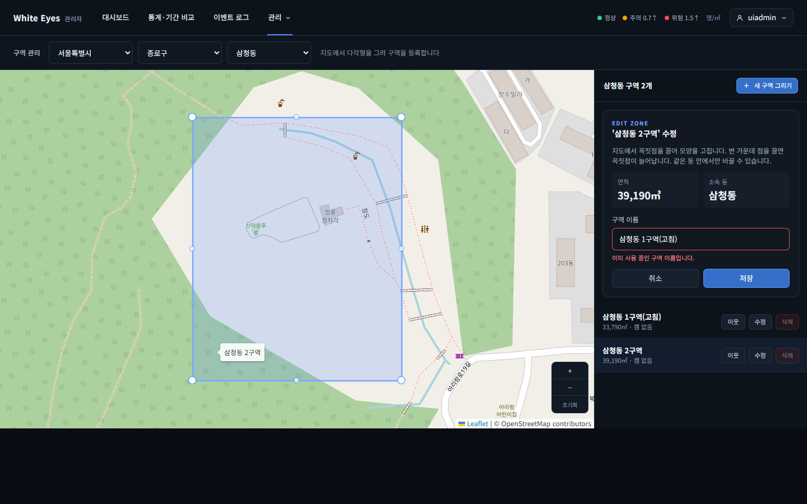

# 구역 수정 화면 확인 — 2026-10-23

spring #70(구역 수정, FNC-A-015)을 실제 브라우저(Chrome 155 헤드리스, 1440×900)로 조작하며 캡처했다. 시안은 `design/png/SCR-A-004-zones.png`.

- 환경: 이 PC에 Docker·MySQL이 없어 **H2에 시험 데이터를 넣고 관리자 앱을 띄워** 확인했다(삼청동에 구역 2개). 시드는 시험용이며 커밋하지 않았다.
- 꼭짓점 끌기는 Leaflet-Geoman의 꼭짓점 표시를 마우스 이벤트로 실제로 끌어 확인했다.

| 화면 | 시안 | 구현 |
|---|---|---|
| SCR-A-004 목록 '수정' → 지도 꼭짓점 편집 + 수정 카드(면적 `39,190㎡ → 33,790㎡`) |  |  |
| SCR-A-004 이름이 같은 동의 다른 구역과 겹칠 때 | - |  |

## 확인한 것
- 목록 행의 '수정'을 누르면 그 구역이 강조되고 꼭짓점·변 가운데 점 8개가 보이며, 오른쪽에 이름·면적·소속 동이 든 수정 카드가 열린다. 처음에는 바뀐 것이 없어 '저장'이 꺼져 있다.
- 꼭짓점을 끌면 미리보기(`POST /manage/zones/preview`)로 새 면적을 받아 `39,190㎡ → 33,790㎡`로 보이고 '저장'이 켜진다.
- 저장하면 `PATCH /manage/zones/{id}`에 **바뀐 것만** 보내고(이름만 바꾸면 name만, 모양을 고쳤으면 boundary 포함), 토스트 후 목록의 면적이 `33,790㎡`로 바뀐다(API로도 33790.4 확인).
- '취소'를 누르면 고치던 모양을 버리고 원래 모양·면적으로 돌아간다.
- 같은 동의 다른 구역 이름으로 바꿔 저장하면 '이미 사용 중인 구역 이름입니다.'가 이름 칸 아래에 나오고 카드는 열려 있다(409 DUPLICATE_ZONE_NAME). 이름만 바꾸기도 동작한다.
- 다른 동으로 옮기는 수정(400 DONG_CHANGE_NOT_ALLOWED)은 서버 시험 12개(`ZoneUpdateTest`)로 확인했다. 화면은 같은 코드를 받아 '다른 동으로 바뀌어 저장할 수 없습니다…' 문구를 보이고 저장을 막도록 만들었지만 **화면에서 직접 다른 동으로 끌어 보지는 못했다**(지도를 크게 줄여 동 경계 너머로 끌어야 해서).

## 시안과 다른 점(의도)
- 시안에는 '수정' 버튼 자리만 있고(3단계 표시) 수정 카드는 없다. 명세(screens.md '지도에서 꼭짓점 편집 → 미리보기 → PATCH')대로 등록 때와 같은 모양의 수정 카드를 오른쪽 패널에 추가했다.

## 확인하지 못한 것
- 화면에서 다른 동으로 끌어 저장이 막히는 모습(위 설명).
- 실제 MySQL에서의 동작(시험은 H2).
