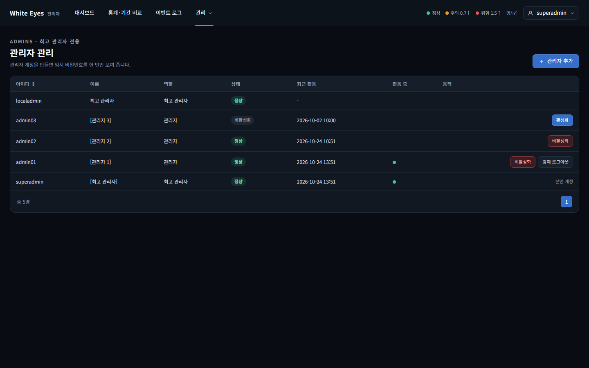
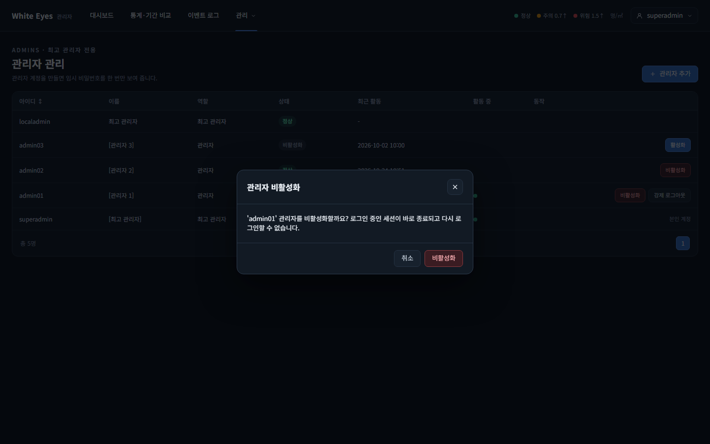
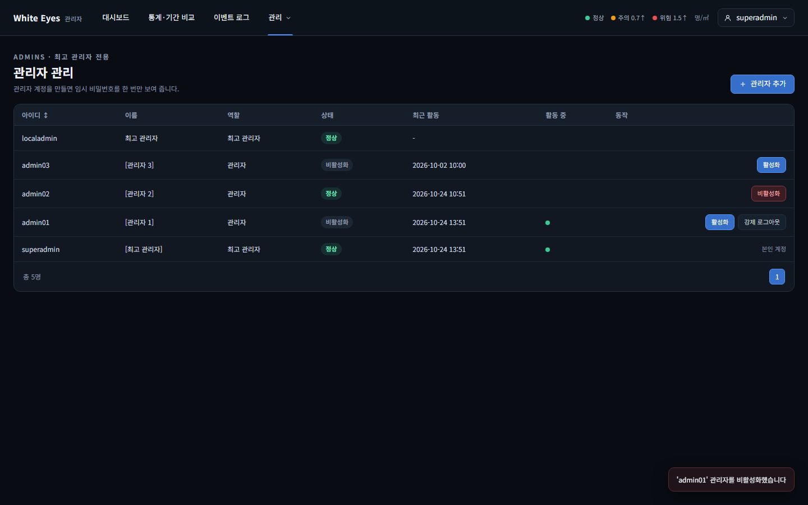
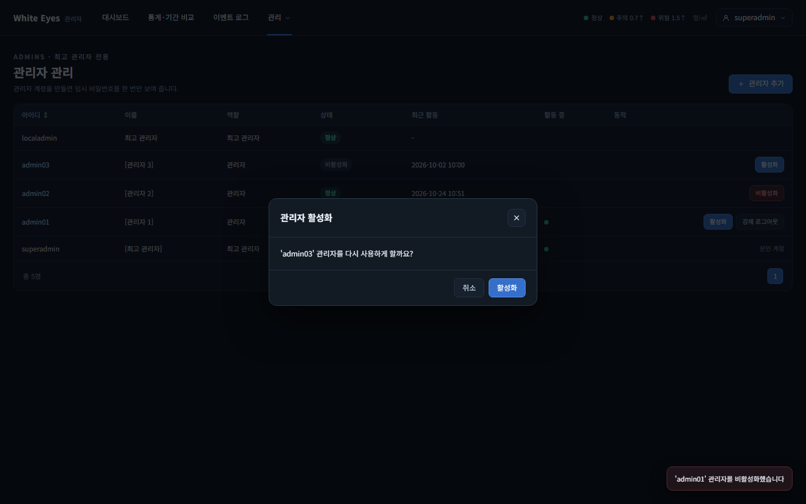
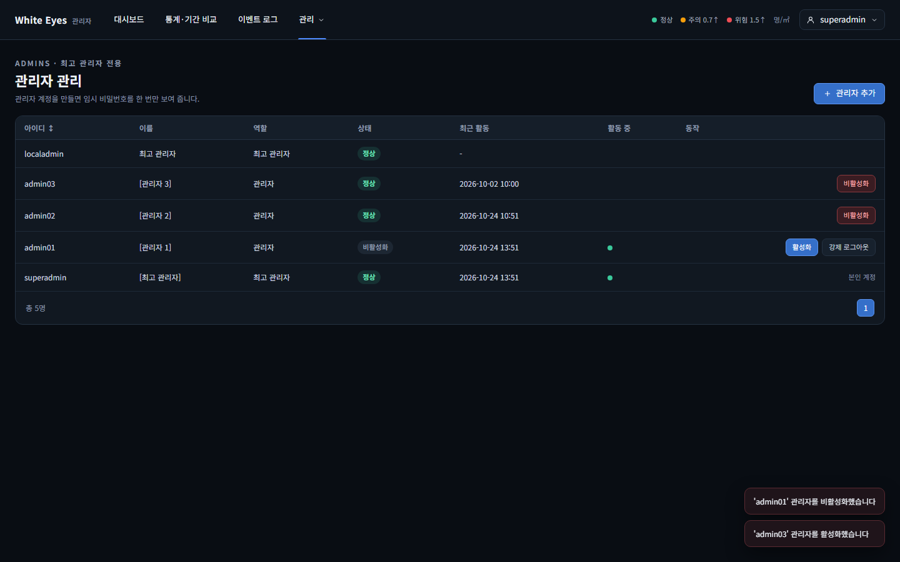
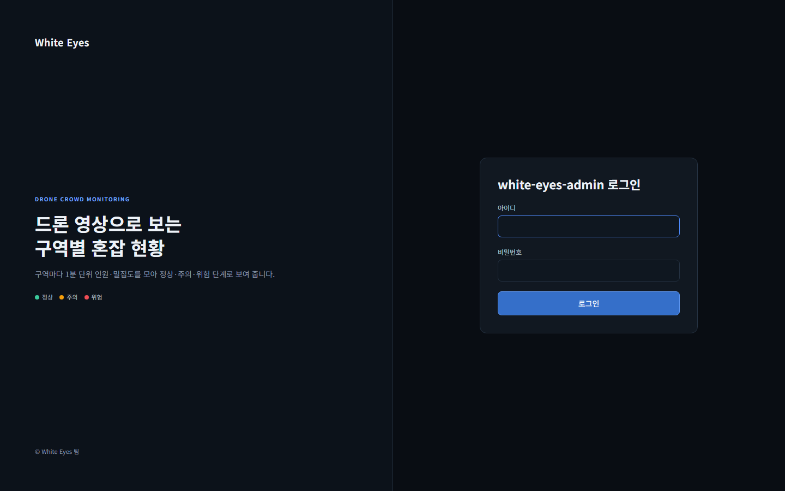

# 관리자 비활성화·활성화 화면 확인 — 2026-10-24

spring #69(FNC-A-011 관리자 비활성화·활성화)의 관리자 관리 화면(SCR-A-003)을 실제 브라우저(Playwright Chromium, 1440×900)로 조작하며 캡처했다. 시안은 `design/png/`.

- 환경: WSL Docker의 MySQL 8.4 + 관리자 앱(local 프로필, `feature/69-admin-disable-enable`). 계정·세션은 시험용 SQL과 실제 로그인으로 만들었다(아이디·이름·비밀번호 모두 가짜이고 커밋하지 않았다). 확인이 끝난 뒤 시험 데이터와 컨테이너는 정리했다.
- 이 브랜치는 #68(강제 로그아웃) 위에 쌓여 있어 '강제 로그아웃' 버튼도 함께 보인다.
- 관리자 목록의 `localadmin` 행은 앱이 처음 켜질 때 자동 등록되는 최고 관리자다(시안에 없음).
- 상태 변경·세션 삭제·최고 관리자 불가·409·권한·작업 기록·롤백의 서버 동작은 이 캡처가 아니라 spring `AdminStatusTest`(H2)로 확인했다.

## SCR-A-003 관리자 관리

| 화면 | 시안 | 구현 |
|---|---|---|
| 목록: 사용 중인 일반 관리자 행에 '비활성화', 비활성화된 행(admin03)에 '활성화', 최고 관리자 행에는 버튼 없음 |  |  |
| '비활성화' 확인 창(admin01) | - |  |
| 확인 뒤 토스트 "'admin01' 관리자를 비활성화했습니다", admin01 행이 '비활성화' 상태·'활성화' 버튼으로 바뀜 | - |  |
| '활성화' 확인 창(admin03) | - |  |
| 확인 뒤 admin03이 '정상'·'비활성화' 버튼으로 바뀜 | - |  |

## 검수 기준: 비활성화 즉시 대상 세션 종료

| 확인 | 구현 |
|---|---|
| admin01을 비활성화한 직후, 로그인해 있던 admin01의 브라우저가 `/admin/stats`를 열면 `/admin/login`으로 이동 |  |

## 확인한 것
- 사용 중(ACTIVE)인 일반 관리자 행에는 '비활성화'(빨강), 비활성화(DISABLED)된 행에는 '활성화'(파랑) 버튼이 보이고, 둘 다 확인 창을 거친다. 최고 관리자 행에는 버튼이 없고 본인 행에는 '본인 계정'이 보인다(screens.md SCR-A-003).
- 확인하면 `POST /api/v1/admins/{id}/disable`·`enable`이 한 번 나가고 목록이 새로 그려진다.
- 비활성화한 관리자의 기존 세션이 바로 끝나(04) 다음 요청은 로그인 화면으로 이동한다.

## 시안과 다른 점
- **의도**: 시안의 '수정'·'비밀번호 재설정'(FNC-A-010)은 다른 기능의 몫이라 이 이슈에서 만들지 않았다.
- **의도**: 시안은 활동 중이 아닌 행에도 비활성(흐린) '강제 로그아웃'을 보이지만, 명세 screens.md는 "활동 중일 때만"이라 명세를 따라 활동 중이 아닌 행에는 버튼을 두지 않았다(#68과 같은 결정).
- **의도**: 확인 창은 시안에 없다(명세는 '확인 창'만 요구). '활성화' 확인 버튼은 파란 기본 버튼, '비활성화'는 빨간 버튼으로 구분했다.
- **기존 화면의 차이**(이 이슈가 바꾼 것 아님): 상태 글자가 시안은 '사용 중·비활성', 구현은 '정상·비활성화'(코드 값 표시 이름), 활동 중이 시안은 '세션 N' 칩, 구현은 초록 점.

## 알아 둘 점 (확인 필요)
- 비활성화 직후에도 그 관리자의 마지막 로그인이 30분 안이면 행이 계속 '활동 중'(초록 점)으로 보이고 '강제 로그아웃' 버튼이 남는다(03번·06번의 admin01 행). 활동 중 판단이 "세션이 없으면 `last_login_at`"을 쓰기 때문이다(conventions.md '활동 중 판단', 명세 그대로). 이때 강제 로그아웃을 누르면 지운 세션 0건으로 응답한다.

## 확인하지 못한 것
- 비활성화된 관리자가 로그인 화면에서 받는 문구는 이 캡처로 확인하지 않았다(spring 테스트는 로그인 실패로 이동하는 것까지 확인).
- 로그인하지 않은 상태·일반 관리자의 403 화면은 캡처하지 않았다(spring 테스트로 확인).
