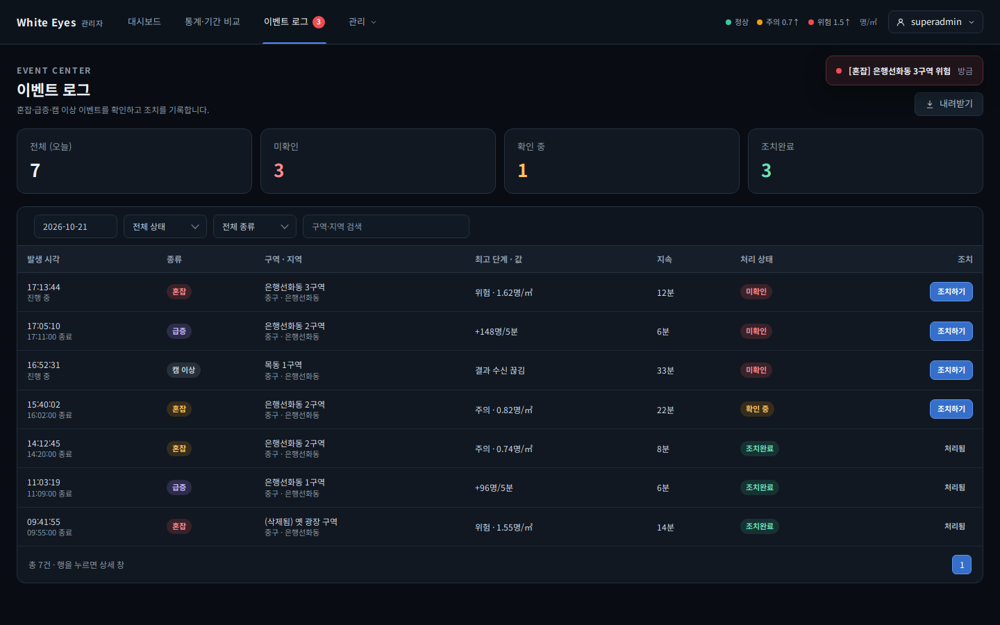
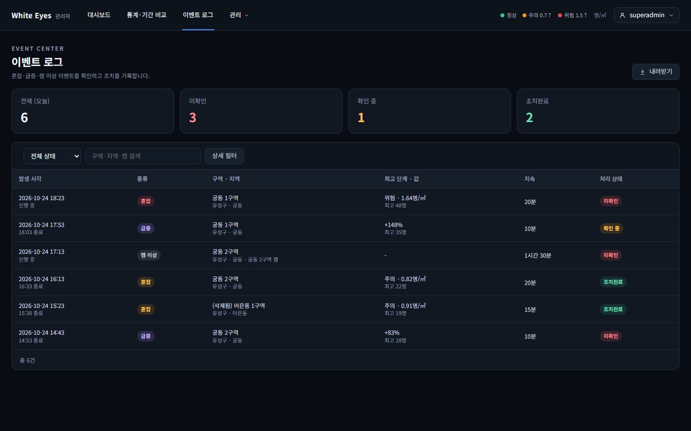
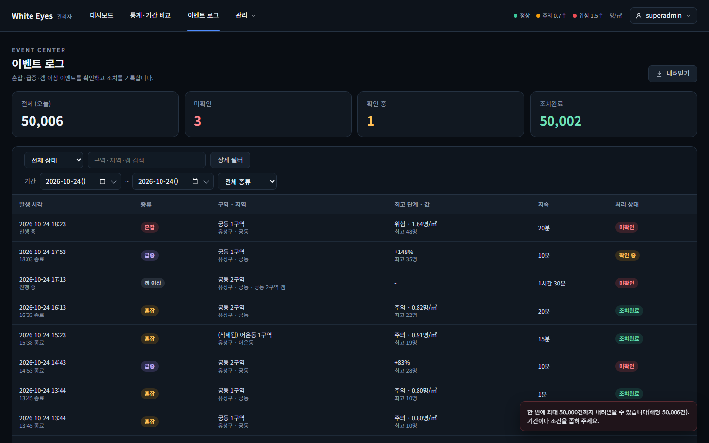

# 이벤트 엑셀 내려받기 화면 확인 — 2026-10-24

spring #75(FNC-A-039 이벤트 엑셀 다운로드)의 SCR-A-010 이벤트 로그 [내려받기] 버튼을 실제 브라우저(Playwright Chromium, 1440×900)로 캡처했다. 시안은 `design/png/SCR-A-010-events.png`.

- 환경: WSL Ubuntu의 Docker MySQL 8.4에 관리자 앱(8081, local 프로필)을 붙여 확인했다. 행정구역·구역·캠·이벤트 6건은 시험용 SQL 가짜 데이터로 넣었고 커밋하지 않았다. 이 PC에서 Hibernate 스키마 검증이 `zone_stat_daily.is_demo`로 실패해 캡처 실행에서만 `ddl-auto`를 끄고 띄웠다(이번 변경과 무관). 확인 뒤 컨테이너와 볼륨을 지웠다. 비밀번호·토큰은 캡처에 나오지 않는다.
- 브랜치: spring `feature/75-event-export`.
- 이 화면의 FNC-A-039 부분([내려받기] 버튼)만 만들었다. 행 클릭 상세(FNC-A-037)·조치(FNC-A-038)·헤더 배지와 새 이벤트 토스트(FNC-A-048)는 각 이슈 몫이다.
- 내려받은 파일 확인: 버튼을 누르면 `events_20261024_20261024.xlsx`가 내려오고, 머리글 15열과 이벤트 6행이 들어 있다.

| 화면·상태 | 시안 | 구현 |
|---|---|---|
| 오늘 이벤트 6건, 제목 줄 오른쪽의 [내려받기] 버튼 |  |  |
| 현재 필터에 해당하는 이벤트가 5만 건을 넘을 때(시험용 5만 6건) 눌렀을 때의 안내 문구 | - |  |

## 시안과 다른 점
**의도**
- 조치 열·헤더 미확인 배지·새 이벤트 토스트·'행을 누르면 상세 창' 안내: 다른 기능(FNC-A-038·048, FNC-A-037)의 몫.
- 5만 건 초과 문구는 시안에 없고 screens.md의 '5만 건 초과 문구'를 공통 토스트로 보인다: "한 번에 최대 50,000건까지 내려받을 수 있습니다(해당 50,006건). 기간이나 조건을 좁혀 주세요."
- 이벤트가 5만 건이 넘는 상태라 요약 카드와 표가 평소와 다르게 보인다(시험용 행).

## 확인하지 못한 것
- 이벤트 처리자·조치 항목이 채워진 행의 엑셀 값은 화면이 아니라 spring 테스트(`EventExportTest`)로 확인했다(처리 상태 변경 기능 #42가 아직 없음).
- 엑셀 프로그램에서 파일을 열어 보는 것(내려받은 파일은 시트 XML과 spring 테스트의 POI 읽기로 확인).
