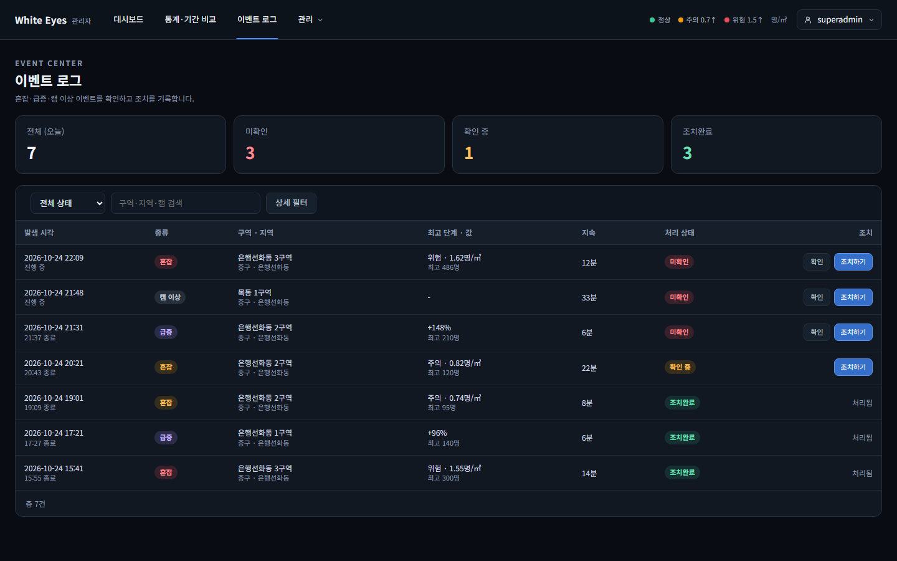
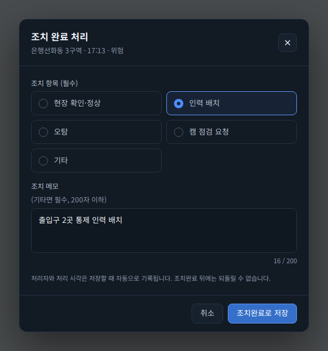
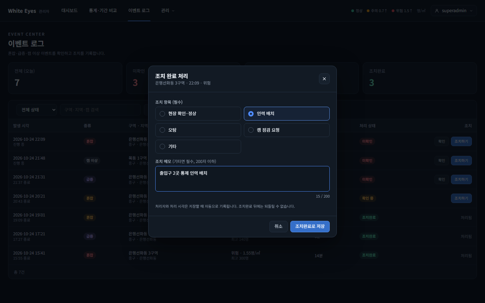
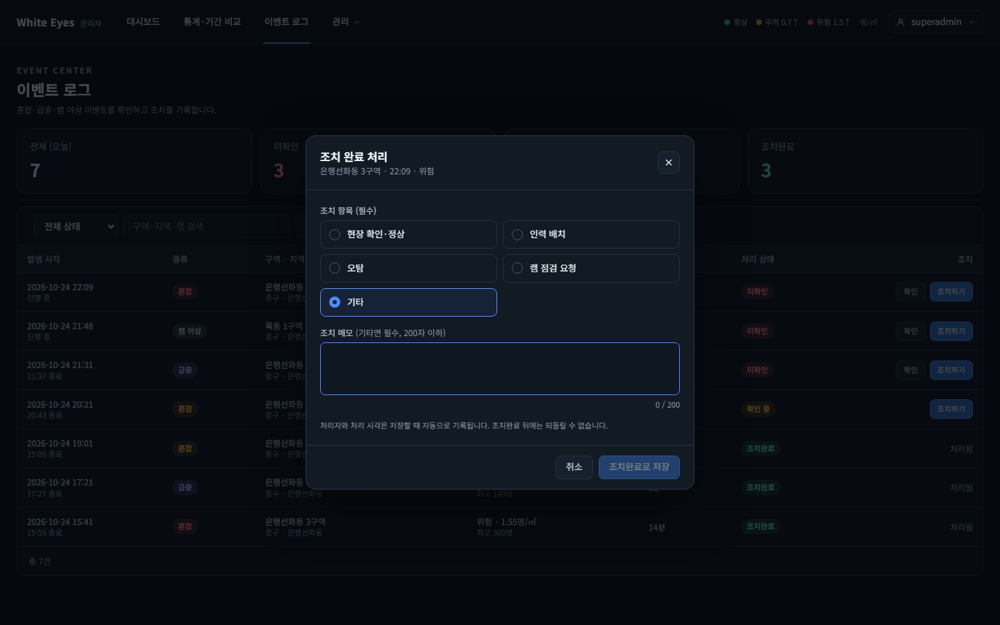
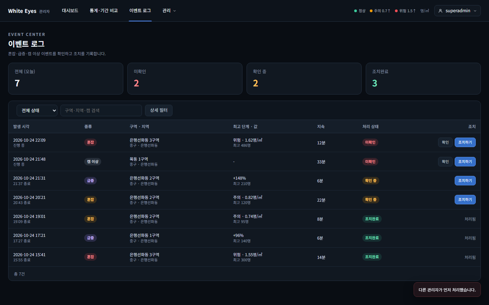
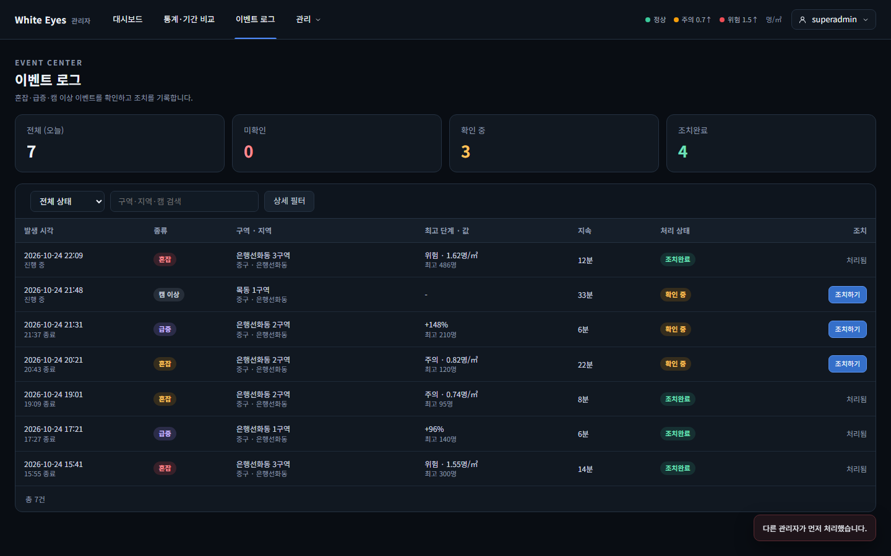

# 이벤트 처리 상태 변경(SCR-A-010 조치 열·SCR-A-011 조치 완료 창) 확인 — 2026-10-24

spring #42(FNC-A-038 처리 상태 변경)를 실제 브라우저(Playwright Chromium, 1440×900)로 캡처했다. 시안은 `design/png/SCR-A-010-events.png`, `design/png/SCR-A-011-action.png`.

- 환경: WSL Ubuntu의 Docker MySQL 8.4에 관리자 앱(local 프로필, 스키마 검증 그대로)을 붙이고, 최고 관리자(`superadmin`)로 실제 로그인해 확인했다. 구역 4개와 이벤트 7건(미확인 3·확인 중 1·조치완료 3)은 시험용 SQL로 넣었고 커밋하지 않았다(이름·시각은 모두 가짜).
- 이 화면의 FNC-A-038 부분(표의 조치 열, 조치 완료 창, 저장 뒤 목록·요약 카드 갱신, 409 처리)을 모두 만들었다.
- 01~06번을 한 흐름으로 실제 저장했고, 저장된 값은 DB에서 확인했다: 05번에서 `조치하기`로 저장한 이벤트는 `RESOLVED`(조치 항목 `STAFF`, 메모, 처리자·처리 시각 있음), 06번에서 `확인`을 누른 이벤트는 `CHECKED`, 작업 기록(`EVENT_STATUS`)은 이 두 건만 생겼다. 04번의 '다른 관리자가 먼저 처리한' 상황은 SQL로 상태를 바꿔 만들었다(상태 충돌은 두 요청을 동시에 보내는 자동 테스트로도 확인).

| 상태 | 시안 | 구현 |
|---|---|---|
| 목록: 미확인 행 [확인][조치하기], 확인 중 행 [조치하기], 조치완료 행 '처리됨' |  |  |
| 조치 완료 창: 조치 항목 '인력 배치' 선택, 메모 입력(머리에 구역·발생 시각·단계) |  |  |
| '기타'를 고르고 메모가 비면 저장 버튼 비활성 | - |  |
| 다른 관리자가 먼저 처리해 409: 토스트 '다른 관리자가 먼저 처리했습니다.' 뒤 목록·요약 카드를 다시 읽음 | - |  |
| 조치완료로 저장 뒤: 행이 '처리됨'으로 바뀌고 요약 카드(미확인 1·조치완료 4) 갱신 | - |  |
| [확인] 바로 저장: 행이 '확인 중'으로 바뀌고 [확인] 버튼이 사라짐 | - |  |

## 시안과 다른 점
**의도**
- [확인] 버튼: 시안의 목록에는 모든 미확인·확인 중 행에 [조치하기]만 있다. screens.md(SCR-A-010 '조치 버튼')가 미확인은 [확인][조치하기], 확인 중은 [조치하기]라고 정하고 [확인]은 바로 저장한다고 해서 명세를 따랐다.
- 조치 항목 선택 칸의 라벨과 메모 라벨은 시안과 같고, 메모 안내 `(기타면 필수, 200자 이하)`는 라벨 옆 한 줄에 둔다(시안은 아래 줄).
- 409 알림은 공통 토스트(화면 아래 오른쪽)로 보인다(공통 틀의 토스트 규칙).
- 목록의 발생 시각 형식·종류 칸 등은 #40(FNC-A-036)에서 정한 그대로다.

**확인 필요**
- 메모 입력칸의 글자 수 표시는 `15 / 200`처럼 입력한 글자 수를 보인다(시안은 `16 / 200` 예시).
- 조치 창 머리의 단계 문구는 혼잡이면 단계 이름(위험·주의), 급증·캠 이상이면 종류 이름이다. 시안은 혼잡 예시 하나뿐이라 급증·캠 이상의 머리는 명세에 없어 이렇게 정했다.

## 확인하지 못한 것
- 헤더 미확인 배지 숫자 갱신과 처리 순서 6(알림 SSE로 미확인 수 갱신): 알림 스트림(FNC-A-048, #46)의 몫.
- 처리한 뒤 상세 창의 '처리 이력'에 새 줄이 나오는 화면: 자동 테스트(`EventStatusChangeTest`)가 상세 API의 `histories`로 확인했고, 화면 캡처는 하지 않았다.
- 두 브라우저에서 같은 순간에 누르는 실제 동시 처리: 자동 테스트의 스레드 2개 동시 요청으로 확인했다.
