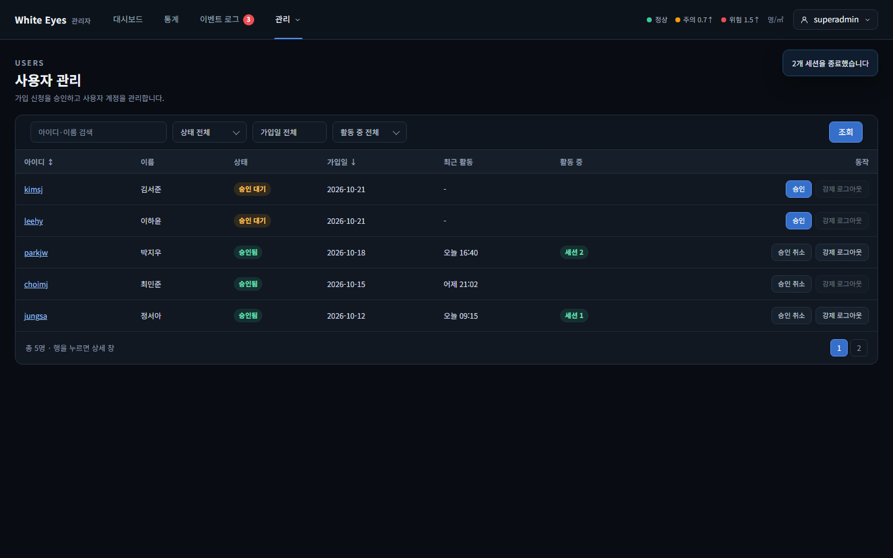
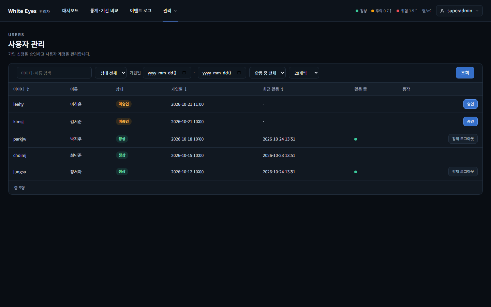
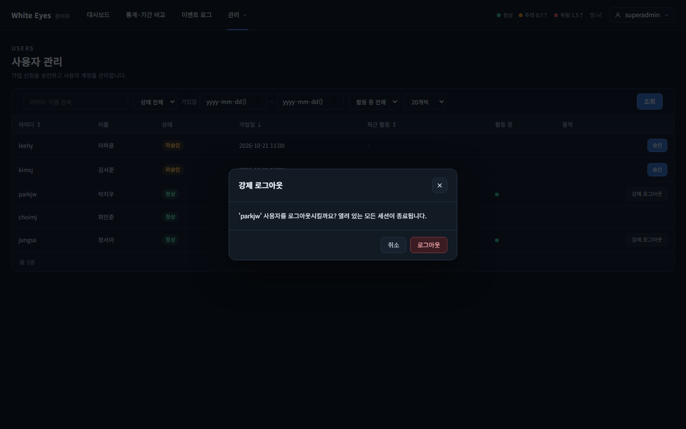
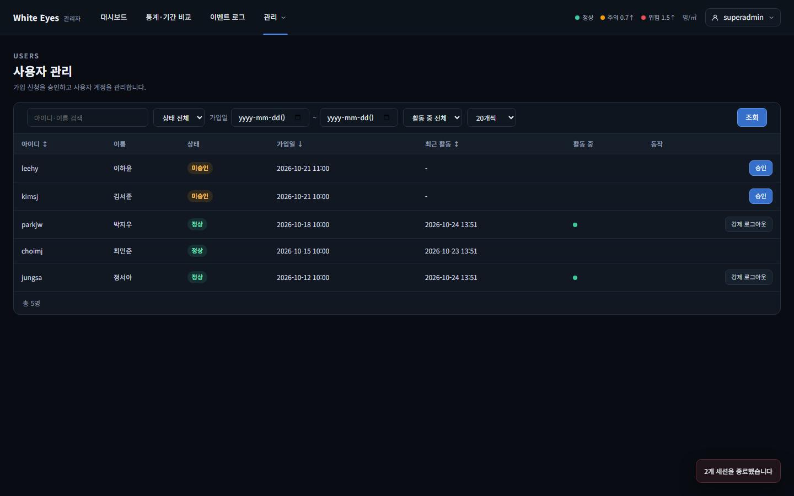
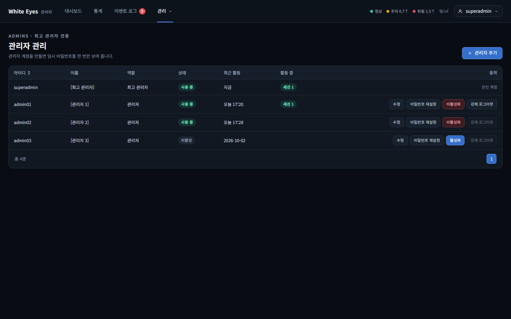
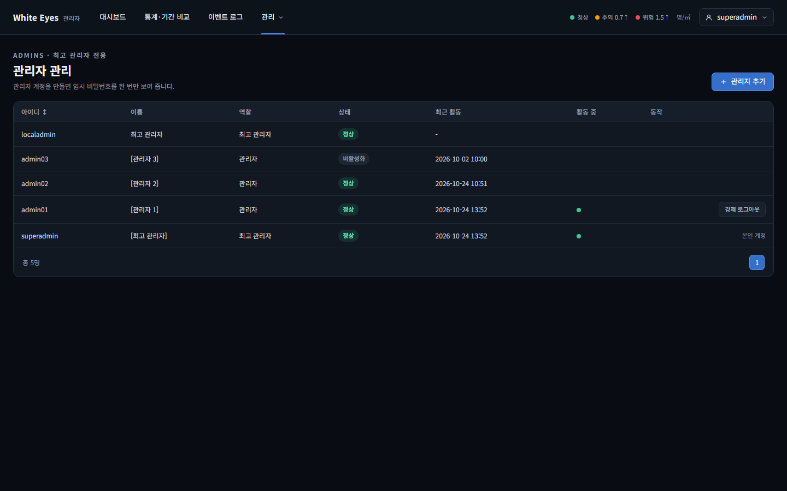
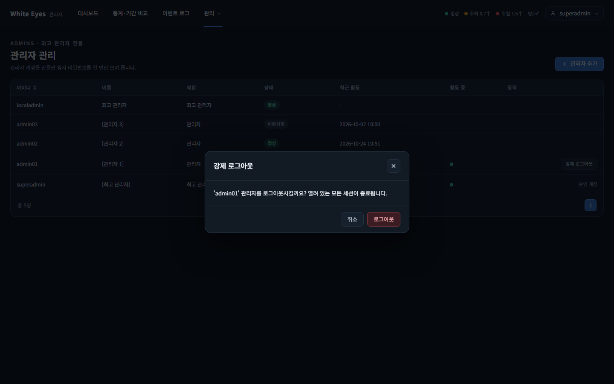
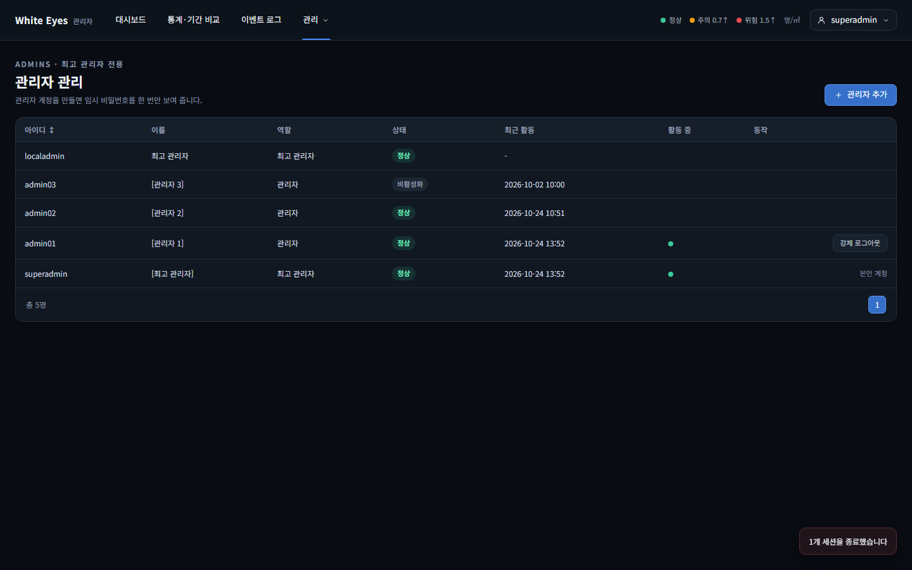
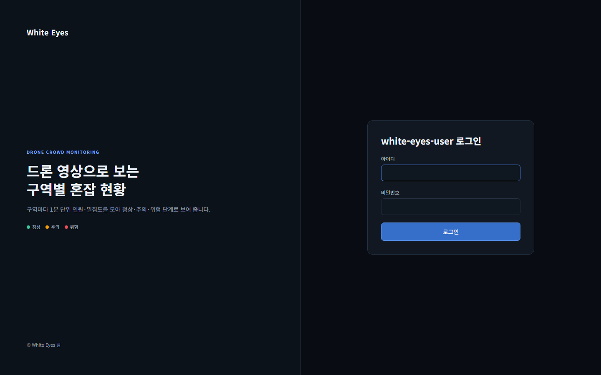

# 강제 로그아웃 화면 확인 — 2026-10-24

spring #68(FNC-A-008 강제 로그아웃)의 사용자 관리(SCR-A-001)·관리자 관리(SCR-A-003) 화면을 실제 브라우저(Playwright Chromium, 1440×900)로 조작하며 캡처했다. 시안은 `design/png/`.

- 환경: WSL Docker의 MySQL 8.4 + 관리자 앱(local 프로필, `feature/68-force-logout`) + 사용자 앱(local 프로필, 08번 확인에만). 계정·세션은 시험용 SQL로 넣었다(아이디·이름·비밀번호 모두 가짜이고 커밋하지 않았다). 확인이 끝난 뒤 시험 데이터와 컨테이너는 정리했다.
- 관리자 목록의 `localadmin` 행은 앱이 처음 켜질 때 자동 등록되는 최고 관리자다(시안에 없음).
- 세션 삭제·권한·자기 자신 불가·작업 기록의 서버 동작은 이 캡처가 아니라 spring `ForceLogoutTest`(H2)로 확인했다.

## SCR-A-001 사용자 관리 (사용자 대상)

| 화면 | 시안 | 구현 |
|---|---|---|
| 목록: 활동 중인 행(parkjw·jungsa)에만 '강제 로그아웃' |  |  |
| '강제 로그아웃' 확인 창 | - |  |
| 확인 뒤 토스트 '2개 세션을 종료했습니다' | - |  |

## SCR-A-003 관리자 관리 (관리자 대상)

| 화면 | 시안 | 구현 |
|---|---|---|
| 목록: 본인 행에 '본인 계정', 활동 중인 일반 관리자(admin01)에만 '강제 로그아웃' |  |  |
| '강제 로그아웃' 확인 창 | - |  |
| 확인 뒤 토스트 '1개 세션을 종료했습니다' | - |  |

## 검수 기준: 대상 브라우저가 다음 요청에서 로그인 화면으로 이동

| 확인 | 구현 |
|---|---|
| 관리자 앱: 강제 로그아웃당한 admin01의 브라우저가 `/admin/stats`를 열면 `/admin/login`으로 이동 |  |
| 사용자 앱: 사용자 앱에 실제로 로그인한 parkjw를 관리자 앱에서 강제 로그아웃하면 `/me/password`가 `/login`으로 이동(두 앱을 함께 띄워 확인) |  |

## 확인한 것
- 사용자 관리: 강제 로그아웃 버튼은 **활동 중인 행에만** 보인다(screens.md SCR-A-001). 누르면 확인 창이 뜨고, 확인하면 `POST /api/v1/users/{id}/logout`이 한 번 나가 'n개 세션을 종료했습니다'가 토스트로 뜬다.- 관리자 관리: 최고 관리자 행에는 버튼이 없고 본인 행에는 '본인 계정'만 보인다(screens.md SCR-A-003). 활동 중인 일반 관리자 행에만 강제 로그아웃이 보인다.
- 실제 MySQL에서 사용자 세션 2개(`SPRING_SESSION_USER`)와 관리자 세션 1개(`SPRING_SESSION_ADMIN`)가 지워졌고, `work_history`에 `ACCOUNT_CHANGE` 2행(`USER_ACCOUNT` / `ADMIN_ACCOUNT`, `{"deletedSessions": n}`)이 남았다.

## 시안과 다른 점
- **의도**: 시안은 활동 중이 아닌 행에도 비활성(흐린) '강제 로그아웃' 버튼을 보이지만, 명세 screens.md는 "활동 중일 때만 표시"라서 명세를 따라 활동 중이 아닌 행에는 버튼을 두지 않았다(design/README: 둘이 다르면 명세를 따른다). 시안을 고치는 PR이 필요하면 따로 올린다.
- **의도**: 시안의 '수정'·'비밀번호 재설정'(FNC-A-010), 사용자 관리의 '승인 취소'(FNC-A-007), 행 클릭 상세 창(SCR-A-002), 헤더의 미확인 이벤트 배지는 다른 기능의 몫이라 이 이슈에서 만들지 않았다.
- **의도**: 두 확인 창은 시안에 없다(명세는 '확인 창'만 요구). 캠 삭제 확인 창과 같은 모달 모양(`we.css`)으로 만들었다.
- **기존 화면의 차이**(이 이슈가 바꾼 것 아님): 상태 글자가 시안은 '승인 대기·승인됨·사용 중', 구현은 '미승인·정상'(코드 값 표시 이름), 활동 중이 시안은 '세션 N' 칩, 구현은 초록 점(screens.md의 "활동 중이면 초록 점").

## 알아 둘 점 (확인 필요)
- 강제 로그아웃 뒤에도 **마지막 로그인이 30분 안이면 그 계정은 계속 '활동 중'으로 보이고 버튼도 남는다.** 활동 중 판단이 "세션이 없으면 `last_login_at`"을 쓰기 때문이다(conventions.md '활동 중 판단', 명세 그대로). 이 보고서의 캡처로는 확인하지 않았고 계산 규칙에서 나온 결론이다(비활성화 직후 같은 모습은 `2026-10-24-admin-disable-enable`의 06번에 있다). 다시 누르면 지운 세션 0건으로 응답한다.

## 확인하지 못한 것
- 실시간 화면 스트림은 강제 로그아웃해도 바로 끊기지 않는다(알려진 한계 11, 명세에 있는 동작이라 확인 대상이 아님).
- 로그인하지 않은 상태·일반 관리자의 403 화면 확인은 캡처하지 않았다(spring 테스트로 확인).
