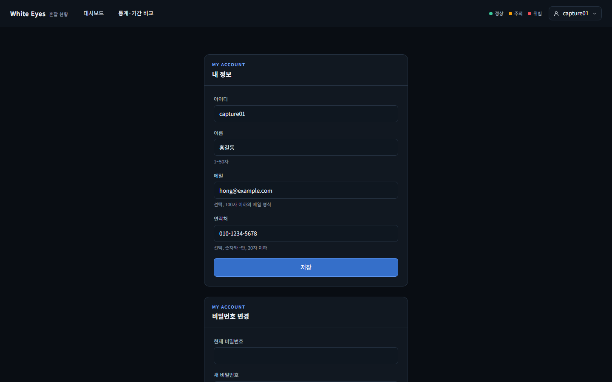
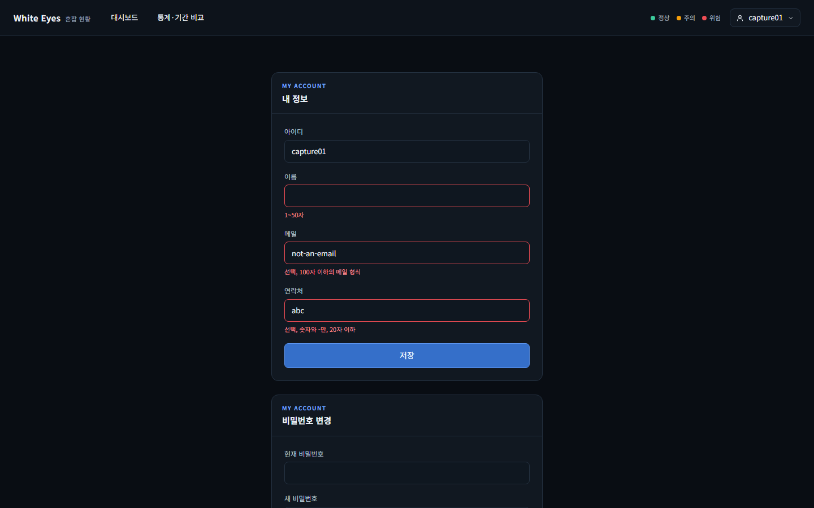
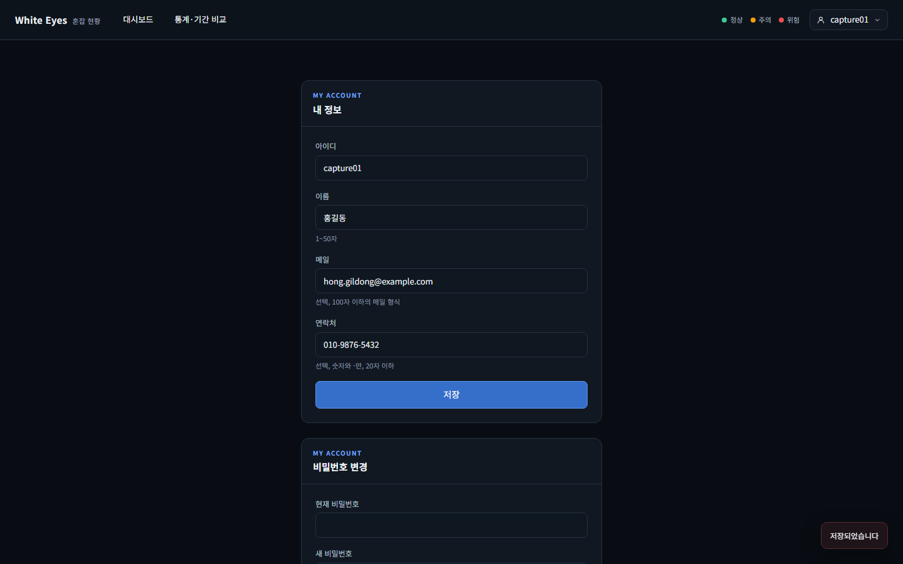
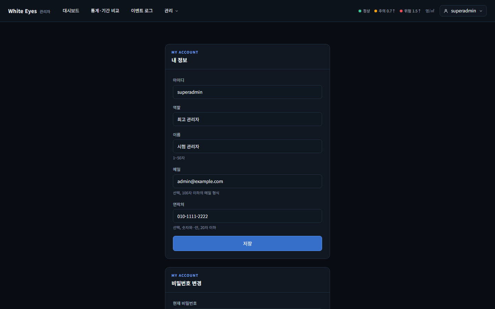

# 내 정보 화면 확인 — 2026-10-24

spring #53(내 정보 조회·수정, FNC-C-006)의 SCR-C-002 **내 정보 영역**을 실제 브라우저(Playwright Chromium, 1440×900)로 조작하며 캡처했다. 시안은 `design/png/`.

- 환경: WSL Docker의 MySQL 8.4에 사용자 앱(8080)과 관리자 앱(8081, local 프로필)을 띄웠다. 시험용 가짜 계정(사용자 `capture01`)과 가짜 값만 썼고, 확인 뒤 컨테이너와 볼륨을 지웠다. 비밀번호·토큰은 캡처에 나오지 않는다.
- 브랜치: spring `feature/53-my-info`.

## 시안이 없는 영역
`design/screens/SCR-C-002-password-forced.html`에는 **비밀번호 변경 영역(FNC-C-007)만** 있고, 내 정보 영역(FNC-C-006)의 시안은 없다(`data-fnc="FNC-C-006"` 요소가 `design/` 어디에도 없음). 그래서 내 정보 패널은 비밀번호 변경 시안과 같은 모양(패널 폭 480px, `MY ACCOUNT` 눈썸 글, `.field`·`.input`·`.hint`, 파란 큰 버튼)으로 만들었다. 시안 자체를 보강하는 일은 이 보고서의 범위 밖이다(사용자에게 알림).

| 화면·상태 | 시안 | 구현 |
|---|---|---|
| 사용자 앱 `/me` 기본 조회(값이 채워짐, 아래에 비밀번호 변경 영역) | 없음(비밀번호 영역 모양만 [시안](../../design/png/SCR-C-002-password-forced.png)) |  |
| 입력값이 규칙을 어길 때(이름 비움·메일 형식·연락처 문자) | 없음 |  |
| 저장 성공('저장되었습니다' 토스트, 새로고침해도 값 유지) | 없음 |  |
| 관리자 앱 `/admin/me`(역할 칸이 더 보임, 최고 관리자) | 없음 |  |
| 비밀번호 변경이 강제된 계정이 `/admin/me`로 가면 `/admin/me/password`로 이동, 내 정보 영역 숨김 | [시안](../../design/png/SCR-C-002-password-forced.png) |  |

## 확인한 것
- `/me`는 화면이 `GET /api/v1/me`로 받은 값으로 입력 칸을 채운다. 아이디(와 관리자 앱의 역할)는 읽기 전용이다. 역할은 '관리자'·'최고 관리자'로 보인다.
- 저장은 `PATCH /api/v1/me`로 이름·메일·연락처를 보낸다. 성공하면 토스트가 뜨고, 새로고침 뒤 다시 조회한 값이 저장한 값(`hong.gildong@example.com`)이었다.
- 입력 중 규칙을 검사해 칸 아래 안내가 빨갛게 바뀌고, 어기면 요청을 보내지 않는다. 서버가 400 `fieldErrors`를 주면 같은 칸 아래에 문구를 보이도록 만들었다(서버 응답은 서버 시험으로 확인).
- 비밀번호 변경이 강제된 계정은 `/admin/me`로 가도 `/admin/me/password`로 이동하고, 비밀번호 영역과 안내 문구, 로그아웃만 보인다(기존 #24 동작 그대로).

## 의도 / 확인 필요
- 의도: 내 정보 영역은 시안이 없어 비밀번호 영역 시안과 같은 패널 모양으로 만들었다. 비밀번호 영역은 `/me`와 `/me/password`가 같은 조각(`password-panel.html`)을 쓴다.
- 확인 필요: 내 정보 영역의 시안을 `design/`에 추가할지(명세 screens.md에는 영역·동작이 있음). 회원 탈퇴 영역(FNC-U-004)은 아직 없다.
- 확인 필요: 이름 칸이 비어 있을 때 칸 아래 안내문은 같은 문구('1~50자')가 빨갛게만 바뀐다.

## 확인하지 못한 것
- 400 `fieldErrors`를 받았을 때의 화면 모양(입력 중 검사가 먼저 막아 서버 오류를 화면에서 만들지 못함. 서버 쪽 응답은 시험 `UserMyInfoTest`·`AdminMyInfoTest`로 확인).
- 사용자 앱 `/me`에서 로그인 상태가 아닐 때의 이동(기존 로그인 이동 동작이라 이번에 따로 캡처하지 않음).
