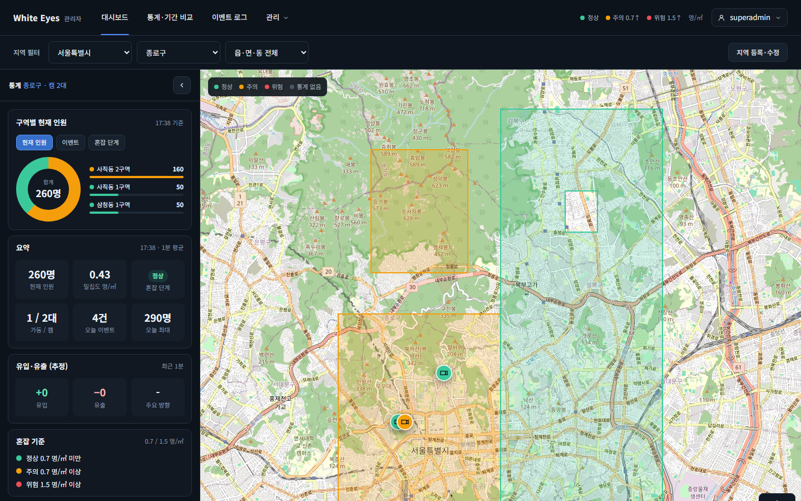
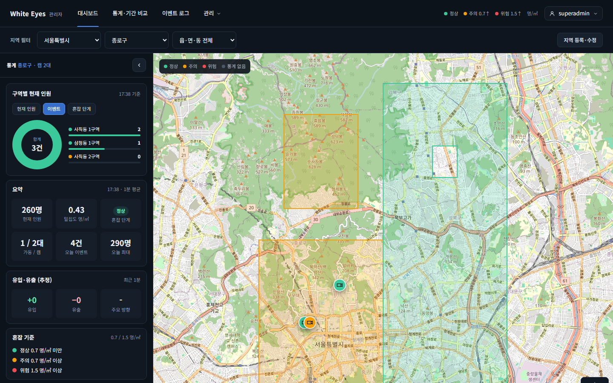
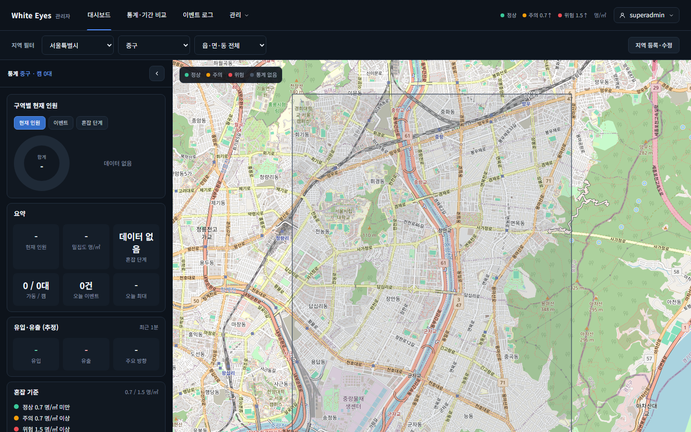

# 오늘 이벤트 수 화면 확인 — 2026-10-24

spring #58(오늘 이벤트 수, FNC-C-017)의 SCR-C-003 통계 메인을 실제 브라우저(Playwright Chromium, 1440×900)로 캡처했다. 시안은 `design/png/`.

- 환경: WSL Docker의 MySQL 8.4에 관리자 앱(8081, local 프로필)과 사용자 앱(8080)을 띄웠다. 행정구역은 spring 테스트 경계 파일(서울 종로구·중구)을 적재하고, 구역·캠·이벤트·1분 통계는 시험용 SQL 가짜 데이터로 넣었다. 확인 뒤 컨테이너와 볼륨을 지웠다. 비밀번호·토큰은 캡처에 나오지 않는다.
- 브랜치: spring `feature/58-today-event-count`.
- 시험 데이터(종로구): 사직동 1구역에 오늘 혼잡 1·급증 1·캠 이상 1·어제 혼잡 1, 삼청동 1구역에 오늘 혼잡 1, 삭제된 구역에 오늘 급증 1. 중구는 구역 없음.

| 화면·상태 | 시안 | 구현 |
|---|---|---|
| 종로구, 요약 '오늘 이벤트' 4건 (혼잡+급증, 캠 이상·어제 제외, 삭제된 구역 포함) | [시안](../../design/png/SCR-C-003-dashboard.png)(0건 예시) |  |
| 종로구, 구역별 현재 인원 패널의 '이벤트' 탭 (구역마다 2·1·0건, 합계 3건) | [시안](../../design/png/SCR-C-003-dashboard.png)(탭만 있고 값 없음) |  |
| 중구(구역 없음), 요약 '오늘 이벤트' 0건 | [시안](../../design/png/SCR-C-003-dashboard.png) |  |

## 확인한 것
- 요약 칸의 '오늘 이벤트'는 `GET /api/v1/dashboard/summary`의 `todayEventCount`를 그대로 보인다. 종로구 4건 = 사직동 1구역 2(혼잡·급증) + 삼청동 1구역 1 + 삭제된 구역 1. 캠 이상과 어제 시작한 이벤트는 세지 않았다.
- 구역별 패널 '이벤트' 탭은 `GET /api/v1/map/status?unit=ZONE`의 구역별 `todayEventCount`를 보인다(사직동 1구역 2, 삼청동 1구역 1, 사직동 2구역 0).
- 사용자 앱(8080)은 로그인한 사용자로 두 API를 직접 불러 확인했다: summary 종로구 4·중구 0·구역 2, map/status(unit=ZONE) 구역별 2·0·1, 시·군·구 단위 종로구 4·중구 0.

## 시안과 다른 점
- 의도: 시안은 오늘 이벤트가 0건인 예시다. 구현 캡처는 시험 데이터로 4건 상태와 0건 상태를 둘 다 찍었다.
- 의도: 지도 타일·구역 모양·캠 수는 시험 데이터와 실제 OSM 타일이라 시안과 다르다. 헤더의 미확인 배지(3)는 알림 기능(#46)의 몫이고, 인원수·밀집도 등 접는 영역은 다른 기능의 몫이라 아직 없다.
- 확인 필요: 요약의 '오늘 이벤트'(4건)에는 삭제된 구역의 이벤트가 포함되고(FNC-C-017 '삭제 포함'), '이벤트' 탭 합계(3건)는 삭제되지 않은 구역 목록만 더하므로 둘이 다르다. 명세 문장대로 만든 결과이며 화면 안내 문구는 없다.

## 확인하지 못한 것
- 사용자 앱 화면(SCR-C-003): 사용자 앱에는 통계 메인 화면(`/stats`)이 아직 없어(404) 캡처하지 못했다 — 검증 불가(사유: 사용자 앱 화면 미구현). 사용자 앱은 위처럼 API 값으로만 확인했다.
- 캠 카드의 오늘 이벤트 수(FNC-A-022)와 지도 핀의 진행 중 이벤트 배지(`ongoingEvent`)는 이 기능의 범위가 아니다.
