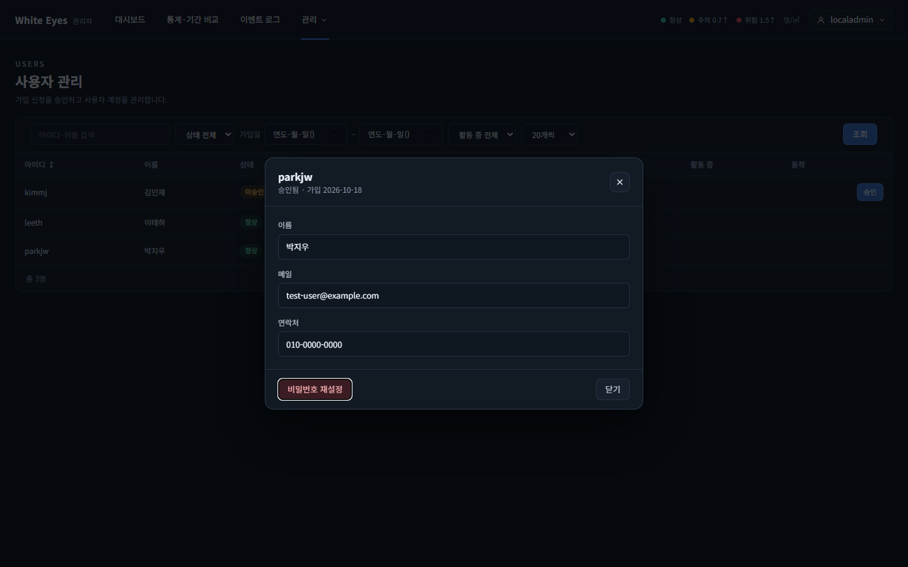
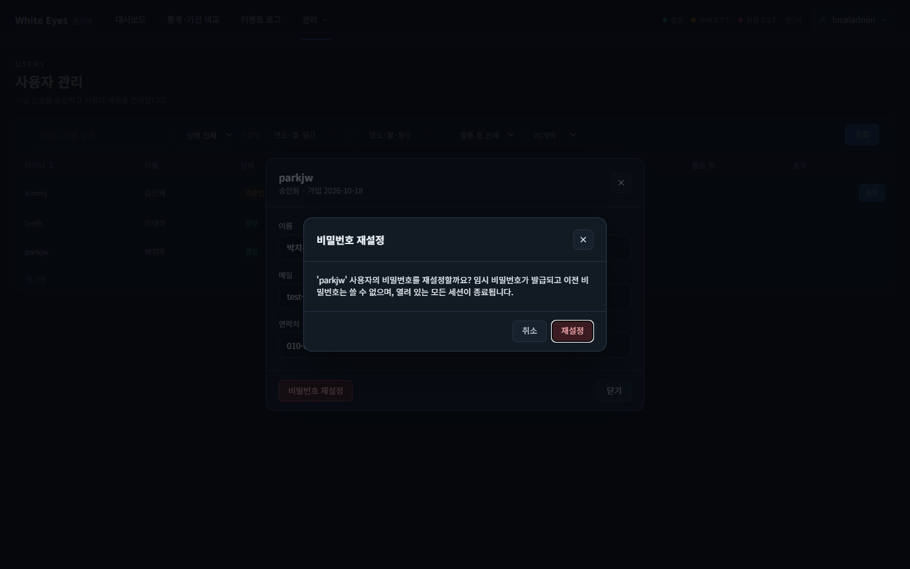
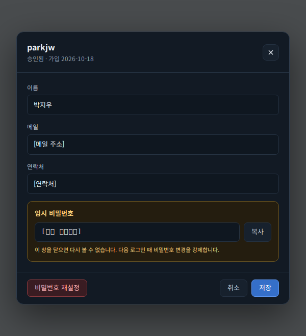
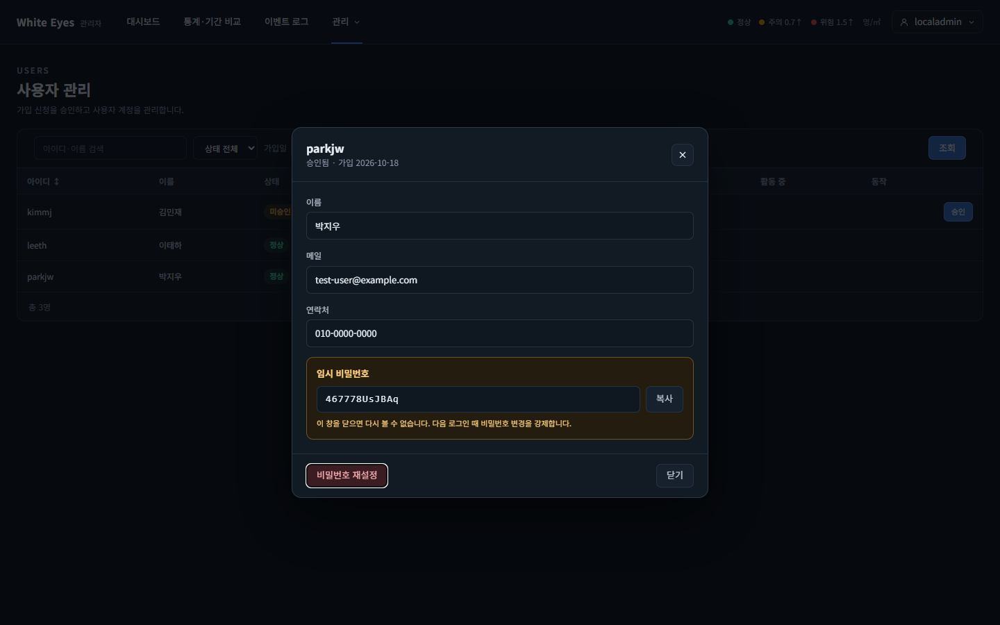

# 사용자 비밀번호 재설정 화면 확인 — 2026-10-24

spring #66(FNC-A-005 사용자 비밀번호 재설정)의 사용자 상세 창(SCR-A-002)을 실제 브라우저(Playwright Chromium, 1440×900)로 조작하며 캡처했다. 시안은 `design/png/`.

- 환경: WSL Docker의 MySQL 8.4 + 관리자 앱(local 프로필, `feature/66-user-password-reset`). 계정은 시험용 SQL로 넣었다(아이디·이름·메일·연락처·비밀번호 모두 가짜이고 커밋하지 않았다). 03번에 보이는 임시 비밀번호는 이 가짜 계정에 발급된 시험 값이다. 확인이 끝난 뒤 시험 데이터와 컨테이너는 정리했다.
- 임시 비밀번호 생성·bcrypt 저장·변경 강제·세션 삭제·작업 기록·권한의 서버 동작은 이 캡처가 아니라 spring `UserPasswordResetTest`(H2)로 확인했다. 이 캡처 환경(MySQL)에서는 해당 계정의 `must_change_password=1`, 저장값이 bcrypt 60자임, `work_history`에 `ACCOUNT_CHANGE`/`USER_ACCOUNT`/`{"password": "변경됨"}` 1행이 남음을 확인했다.

## SCR-A-002 사용자 상세 창

| 화면 | 시안 | 구현 |
|---|---|---|
| 사용자 관리 목록에서 행(parkjw)을 눌러 연 상세 창(재설정 전) | - (시안에는 재설정 전 상태가 없음) |  |
| '비밀번호 재설정' 확인 창 | - |  |
| 확인 뒤 임시 비밀번호 한 번 표시(복사 버튼, '이 창을 닫으면 다시 볼 수 없습니다') |  |  |

## 확인한 것
- 행을 누르면 상세 창이 열리고 제목에 아이디, 부제에 '승인됨 · 가입 날짜'가 보인다. 이름·메일·연락처는 목록 행의 값을 읽기 전용으로 보여 준다.
- '비밀번호 재설정'을 누르면 확인 창이 뜨고, 확인하면 `POST /api/v1/users/{id}/reset-password`가 한 번 나가 12자 임시 비밀번호가 노란 상자에 표시된다.
- 창을 닫으면 임시 비밀번호 글자가 지워져(Playwright로 닫은 뒤 빈 문자열 확인) 다시 볼 수 없다.

## 시안과 다른 점
- **의도**: 시안 아래쪽의 '취소'·'저장' 버튼과 이름·메일·연락처 입력(수정 가능)은 FNC-A-004(사용자 정보 수정, #65)의 몫이라 만들지 않았다. 입력 칸은 읽기 전용이고 오른쪽 버튼은 '닫기'다. #65가 저장을 붙일 때 바꾼다.
- **의도**: 재설정 확인 창은 시안에 없다(명세는 '확인 창'만 요구). 강제 로그아웃 확인 창과 같은 모달 모양(`we.css`)으로 만들었다.
- **확인 필요**: 03번에서 '비밀번호 재설정' 버튼에 포커스 링이 보인다(재설정 뒤 확인 창을 닫으며 버튼으로 포커스를 돌려서). 시안은 정적 그림이라 포커스 상태가 없다.
- **기존 화면의 차이**(이 이슈가 바꾼 것 아님): 목록의 상태 글자와 활동 중 표시는 `2026-10-24-force-logout` 보고서의 설명과 같다.

## 확인하지 못한 것
- 재설정한 계정으로 사용자 앱에 로그인하면 `/me/password`로 이동하는 것은 이 캡처에서 확인하지 않았다. 사용자 앱을 띄우지 않았고, spring `UserLoginTest`(must_change_password=1이면 비밀번호 변경 화면으로 이동)와 `UserPasswordResetTest`(재설정 뒤 `must_change_password=1`)로 나눠 확인했다.
- 목록 행에서 클릭한 곳이 버튼이면 상세 창이 열리지 않는 동작(승인·강제 로그아웃 버튼)은 코드로만 막았고 캡처하지 않았다.