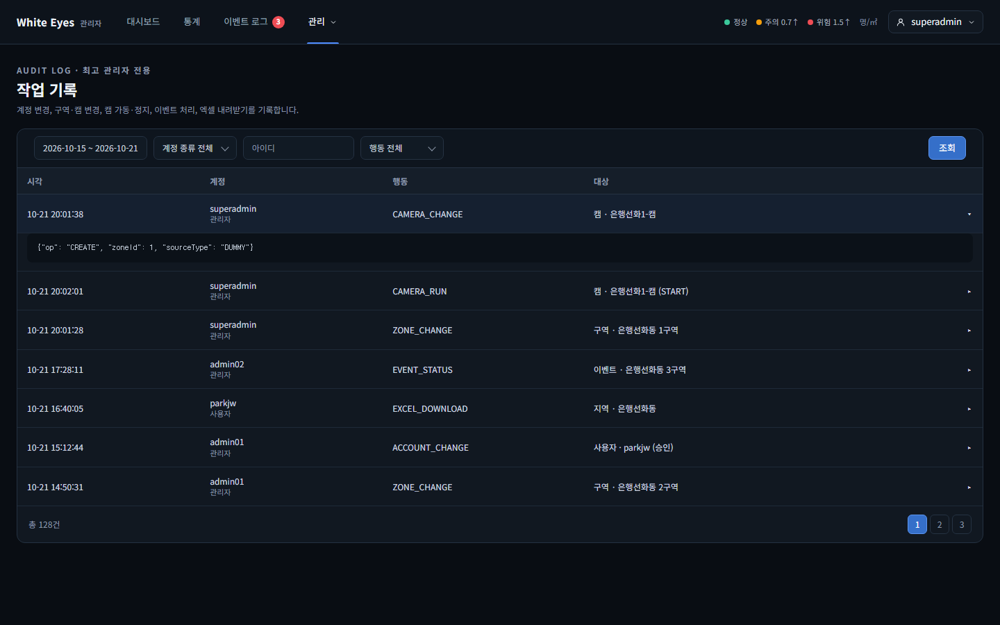
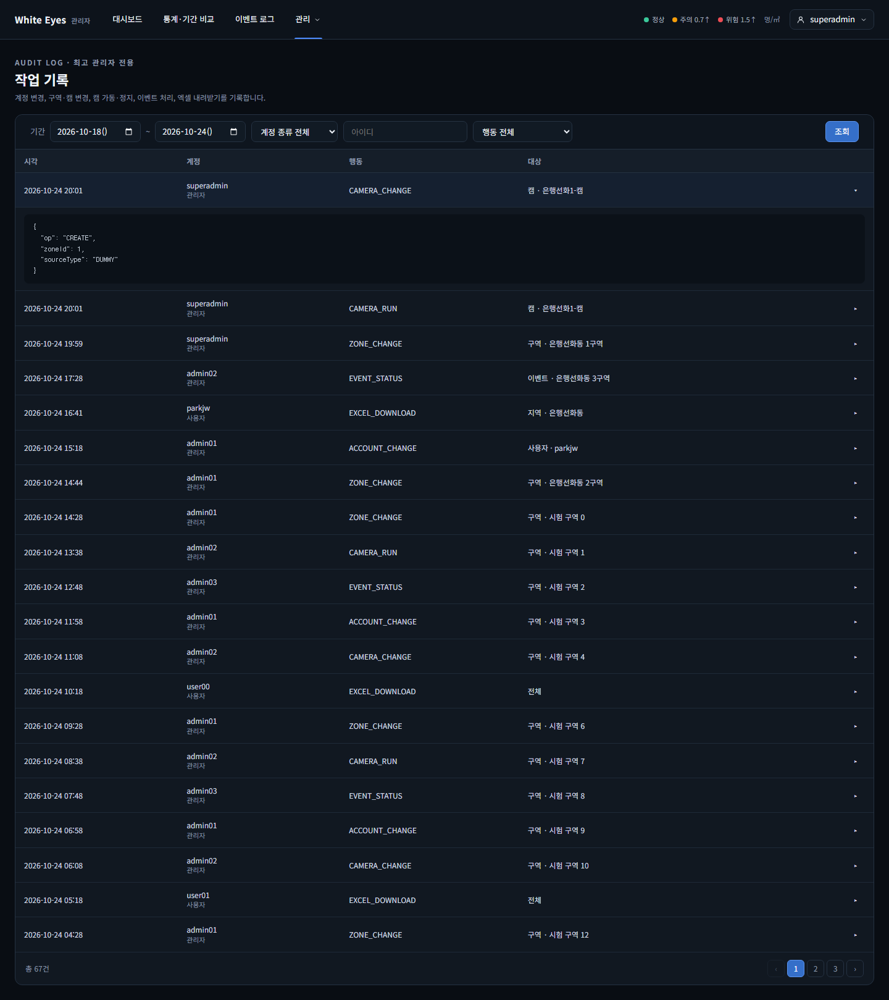
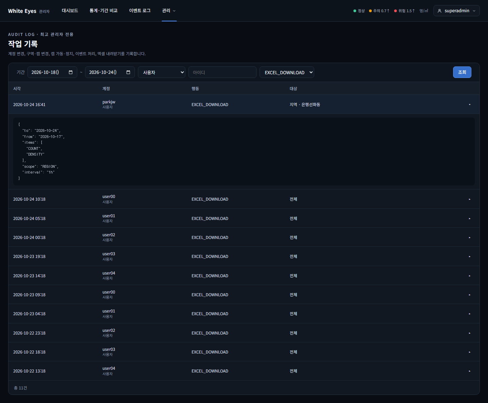
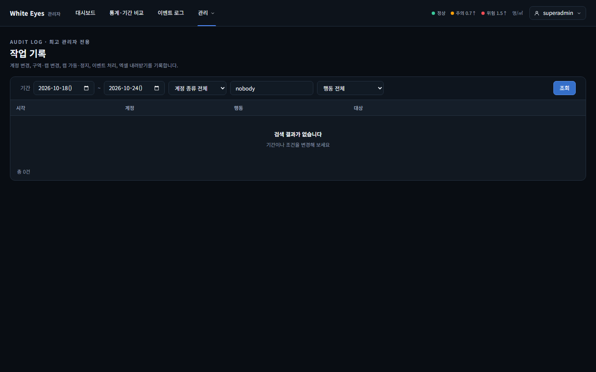
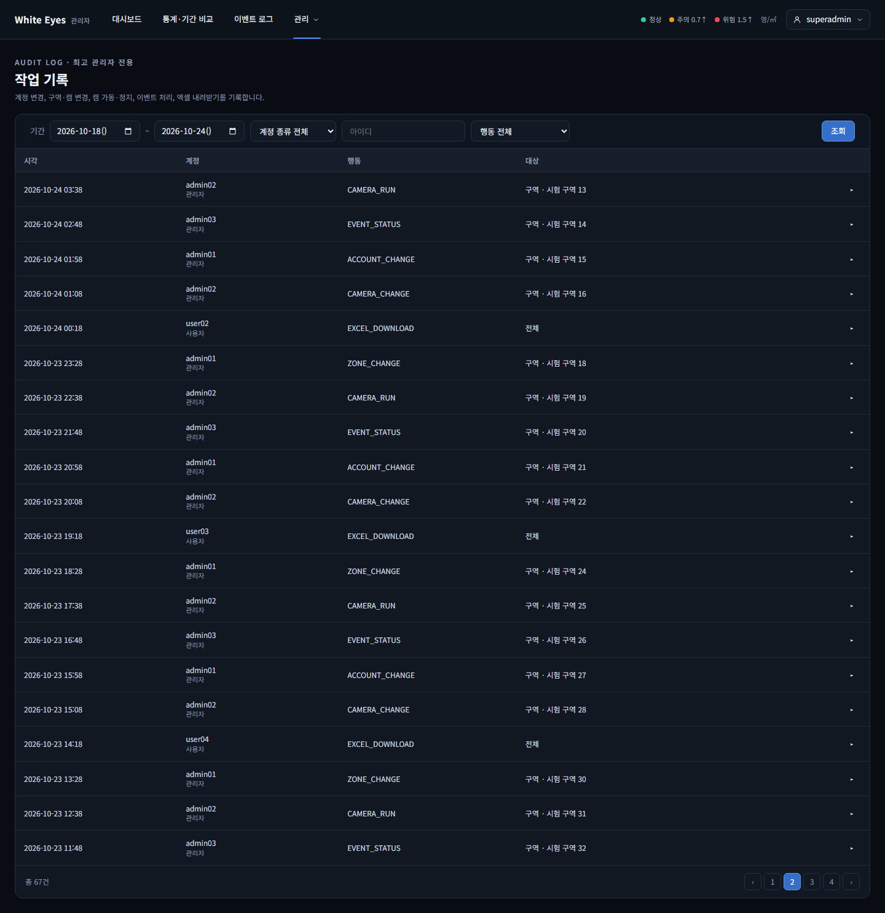
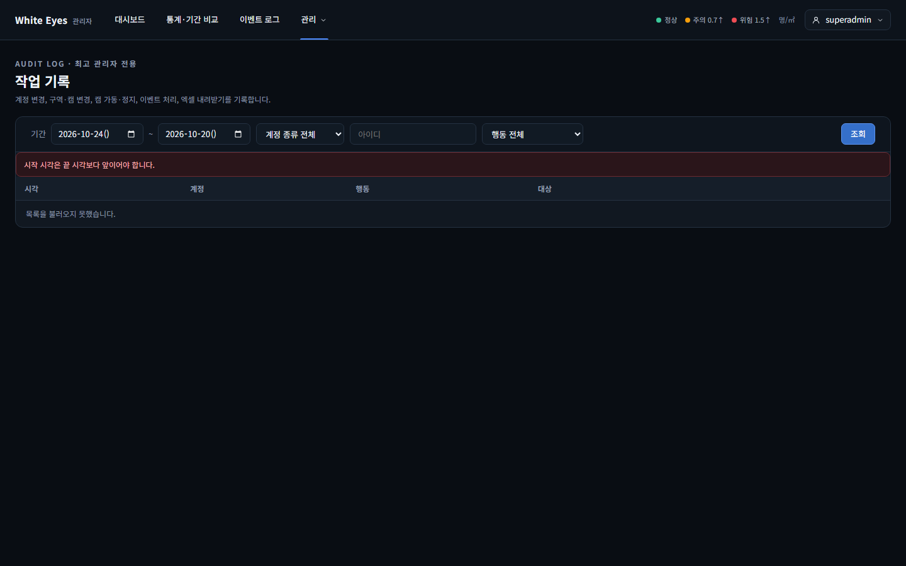

# 작업 기록(SCR-A-012) 확인 — 2026-10-24

spring #81(FNC-A-053 작업 기록 조회)을 실제 브라우저(Playwright Chromium, 1440×900)로 캡처했다. 시안은 `design/png/SCR-A-012-history.png`.

- 환경: WSL Ubuntu의 Docker MySQL 8.4에 관리자 앱(local 프로필)을 붙이고, 최고 관리자(`superadmin`)로 실제 로그인해 확인했다. 작업 기록 67건은 시험용 SQL로 넣었고 커밋하지 않았다(이름·아이디는 모두 가짜).
- 이 화면의 FNC-A-053 부분(필터 줄·작업 기록 표·상세 펼침·페이지)을 모두 만들었다.
- 01·02·04번은 아래쪽 페이지 표시까지 보이게 화면 전체를 찍었다(03·05번은 뷰포트 크기).

| 상태 | 시안 | 구현 |
|---|---|---|
| 기본 조회(최근 7일, 오늘 포함)와 첫 행 펼침(`detail` JSON) |  |  |
| 계정 종류 '사용자' + 행동 'EXCEL_DOWNLOAD' 필터, 첫 행 펼침 | - |  |
| 검색 결과 없음(없는 아이디) | - |  |
| 2쪽으로 이동(총 67건, 20건씩) | - |  |
| 시작일이 종료일보다 늦음(400, 표 위 문구) | - |  |

## 시안과 다른 점
**의도**
- 시각은 공통 형식 `yyyy-MM-dd HH:mm`(conventions.md '시각 형식'). 시안은 `MM-dd HH:mm:ss`.
- 기간 입력은 시작일·종료일 두 칸(이벤트 로그 화면과 같게). 시안은 날짜 한 칸.
- 대상 열은 `대상 종류 · 대상 이름`만 보인다. 시안의 `(START)`·`(승인)` 같은 괄호 값은 screens.md에 없어 만들지 않았고, 펼친 `detail`로 확인한다.
- 펼친 `detail`은 들여쓰기한 JSON이다(시안은 한 줄). 키 순서는 DB의 JSON 칼럼이 정한다.
- 한 페이지 분량만 있을 때는 페이지 번호를 숨긴다(이벤트 로그와 같게). 시안은 `1`을 보인다. 확인 필요.
- 시안의 헤더 '미확인 이벤트 배지'는 FNC-A-048의 몫이라 숨겨 둔 상태다.

**확인 필요**
- 날짜 입력 칸에 `2026-10-18()`처럼 괄호가 보인다. 헤드리스 Chromium에서 날짜 칸의 요일 표시 글꼴이 없어서로 보이고, 이벤트 로그의 날짜 칸도 같다고 추정한다(확인하지 않음).
- 시안 상태(7행)보다 행이 많아 한 쪽에 20행이 보인다(`size` 기본 20).

## 확인하지 못한 것
- 실제 기능(구역·캠·계정·이벤트·엑셀)이 쌓은 기록. 이벤트 처리(`EVENT_STATUS`)와 엑셀 다운로드(`EXCEL_DOWNLOAD`)를 남기는 기능은 아직 dev에 없어(#42, #28) 시험용 SQL 행으로 확인했다.
- 일반 관리자(ADMIN)가 `/admin/histories`를 열 때의 403 화면(시험 코드로만 확인).
