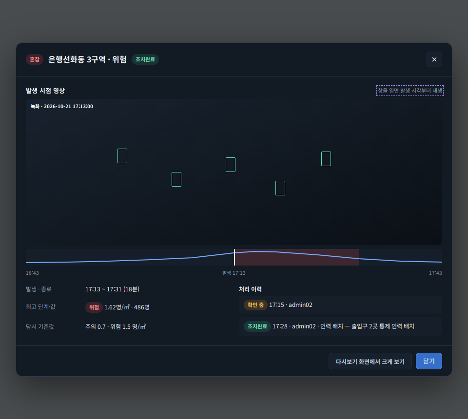
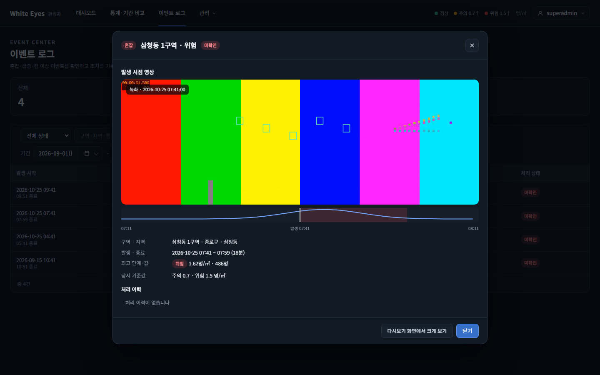
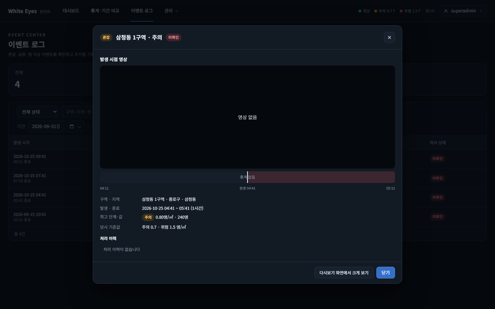
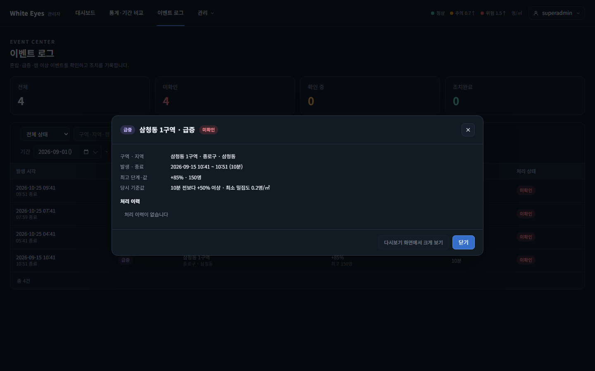
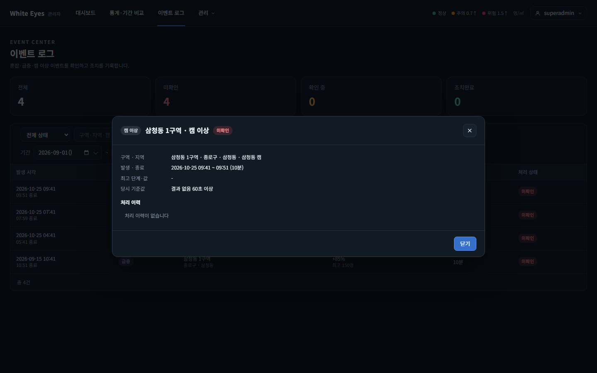

# 이벤트 상세 창 발생 시점 영상(SCR-A-011) 확인 — 2026-10-25

spring #76(FNC-A-040 이벤트에서 다시보기 이동)을 실제 브라우저(Playwright Chromium, 1440×900)로 캡처했다. 시안은 `design/png/SCR-A-011-event-detail.png`.

- 환경: WSL Ubuntu의 Docker MySQL 8.4에 관리자 앱(local 프로필)을 붙이고, 최고 관리자(`superadmin`)로 실제 로그인해 이벤트 로그에서 행을 눌러 확인했다. 구역·캠·녹화·1분 통계·이벤트 4건은 시험용 SQL로 넣었고 커밋하지 않았다(이름은 모두 가짜).
- 이 화면의 FNC-A-040 부분(발생 시점 영상·박스·발생 앞뒤 30분 인원 띠·다시보기 이동 링크)을 모두 만들었다.

| 상태 | 시안 | 구현 |
|---|---|---|
| 혼잡·위험: 창을 열면 발생 시각부터 재생, 박스, 인원 띠(이벤트 구간·발생선) |  |  |
| 혼잡·주의인데 그 시각의 녹화가 없음 → 영상 칸에 '영상 없음', 띠는 '통계 없음' | - |  |
| 급증, 40일 전(보관 기간 지남) → 영상 영역 없음, '다시보기 화면에서 크게 보기' 비활성 | - |  |
| 캠 이상 → 영상 영역·버튼 없음 | - |  |

## 시안과 다른 점
**의도**
- 영상에 재생 컨트롤(video controls)을 붙였다. 시안은 정적 그림이라 컨트롤이 없다. 사용자가 직접 멈추거나 이동할 수 있게 했다.
- 처리 이력은 시안 상태(조치완료 2건)와 달리 시험 데이터에 없어 '처리 이력이 없습니다'가 보인다(FNC-A-037, 조치는 #42).
- 캠 이상·30일 지난 이벤트는 영상 영역이 없다(이슈 #76 완료 기준). 영상 칸 안의 '영상 없음'·'보관 기간 지남'은 영역이 있는 이벤트에서 다시보기 API가 404를 줄 때만 보인다.

**확인 필요**
- 상세 창에 이어 재생(FNC-A-045)은 넣지 않았다(FNC-A-040 처리 순서에 없음). 녹화가 1분 단위 파일이라 영상은 파일 끝에서 멈춘다.

## 확인하지 못한 것
- 실제 nginx(X-Accel-Redirect)와 H.264 mp4의 전송·재생. nginx가 없어 영상·좌표 파일 요청 두 개만 Playwright 라우트로 대신 응답했고, 영상은 시험용 테스트 패턴(VP8 webm 1분)이다. 영상 속 색 막대·숫자는 테스트 패턴이고, 초록 박스 5개는 시험용 좌표 파일이다. 나머지 요청(녹화 찾기, 통계, 이벤트 상세)은 실제 앱·MySQL이다.
- 팀 서버(dev)에서의 실제 녹화로 본 확인.
