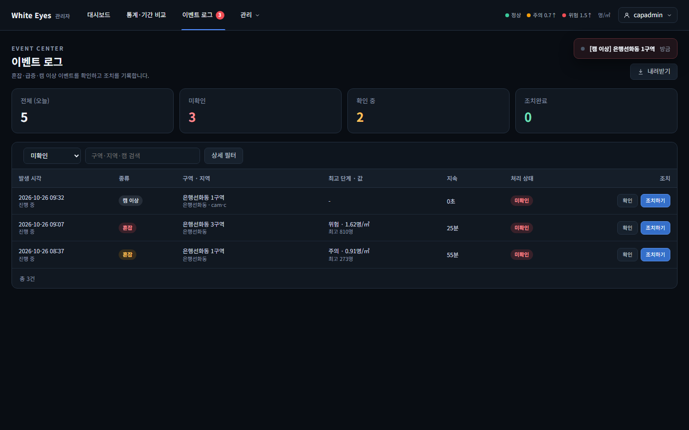
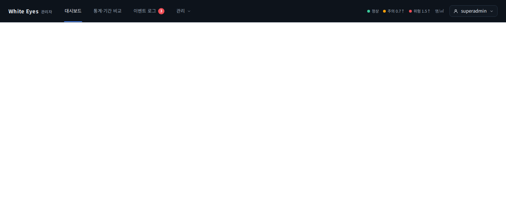
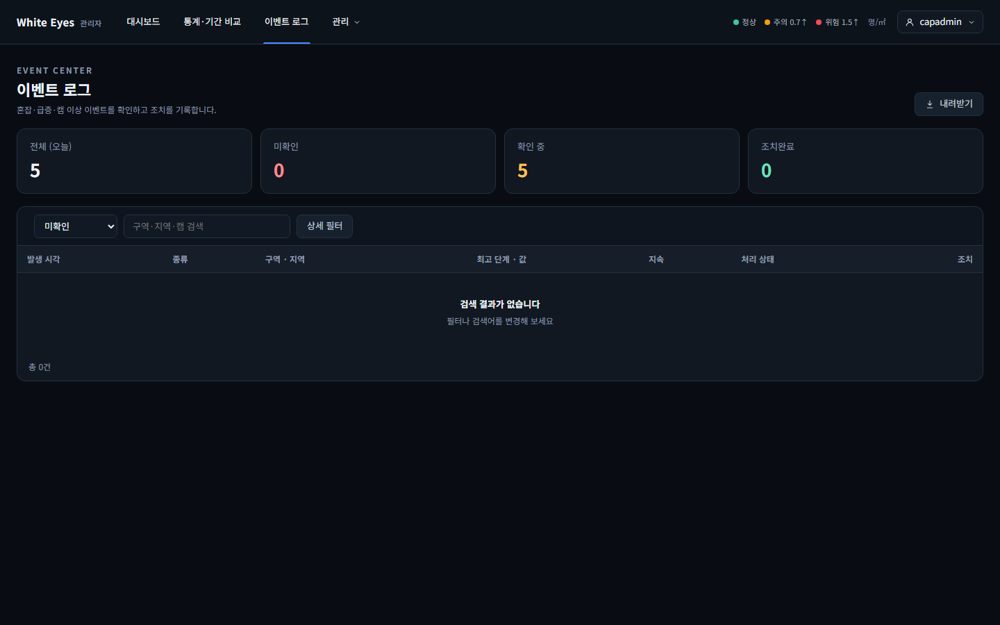
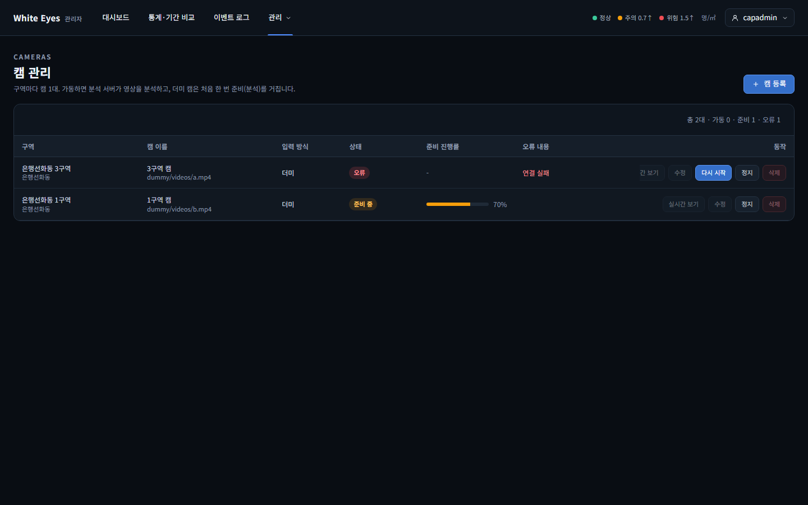
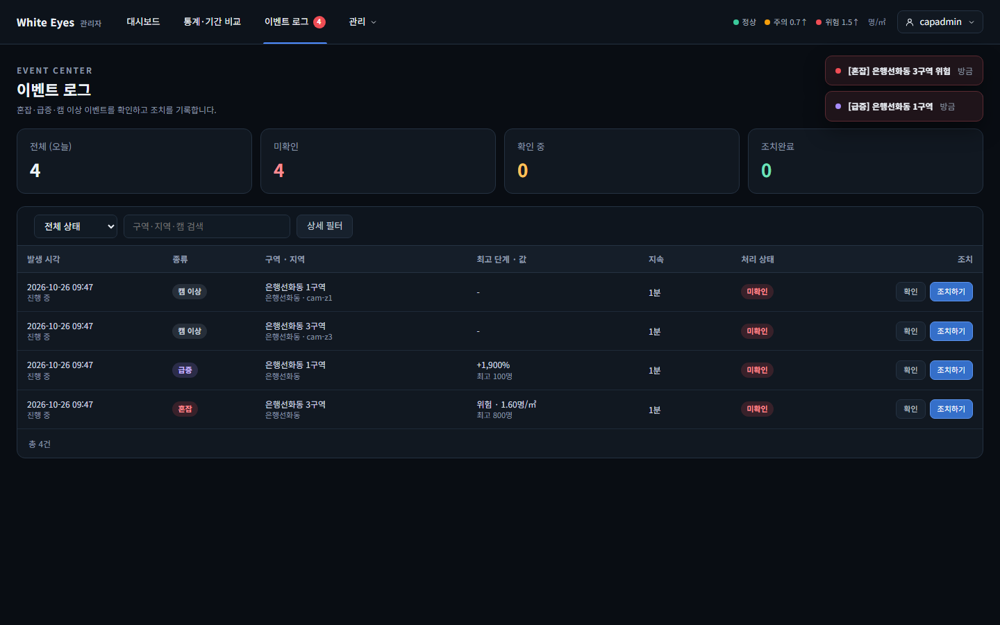
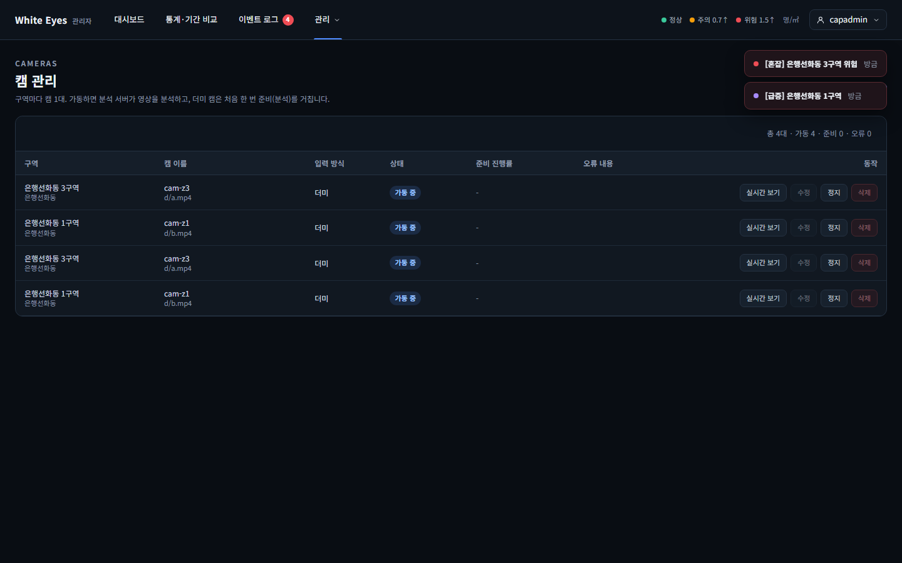

# 관리자 알림 스트림(FNC-A-048) 확인 — 2026-10-26

spring #46(FNC-A-048 관리자 알림 스트림)을 실제 브라우저(Playwright Chromium, 1440×900)로 캡처했다. 시안은 `design/png/SCR-A-010-events.png`(새 이벤트 토스트)와 `design/png/SCR-A-013-admin-header.png`(헤더 배지).

- 환경(04·05는 이어서 다시 띄운 같은 환경): WSL Ubuntu의 Docker MySQL 8.4에 관리자 앱(local 프로필)을 붙였다. 구역 2·이벤트 3건은 시험용 SQL로 넣었고 커밋하지 않았다. 새 이벤트는 오류 상태 캠을 넣어 캠 이상 감지(FNC-A-035)가 실제로 이벤트를 열게 했고, 캠 진행률은 내부 API(`PATCH /internal/v1/cameras/{id}/status`)로 보고했다. 캡처 환경은 확인 뒤 지웠다.
- 이 PC에서 Hibernate 스키마 검증이 `zone_stat_daily.is_demo`로 실패해 `ddl-auto`를 끄고 띄웠다(이번 변경과 무관, 이전 보고서와 같음).

| 상태 | 시안 | 구현 |
|---|---|---|
| 새 이벤트가 생기면 열려 있는 화면에 토스트, 헤더 배지 2→3, 이벤트 로그 맨 위에 새 행 |  |  |
| 미확인을 모두 '확인'하면 배지가 사라짐 |  |  |
| 캠 관리 화면에 준비 진행률이 새로 고침 없이 반영(70%) | - |  |
| 혼잡(위험)·급증 이벤트가 열리면 토스트 두 개가 쌓이고 배지 4. **이벤트 로그 화면**을 연 창 |  |  |
| 같은 순간 **캠 관리 화면**을 연 다른 브라우저 창(다른 로그인 세션)에도 같은 토스트와 배지 | - |  |

## 시안과 다른 점
**의도**
- 토스트 문구는 시안 `[혼잡] 은행선화동 3구역 위험` 모양을 따랐고, 캠 이상·급증은 단계가 없어 `[캠 이상] 구역 이름`처럼 종류와 구역만 보인다. 점 색은 혼잡 단계(주의·위험), 급증(보라), 캠 이상(회색).
- 토스트를 누르면 이벤트 로그의 상세 창이 열린다(`/events?eventId=`).
- 헤더의 '이벤트 로그' 탭은 눌렀을 때 미확인 목록(`?status=UNCHECKED`)으로 간다.
- 이 캡처의 이벤트 로그는 배지에서 들어온 미확인 필터라 시안의 전체 목록과 행 수가 다르다.

## 추가로 확인한 것 (04·05)
- 혼잡·급증 토스트: 분석 결과 입력 API(`POST /internal/v1/results`)로 구역 3(500㎡)에 800명, 구역 1(300㎡)에 100명(10분 전 5명)을 넣어 실제 혼잡 판정(밀집도 1.6, 위험)과 급증 판정(+1,900%)이 이벤트를 열게 했다. 토스트는 '[혼잡] 은행선화동 3구역 위험'(빨간 점), '[급증] 은행선화동 1구역'(보라 점)이다.
- 여러 창 동시 전달: 브라우저 창 2개(각각 로그인, 이벤트 로그와 캠 관리 화면)에서 두 토스트와 배지 4가 모두 떴다.
- 05의 캠 목록에 같은 캠이 두 줄씩 보이는 것은 캡처를 다시 돌리며 시험용 캠을 중복으로 넣었기 때문이다(기능과 무관).

## 확인하지 못한 것
- 다른 쪽(2쪽 이후)을 보는 중 새 이벤트가 오는 경우의 화면.
- 캠 진행률 화면은 시안이 없어 비교하지 않았다.
