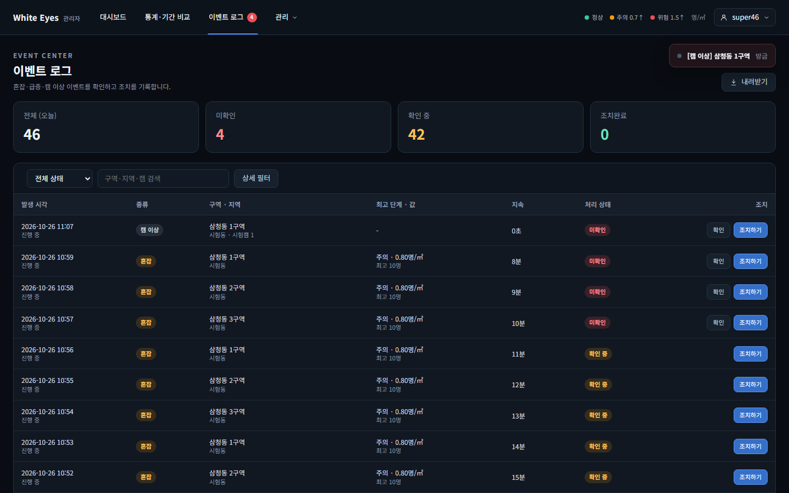
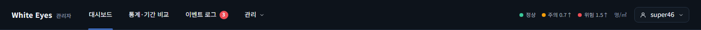
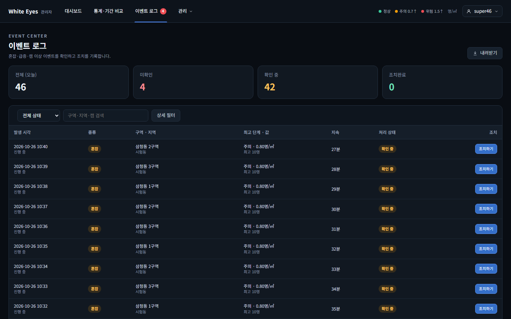
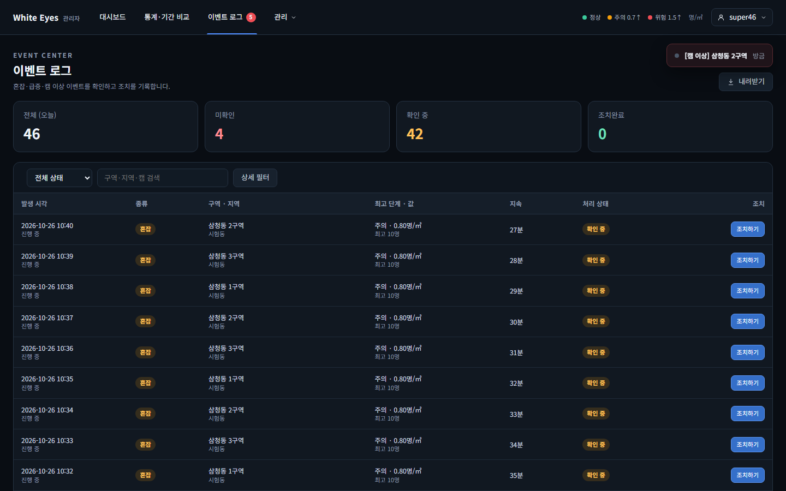
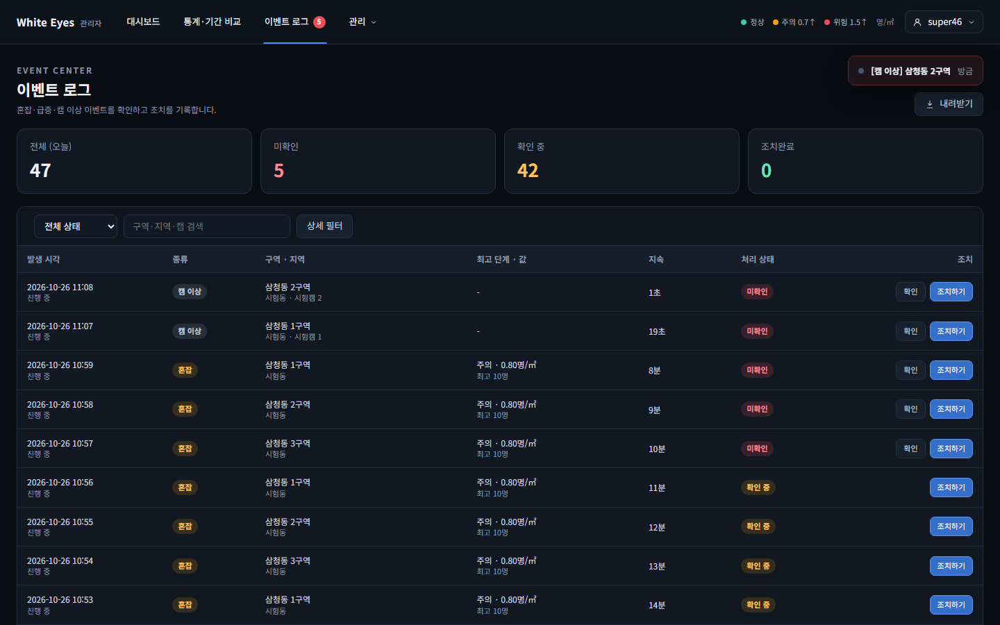

# 관리자 알림 스트림(FNC-A-048) 확인 — 2026-10-26

spring #46(FNC-A-048 관리자 알림 스트림)을 실제 브라우저(Playwright Chromium, 1440×900)로 캡처했다. 시안은 `design/png/SCR-A-010-events.png`(새 이벤트 토스트)와 `design/png/SCR-A-013-admin-header.png`(헤더 배지).

- 환경(04·05는 이어서 다시 띄운 같은 환경): WSL Ubuntu의 Docker MySQL 8.4에 관리자 앱(local 프로필)을 붙였다. 구역 2·이벤트 3건은 시험용 SQL로 넣었고 커밋하지 않았다. 새 이벤트는 오류 상태 캠을 넣어 캠 이상 감지(FNC-A-035)가 실제로 이벤트를 열게 했고, 캠 진행률은 내부 API(`PATCH /internal/v1/cameras/{id}/status`)로 보고했다. 캡처 환경은 확인 뒤 지웠다.
- 이 PC에서 Hibernate 스키마 검증이 `zone_stat_daily.is_demo`로 실패해 `ddl-auto`를 끄고 띄웠다(이번 변경과 무관, 이전 보고서와 같음).

| 상태 | 시안 | 구현 |
|---|---|---|
| 새 이벤트가 생기면 열려 있는 화면에 토스트, 헤더 배지 2→3, 이벤트 로그 맨 위에 새 행 |  |  |
| 미확인을 모두 '확인'하면 배지가 사라짐 |  |  |
| 캠 관리 화면에 준비 진행률이 새로 고침 없이 반영(70%) | - |  |
| 혼잡(위험)·급증 이벤트가 열리면 토스트 두 개가 쌓이고 배지 4. **이벤트 로그 화면**을 연 창 |  |  |
| 같은 순간 **캠 관리 화면**을 연 다른 브라우저 창(다른 로그인 세션)에도 같은 토스트와 배지 | - |  |

## 시안과 다른 점
**의도**
- 토스트 문구는 시안 `[혼잡] 은행선화동 3구역 위험` 모양을 따랐고, 캠 이상·급증은 단계가 없어 `[캠 이상] 구역 이름`처럼 종류와 구역만 보인다. 점 색은 혼잡 단계(주의·위험), 급증(보라), 캠 이상(회색).
- 토스트를 누르면 이벤트 로그의 상세 창이 열린다(`/events?eventId=`).
- 헤더의 '이벤트 로그' 탭은 필터 없이 `/events`로 가고, 미확인 필터(`?status=UNCHECKED`)는 배지를 눌렀을 때만 걸린다(screens.md SCR-A-013 '이동 대상 화면', 시안과 같음. 리뷰어 요청 2로 고침).
- 01·04의 이벤트 로그는 고치기 전 탭이 미확인 필터로 보내던 때의 목록이라 시안의 전체 목록과 행 수가 다르다. 지금은 탭이 전체 목록을 연다(06 참조).

## 추가로 확인한 것 (04·05)
- 혼잡·급증 토스트: 분석 결과 입력 API(`POST /internal/v1/results`)로 구역 3(500㎡)에 800명, 구역 1(300㎡)에 100명(10분 전 5명)을 넣어 실제 혼잡 판정(밀집도 1.6, 위험)과 급증 판정(+1,900%)이 이벤트를 열게 했다. 토스트는 '[혼잡] 은행선화동 3구역 위험'(빨간 점), '[급증] 은행선화동 1구역'(보라 점)이다.
- 여러 창 동시 전달: 브라우저 창 2개(각각 로그인, 이벤트 로그와 캠 관리 화면)에서 두 토스트와 배지 4가 모두 떴다.
- 05의 캠 목록에 같은 캠이 두 줄씩 보이는 것은 캡처를 다시 돌리며 시험용 캠을 중복으로 넣었기 때문이다(기능과 무관).

## 리뷰어 요청 반영 확인 (spring #46 PR #230, 2026-10-26)
같은 방법(Playwright Chromium 1440×900, WSL Docker의 새 MySQL 8.4 컨테이너에 관리자 앱 local 프로필, 시험 로그인 계정)으로 다시 확인했다. 구역 3·캠 3(구역마다 1대, 가동 요청 상태)·오늘 이벤트 45건(미확인 3)을 시험용 SQL로 넣었고 커밋하지 않았다. 새 이벤트는 캠 상태를 ERROR로 보고(`PATCH /internal/v1/cameras/{id}/status`)해 캠 이상 감지(FNC-A-035)가 실제로 열게 했다. 이벤트 로그는 한 쪽에 20건이라 3쪽이 된다. 확인 뒤 환경은 지웠다.

### 1. 새 이벤트 토스트 10초 (요청 1)
- 방법: 페이지에 `MutationObserver`를 달아 토스트 요소가 붙은 때와 떨어진 때의 `performance.now()` 차이를 쟀다. `notifications.js`는 `showLinkToast(…, 10000)`을 부른다(기본값 5초를 쓰지 않음).
- 결과: 토스트가 떠 있던 시간 **10,002ms**(처음 한 번은 10,014ms). 토스트가 뜬 지 9초가 지난 시점에도 화면에 남아 있었고(08), 10초 직후 사라졌다.

| 상태 | 구현 |
|---|---|
| 새 이벤트 알림 직후 토스트 `[캠 이상] 삼청동 1구역` |  |
| 같은 토스트가 9초가 지난 뒤에도 보임 |  |

### 2. 헤더 탭·배지 링크 (요청 2)
- 탭 `href`는 `/admin/events`, 배지 `href`는 `/admin/events?status=UNCHECKED`. 대시보드에서 탭을 누르면 주소에 필터가 없고(`/admin/events`), 배지를 누르면 `?status=UNCHECKED`가 붙는다.
- 탭 안에 배지 링크를 넣으면 링크 속 링크가 되어, 탭과 배지를 나란히 두고 배지를 탭 오른쪽 여백에 겹쳐 놓았다. 처음에는 탭 링크가 겹친 배지의 클릭을 가로채 배지를 눌러도 탭으로 갔고, 배지를 탭 위로 올려 고쳤다. 선택된 탭의 밑줄은 탭과 배지 아래로 이어진다(10).

| 상태 | 구현 |
|---|---|
| 헤더: 이벤트 로그 탭 옆 미확인 배지 3 |  |

### 3. 2쪽 이후를 보는 중 새 이벤트 (요청 4)
- 결과: 통과. 2쪽(`?page=1`)을 열어 둔 채 새 이벤트(캠 이상, 삼청동 2구역)를 열었다.
  - 보던 2쪽의 행 20건과 순서가 그대로이고, 아래 쪽 번호도 2쪽 그대로, 목록 맨 아래 `총 46건`도 그대로.
  - 토스트 `[캠 이상] 삼청동 2구역`이 뜨고, 헤더 배지는 4→5로 바뀌었다.
  - 1쪽 단추를 누르면 새 이벤트가 맨 위 행에 보이고 `총 47건`이 된다.

| 상태 | 구현 |
|---|---|
| 2쪽을 보는 중(알림 전, 배지 4) |  |
| 새 이벤트 알림 뒤: 2쪽 목록은 그대로, 토스트와 배지 5 |  |
| 1쪽으로 돌아가면 새 행이 맨 위, 총 47건 |  |

## 확인하지 못한 것
- 캠 진행률 화면은 시안이 없어 비교하지 않았다.
