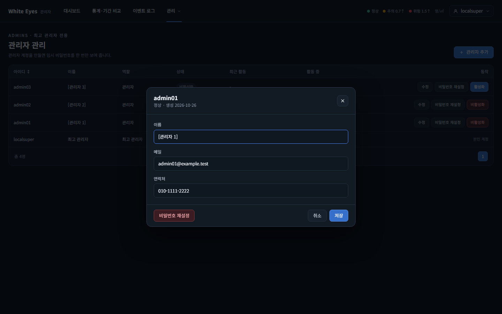
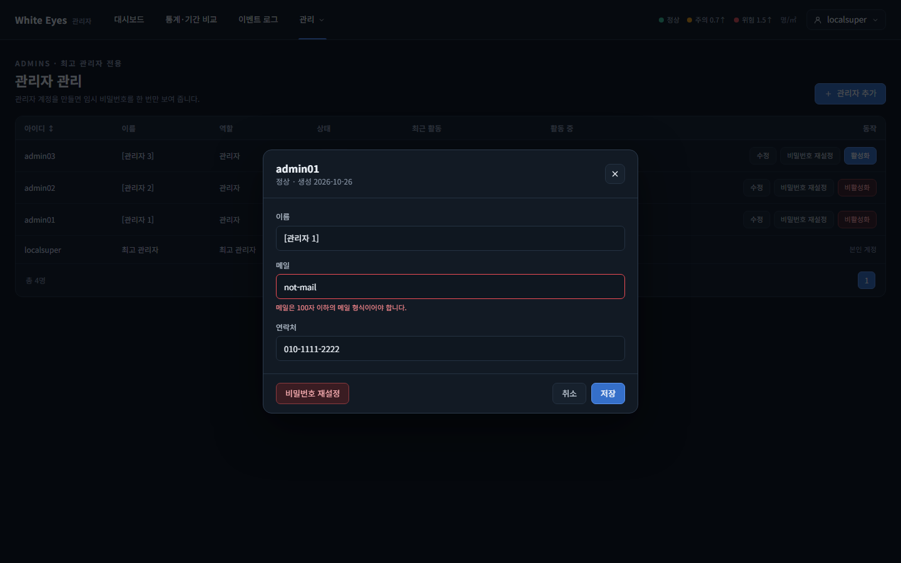
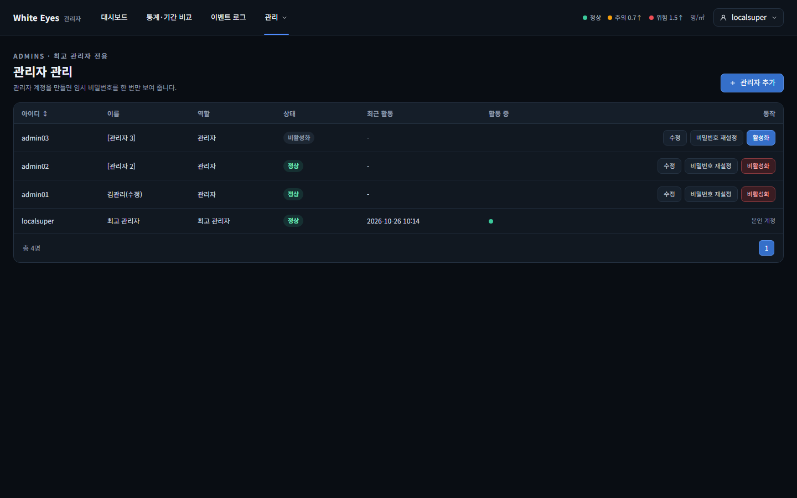
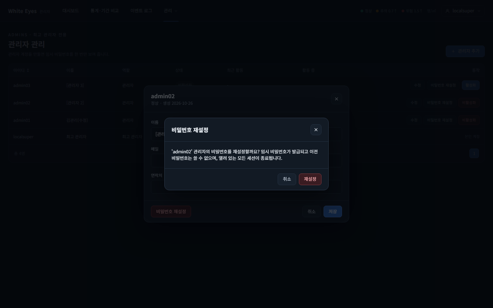
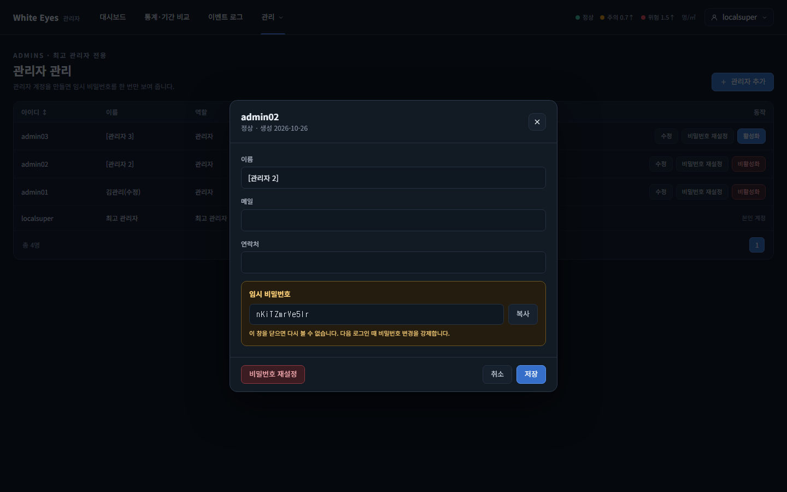

# 관리자 정보 수정·비밀번호 재설정 화면 확인 — 2026-10-26

spring #82(FNC-A-010 관리자 정보 수정·비밀번호 재설정)의 관리자 관리 화면(SCR-A-003)을 실제 브라우저(Playwright Chromium, 1440×900)로 조작하며 캡처했다. 시안은 `design/png/`.

- 환경: WSL Docker의 MySQL 8.4 + 관리자 앱(local 프로필, `feature/82-admin-update-reset`). 계정은 시험용 SQL과 실제 로그인으로 만들었다(아이디·이름·비밀번호 모두 가짜이고 커밋하지 않았다). 확인이 끝난 뒤 시험 데이터·컨테이너·볼륨·`.env`는 정리했다.
- `localsuper` 행은 앱이 처음 켜질 때 자동 등록되는 최고 관리자다(시안에 없음).
- 저장·재설정·세션 삭제·최고 관리자 대상 400·404·권한·작업 기록·롤백의 서버 동작은 이 캡처가 아니라 spring `AdminUpdateTest`·`AdminPasswordResetTest`(H2)로 확인했다.

## SCR-A-003 관리자 관리

| 화면 | 시안 | 구현 |
|---|---|---|
| 목록: 일반 관리자 행에 '수정'·'비밀번호 재설정'·상태 버튼, 최고 관리자 행(본인)에는 버튼 없음 |  |  |
| '수정' 창(admin01): 이름·메일·연락처가 행의 값으로 채워짐 |  |  |
| 메일 형식 오류: 칸 아래에 서버 메시지 | - |  |
| 이름·메일을 고쳐 저장하면 창이 닫히고 admin01 행의 이름이 바뀜 | - |  |
| 행의 '비밀번호 재설정'(admin02) → 확인 창 | - |  |
| 확인 뒤 임시 비밀번호와 복사 버튼, 닫으면 다시 볼 수 없다는 안내 | - |  |

## 확인한 것
- 일반 관리자 행에는 '수정'·'비밀번호 재설정' 버튼이 보이고, 최고 관리자 행에는 버튼이 없다.
- 두 버튼 모두 같은 수정 창을 연다. '비밀번호 재설정'은 확인 창을 거친다.
- 형식 오류는 칸 아래에 보이고, 저장 성공 시 목록이 새로 그려진다.
- '복사' 버튼을 누르면 클립보드 값이 화면의 임시 비밀번호(12자)와 같고, 창을 닫으면 임시 비밀번호 글자가 지워진다(Playwright에서 클립보드 권한을 허용해 읽어 비교, 캡처는 없음).

## 시안과 다른 점
- **의도**: 수정 창은 시안 `SCR-A-002-user-detail.png`(사용자 상세 창)와 같은 모양으로 만들었다. 관리자 수정 전용 시안이 없다.
- **의도**: 확인 창은 시안에 없다(명세는 '확인 창'만 요구).
- **기존 화면의 차이**(이 이슈가 바꾼 것 아님): 상태 글자가 시안은 '사용 중·비활성', 구현은 '정상·비활성화'.

## 확인하지 못한 것
- 임시 비밀번호로 실제 로그인하면 비밀번호 변경 화면으로 이동하는 것은 spring 테스트로 확인했다(캡처 없음).
- 로그인하지 않은 상태·일반 관리자의 403 화면은 캡처하지 않았다(spring 테스트로 확인).
