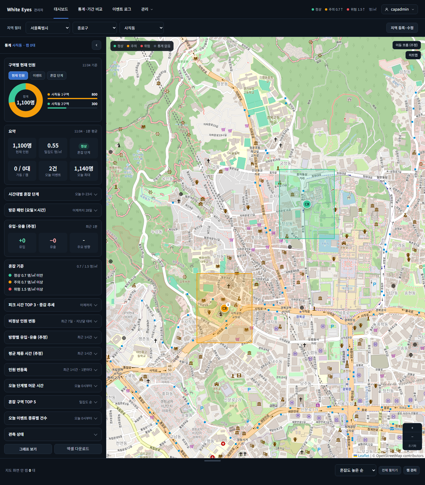
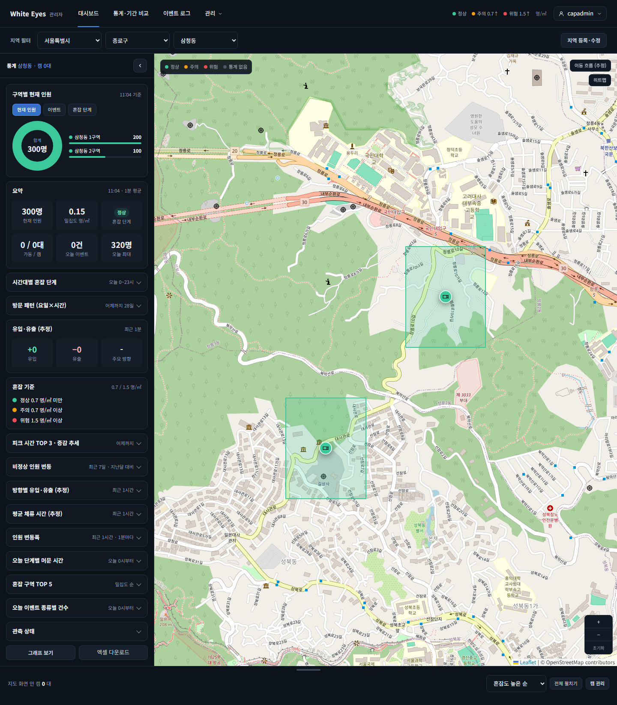
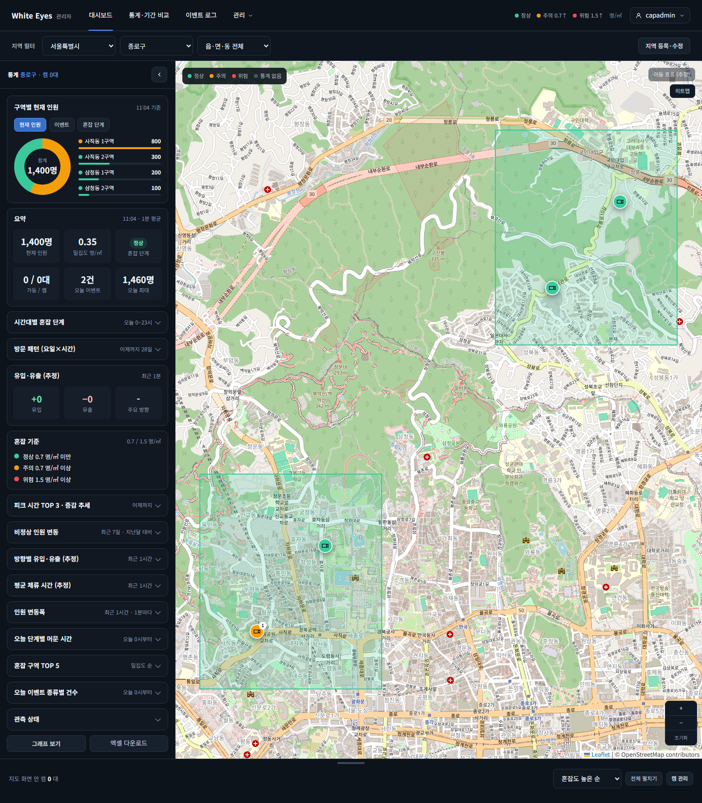
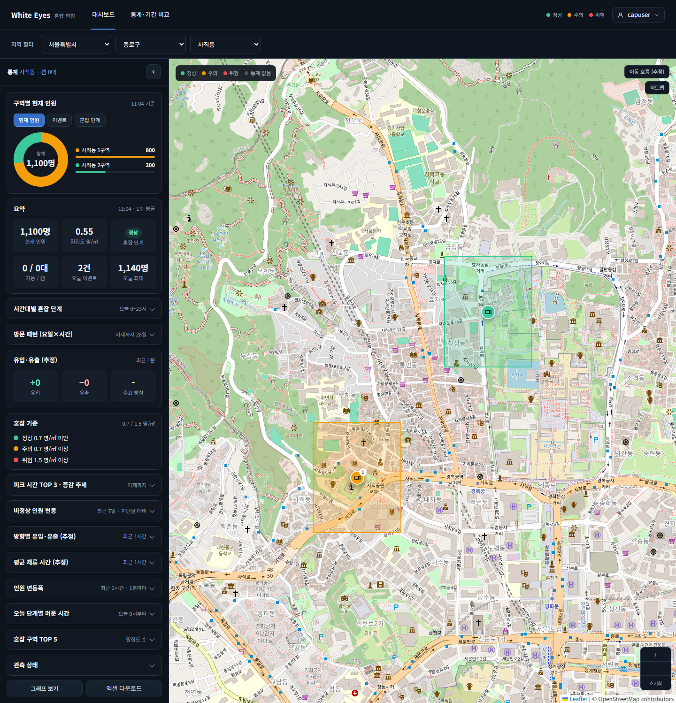

# 지도 핀 진행 중 이벤트 배지 화면 확인 — 2026-10-26

spring #211(지도 핀 진행 중 이벤트 배지, FNC-C-009 처리 순서 5)의 SCR-C-003 통계 메인 지도를 실제 브라우저(Playwright Chromium, 가로 1440)로 캡처했다. 시안은 `design/png/`.

- 환경: WSL Docker의 MySQL 8.4에 관리자 앱(local 프로필)과 사용자 앱을 띄웠다. 구역·이벤트·1분 통계는 시험용 SQL 가짜 데이터다. 확인 뒤 컨테이너와 볼륨을 지웠다. 비밀번호·토큰은 캡처에 나오지 않는다(화면의 `capadmin`은 시험용 가짜 아이디).
- 브랜치: spring `feature/211-map-ongoing-event`.
- 캡처는 페이지 전체(가로 1440, 세로는 화면 길이만큼)다. 지도 칸이 세로로 길어 세로 900에서는 핀이 잘려 전체 페이지로 찍었다.
- 시험 데이터(종로구): 사직동 1구역 = 열린 혼잡 이벤트, 사직동 2구역 = 종료된 혼잡 이벤트(조치완료), 삼청동 1구역 = 열린 캠 이상, 삼청동 2구역 = 이벤트 없음.

| 화면·상태 | 시안 | 구현 |
|---|---|---|
| 관리자 앱, 사직동: 열린 혼잡 이벤트가 있는 사직동 1구역 핀(주황)에 배지 `1`, 종료된 이벤트만 있는 2구역 핀(초록)에는 없음 | [시안](../../design/png/SCR-C-003-dashboard.png)(핀 배지 없음) |  |
| 관리자 앱, 삼청동: 열린 캠 이상(1구역)과 이벤트 없음(2구역) 모두 배지 없음 | [시안](../../design/png/SCR-C-003-dashboard.png) |  |
| 관리자 앱, 종로구: 구역 핀 4개 중 사직동 1구역만 배지 | [시안](../../design/png/SCR-C-003-dashboard.png) |  |
| 사용자 앱, 사직동: 관리자 앱과 같은 핀·배지 | [시안](../../design/png/SCR-C-003-dashboard.png) |  |

## 확인한 것
- `GET /api/v1/map/status`의 `ongoingEvent`가 핀 배지로 나온다. 열린 혼잡·급증이 있는 구역만 배지가 붙고, 종료된 이벤트·캠 이상·이벤트 없는 구역은 붙지 않는다.
- 화면에서 핀의 `<b>` 배지 요소 유무를 읽어 확인했다: 사직동 [배지 있음, 없음], 삼청동 [없음, 없음], 종로구 [있음, 없음, 없음, 없음]. 사용자 앱 사직동도 [있음, 없음].
- 사용자 앱(로그인한 시험 계정)에서 API 값도 확인했다(같은 시험 데이터로 먼저 한 번 찍었을 때): 사직동 구역 [true, false], 삼청동 구역 [false, false], 종로구의 하위 지역 [사직동 true, 삼청동 false], 서울의 하위 지역 [종로구 true].

## 시안과 다른 점
- 의도: 시안은 핀 배지가 없는 상태다. 구현은 진행 중 이벤트가 있는 구역에만 배지를 붙인다.
- 의도: 지도 타일·구역 모양·캠 수는 시험 데이터와 실제 OSM 타일이라 시안과 다르다.
- 확인 필요: 명세(screens.md SCR-C-003 구역 핀)는 '숫자 배지'인데 API는 true/false이고 화면은 항상 `1`을 보인다. 이번 이슈에서는 화면을 바꾸지 않았다.

## 확인하지 못한 것
- 급증 이벤트 핀 배지 화면: 시험 데이터를 혼잡 이벤트만 넣어 캡처하지 않았다. 급증은 자동 시험(`MapStatusIntegrationTest`)으로 확인했다.
