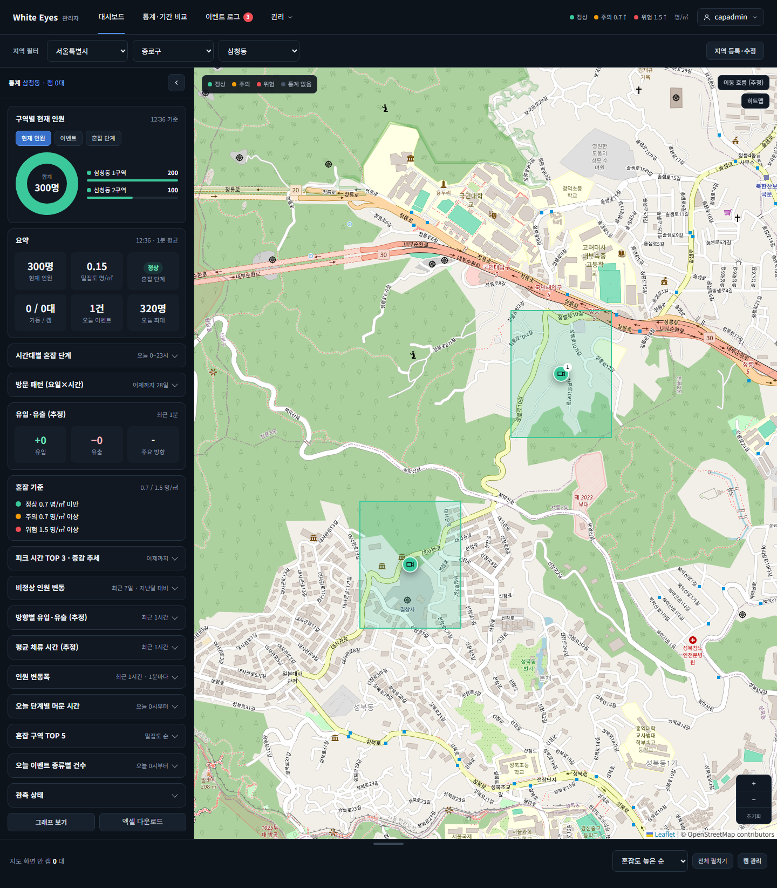

# 지도 핀 진행 중 이벤트 배지 화면 확인 — 2026-10-26

spring #211(지도 핀 진행 중 이벤트 배지, FNC-C-009 처리 순서 5)의 SCR-C-003 통계 메인 지도를 실제 브라우저(Playwright Chromium, 가로 1440)로 캡처했다. 배지 숫자는 같은 항목의 `todayEventCount`(오늘 혼잡·급증 이벤트 수)이고, 진행 중 이벤트(`ongoingEvent`)가 있을 때만 붙는다(리뷰어 요청 반영). 시안은 `design/png/`.

- 환경: WSL Docker의 MySQL 8.4에 관리자 앱(local 프로필)과 사용자 앱을 띄웠다. 구역·이벤트·1분 통계는 시험용 SQL 가짜 데이터다. 확인 뒤 컨테이너와 볼륨을 지웠다. 비밀번호·토큰은 캡처에 나오지 않는다(화면의 `capadmin`은 시험용 가짜 아이디).
- 브랜치: spring `feature/211-map-ongoing-event`(dev 병합 뒤).
- 캡처는 페이지 전체(가로 1440, 세로는 화면 길이만큼)다. 지도 칸이 세로로 길어 세로 900에서는 핀이 잘려 전체 페이지로 찍었다.
- 시험 데이터(종로구, 오늘 시작한 이벤트): 사직동 1구역 = 혼잡 3건(종료 2건 + 열림 1건), 사직동 2구역 = 종료된 혼잡 2건, 삼청동 1구역 = 열린 캠 이상, 삼청동 2구역 = 열린 혼잡 1건.

| 화면·상태 | 시안 | 구현 |
|---|---|---|
| 관리자 앱, 사직동: 열린 혼잡이 있는 사직동 1구역 핀(주황)에 배지 `3`(오늘 이벤트 3건), 종료된 이벤트만 있는 2구역 핀(초록)에는 없음 | [시안](../../design/png/SCR-C-003-dashboard.png)(핀 배지 없음) |  |
| 관리자 앱, 삼청동: 열린 캠 이상(1구역)은 배지 없음, 열린 혼잡 1건(2구역)은 배지 `1` | [시안](../../design/png/SCR-C-003-dashboard.png) |  |
| 관리자 앱, 종로구: 구역 핀 4개 중 사직동 1구역 `3`, 삼청동 2구역 `1`만 배지 | [시안](../../design/png/SCR-C-003-dashboard.png) |  |
| 사용자 앱, 사직동: 관리자 앱과 같은 핀·배지 `3` | [시안](../../design/png/SCR-C-003-dashboard.png) |  |

## 확인한 것
- 핀 배지 숫자가 `todayEventCount`로 나온다. 화면에서 핀의 `<b>` 배지 글자를 읽어 확인했다: 사직동 [3, 없음], 삼청동 [없음, 1], 종로구 [3, 없음, 없음, 1]. 사용자 앱 사직동도 [3, 없음].
- 종료된 이벤트만 있는 구역은 오늘 이벤트 수가 2여도 배지가 없다(진행 중일 때만 붙는다). 캠 이상은 이벤트 수에 세지 않아 배지가 없다.
- 사용자 앱(로그인한 시험 계정)에서 API 값도 확인했다: 사직동 구역 [(진행 중, 3), (아님, 2)], 삼청동 구역 [(아님, 0), (진행 중, 1)], 종로구 구역 4개 [(진행 중, 3), (아님, 2), (아님, 0), (진행 중, 1)].
- 오늘 이벤트 수가 0이면 숫자 없는 배지가 나온다(리뷰어 추가 요청). `todayEventCount`는 오늘 0시 이후 시작한 이벤트만 세고 `ongoingEvent`는 시작 날짜와 상관없이 `ended_at`이 비어 있으면 true라서, 어제 시작해 자정을 넘겨 열려 있는 이벤트만 있는 구역은 `ongoingEvent: true`, `todayEventCount: 0`이 된다. 이때 `status-map.js`는 `todayEventCount > 0`일 때만 `<b>` 배지에 글자를 넣고, 0이면 글자 없이 같은 `<b>`(위치·색·크기 그대로, 흰 동그라미)만 그린다. 이 경우의 API 값은 `MapStatusIntegrationTest.ongoingEvent_openSinceYesterday_trueWithZeroTodayCount`로 확인했다(`./gradlew build` 전체 1471건 통과, 실패 0). 위 시험 데이터는 모두 오늘 시작한 이벤트라 이 상태의 캡처는 없다.
- 급증 이벤트 핀 배지는 캡처하지 않았다. 화면 코드가 이벤트 종류를 구분하지 않아 자동 시험(`MapStatusIntegrationTest`)으로 확인했다.

## 시안과 다른 점
- 의도: 시안은 핀 배지가 없는 상태다. 구현은 진행 중 이벤트가 있는 구역에만 오늘 이벤트 수 숫자 배지를 붙인다(screens.md SCR-C-003 구역 핀 '진행 중 이벤트가 있으면 숫자 배지'와 같다).
- 의도: 어제 시작해 계속 열린 이벤트만 있는 구역은 숫자 없는 배지만 보인다(숫자 0을 보이지 않음). 시안에는 배지 자체가 없다.
- 의도: 지도 타일·구역 모양·캠 수는 시험 데이터와 실제 OSM 타일이라 시안과 다르다.
