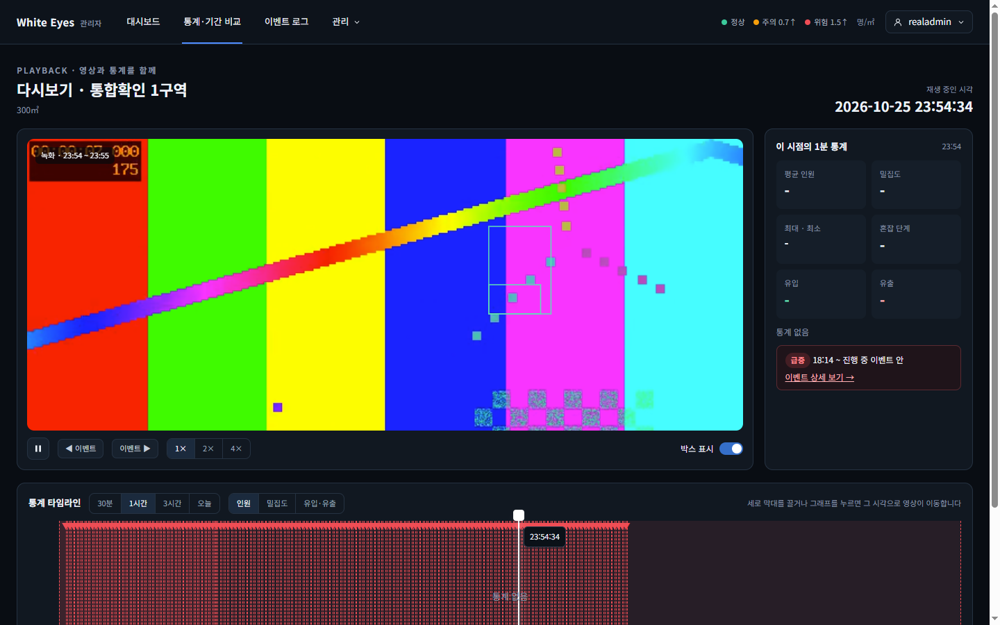

# 다시보기 시간축 이벤트(150건 + 범위 앞에서 시작한 이벤트) 확인 — 2026-10-26

spring #198(다시보기 시간축 이벤트 조회 한도·범위 앞에 시작한 이벤트, SCR-A-009 / FNC-A-036·047)을 **실제 `/admin` 환경**으로 확인했다. 이 PR은 명세 수정(이벤트 목록 `overlap` 조건)과 이 확인 보고서를 함께 담는다.

- 환경: WSL Docker의 MySQL 8.0, spring 이 브랜치의 관리자 앱 jar(`context-path /admin`, `ddl-auto: validate` 그대로), nginx(80), Windows의 Chrome(헤드리스, 1440×900). 시험 데이터: 구역 1개, 캠 1대, 녹화 1건, 이벤트 152건(구역 1개의 혼잡 150건, 15초 간격으로 8초씩 이어짐 / 창이 시작되기 3시간 전에 시작해 창 안에서 끝난 혼잡 1건 / 6시간 전에 시작해 아직 진행 중인 급증 1건). 영상·통계는 시험용이다.

| 화면 | 캡처 |
|---|---|
| SCR-A-009 다시보기 시간축: 이벤트 구간(붉은 영역)과 시작 표시(▼). 오른쪽 패널에 6시간 전에 시작한 진행 중 급증 이벤트('급증 18:14 ~ 진행 중')가 잡힌다 |  |

## 확인한 것
- 시간축이 이벤트를 **100건씩 끝까지 이어서** 읽는다: 요청이 `page=0&size=100`, `page=1&size=100` 두 번 나갔고(둘 다 `overlap=true`) 구간 152개를 모두 그렸다. 이전에는 `size=100` 한 번만 읽어 100건에서 끊겼다.
- **범위 앞에서 시작한 이벤트가 보인다**: 구간 152개 중 시작 표시(▼)는 150개다. 나머지 2개(범위 앞에서 시작해 범위 안에서 끝난 혼잡, 진행 중인 급증)는 범위 안의 부분만 구간으로 그려지고 ▼는 없다(범위 안에서 시작한 것만 ▼).
- **이전·다음 이벤트 버튼은 시간축 안(▼가 있는) 이벤트로만 간다**(리뷰 반영, FNC-A-047): 첫 이벤트(00:05:40)보다 앞(00:05:20)을 열면 이 앞에는 범위 앞에서 시작한 긴 이벤트 2건뿐이라 [◀ 이벤트]는 꺼져 있고 [이벤트 ▶]는 켜져 있다. [이벤트 ▶]를 누르면 첫 이벤트 시작 시각(`at=…00:05:40`)으로 이동한다. 이전에는 [◀ 이벤트]가 6시간 전에 시작한 급증 이벤트로 가서 시간축 밖으로 나갔다.
- **쪽 읽기 실패**(리뷰 반영): 3시간 범위(이벤트 152건)에서 `page=1` 요청만 500으로 만들면 받은 100건은 그대로 그려지고 '일부 이벤트를 불러오지 못했습니다.' 안내가 뜬다(이전에는 받은 것까지 버려 '이벤트 없음'처럼 보였다).
- **범위를 빠르게 바꿀 때**(리뷰 반영): 30분→1시간 순으로 연달아 누르면 이벤트 요청은 `page=0` 2번(두 범위), `page=1` 1번(마지막 범위만)이다. 앞 범위의 낡은 요청은 `page=0`만 받고 멈춘다.
- 서버 시험(`EventListTest`): `overlap=true`는 기간 앞에서 시작해 이어진 이벤트(종료가 from 뒤이거나 진행 중)와 기간 안 이벤트만 주고, 기간 앞에서 끝난 것·끝이 정확히 from인 것·to에 시작한 것은 뺀다. 기본(overlap 없음)은 기존대로 발생 시각 기준이다. 요약(`/summary`)도 같은 조건이고, 잘못된 값은 400이다.
- 참고: 이 확인에서 관리자 앱은 `ddl-auto` 우회 없이 실제 MySQL에서 정상 기동했다(`is_demo` 형식 문제는 팀이 #168에서 고침).

## 확인하지 못한 것
- 20쪽(2000건) 상한에 걸리는 경우. 상한은 반복이 끝없이 돌지 않게 둔 안전장치이고, 한 구역의 한 시간축 범위에서 거기까지 가지는 않을 것으로 본다(걸리면 뒤쪽이 빠진다).
- 이벤트 목록 화면(SCR-A-010)에서 `overlap`을 쓰는 것(이 PR은 시간축만 쓴다. 이벤트 목록 화면은 기존 발생 시각 기준 그대로).
- 사용자 앱: 이벤트 API는 관리자 앱 전용이다.
