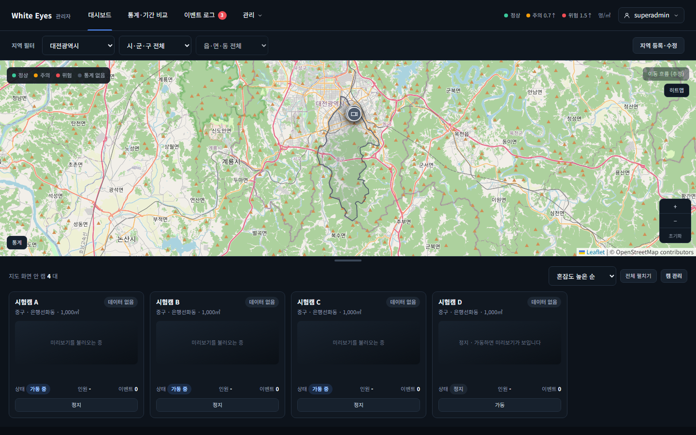
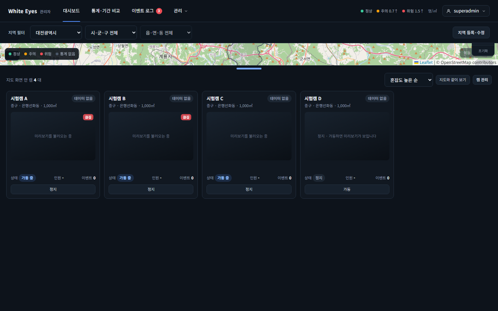
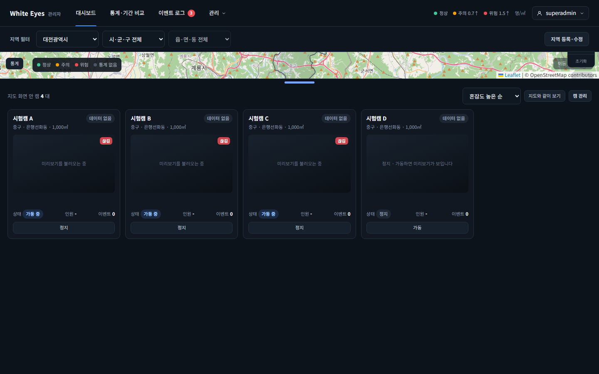
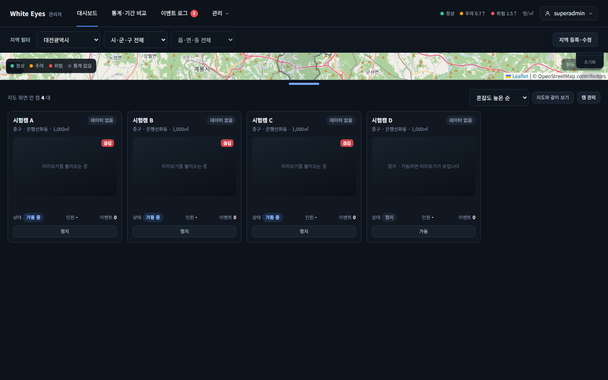
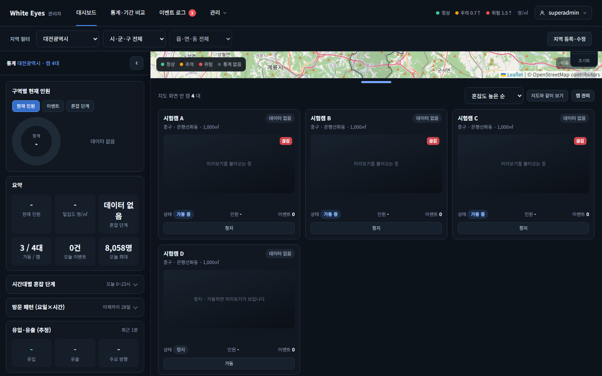
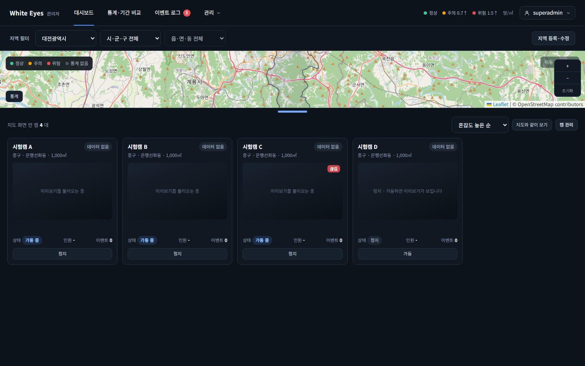
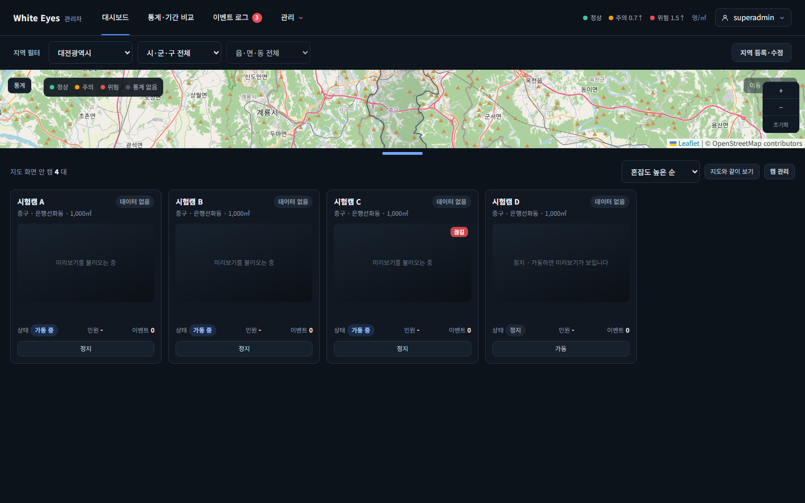

# 통계 버튼이 범례에 가려 눌리지 않는 문제 화면 확인 — 2026-10-27

spring #258(통계 패널을 접고 캠 패널을 펼치면 `통계` 버튼이 지도 범례에 가려 눌리지 않음, FNC-C-016)의 SCR-C-003 통계 메인을 실제 브라우저(Playwright Chromium, 1440×900)로 캡처했다. 명세(screens.md SCR-C-003 통계 패널 머리)는 패널을 접으면 왼쪽 끝에 `통계` 버튼만 남는다고 적었다. 시안은 `design/png/SCR-C-003-dashboard.png`이다.

- 환경: WSL Docker(MySQL 8.4)에 spring `feature/258-panel-open-legend-overlap` 브랜치로 빌드한 관리자 앱을 띄우고 로그인한 `/admin/stats`다. 수정 전은 같은 앱에 dev의 `stats-main.css`만 덧씌워 찍었다. 비밀번호·토큰은 캡처에 나오지 않는다.
- 시안에는 '캠 패널을 펼쳐 지도가 64px로 얇아진' 상태가 없어 시안과 나란히 둘 수 없다. 같은 절차의 수정 전·후를 비교한다.

| 상태 | 수정 전 | 수정 후 |
|---|---|---|
| 통계 패널을 접음(지도 충분히 높음) |  | (수정 전과 같음: 버튼 왼쪽 아래) |
| 캠 패널 `전체 펼치기`(지도 64px): 버튼 자리의 맨 위 요소 | 범례 글자(SPAN), 버튼이 가려짐  | 버튼이 왼쪽 위로 올라오고 범례는 오른쪽  |
| `통계` 버튼을 마우스로 클릭 | 통계 패널이 열리지 않음  | 통계 패널이 다시 열림  |
| 손잡이를 끌어 지도 140px | 버튼 왼쪽 아래, 눌림  | 버튼 왼쪽 위, 눌림  |

## 확인한 것
- 1280×720·1440×900·1920×1080 모두 수정 전에는 버튼 자리의 맨 위 요소가 범례 SPAN이고 클릭해도 패널이 열리지 않았다. 수정 후에는 모두 `panel-open`이고 클릭하면 열렸다.
- 접기만 한 상태는 수정 전후 모두 눌린다.
- 지도 140px·250px(손잡이 끌기, 1440×900)는 수정 전후 모두 눌린다. 수정 후에는 펼친 모양이면 버튼이 왼쪽 위(14, 139)에 놓이고 범례는 left 78px이다.

## 시안과 다른 점
- 의도: 펼친 모양(`.dash.expanded`)에서만 버튼을 왼쪽 위로 옮기고 범례를 오른쪽으로 민다. 시안에 이 상태가 없어 명세 문구(접으면 왼쪽 끝에 `통계` 버튼)와 어긋나지 않는 범위에서 정했다.
- 의도: 지도 타일·캠 수는 시험 데이터와 실제 OSM 타일이라 시안과 다르다.

## 확인하지 못한 것
- 버그 리포터가 직접 보는 확인은 별도다.
