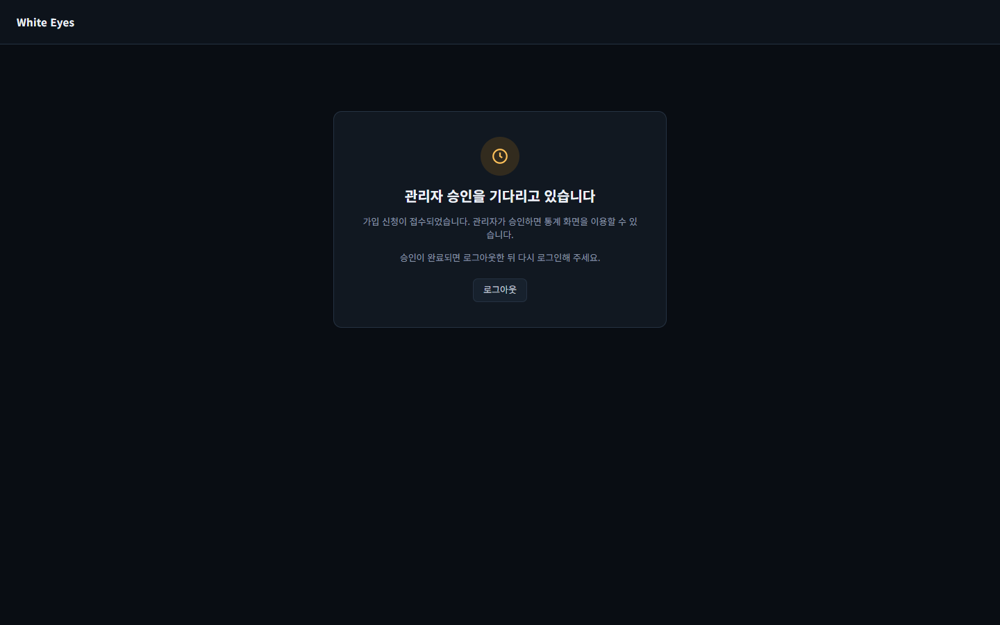

# 승인 대기 화면 다시 로그인 안내 화면 확인 — 2026-10-27

spring #249(승인된 뒤에도 승인 대기 세션이 `/pending`에 남고 안내가 없음, FNC-U-003)의 SCR-U-002 승인 대기 화면을 실제 브라우저(Playwright Chromium, 1440×900)로 캡처했다. 시안은 `design/png/`.

- 환경: 사용자 앱을 시험용 H2 메모리 DB로 띄우고 시험 계정(`hong01`, 가짜 값)을 가입한 뒤 로그인해 `/pending`을 캡처했다. 확인 뒤 앱을 종료했다. 비밀번호·토큰은 캡처에 나오지 않는다.
- 브랜치: spring `feature/249-pending-relogin-notice`.

| 화면·상태 | 시안 | 구현 |
|---|---|---|
| SCR-U-002 승인 대기: 안내 문구 아래에 '승인이 완료되면 로그아웃한 뒤 다시 로그인해 주세요.' | [시안](../../design/png/SCR-U-002-pending.png) |  |

## 확인한 것
- 승인 대기 계정으로 로그인하면 `/pending`이 열리고, '관리자 승인을 기다리고 있습니다' 아래 설명 문단 뒤에 '승인이 완료되면 로그아웃한 뒤 다시 로그인해 주세요.'가 한 줄 보인다(screens.md SCR-U-002 '승인 안내').
- 로그아웃 버튼은 그대로 있다.
- 자동 이동(승인 알림·세션 갱신)은 이슈 결정대로 범위 밖이라 만들지 않았다.

## 시안과 다른 점
- 의도: 시안(`SCR-U-002-pending.html`)에는 다시 로그인 안내 문구가 없다. screens.md(docs PR #93)가 문구를 정했고 명세가 시안보다 우선한다.
- 의도: 시안의 제목은 '승인을 기다리고 있습니다'이고 구현은 명세·FNC-U-003대로 '관리자 승인을 기다리고 있습니다'다(기존 구현, 이번 변경 아님).
- 확인 필요: 시안 파일에 새 안내 문구를 반영할지는 사용자가 정한다.
