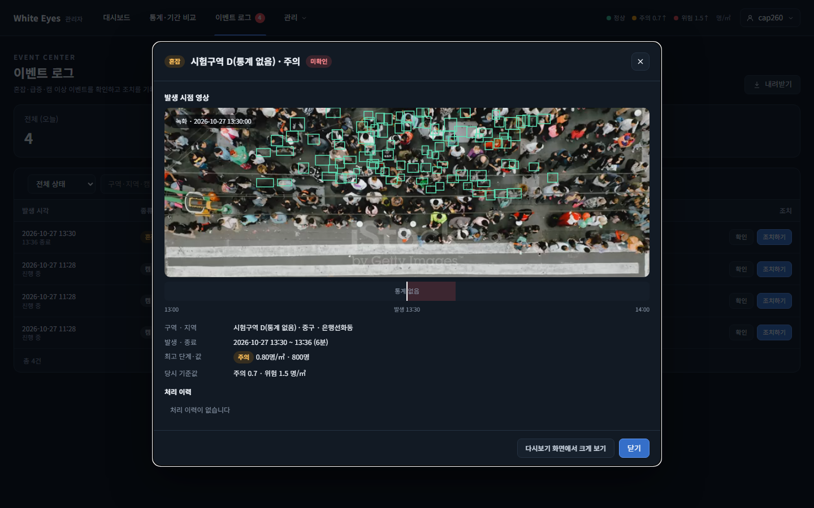
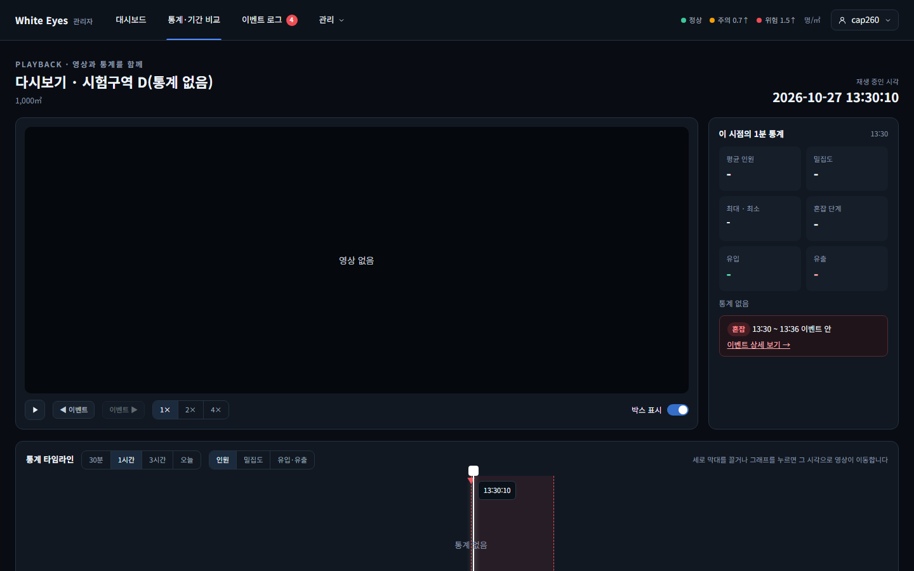
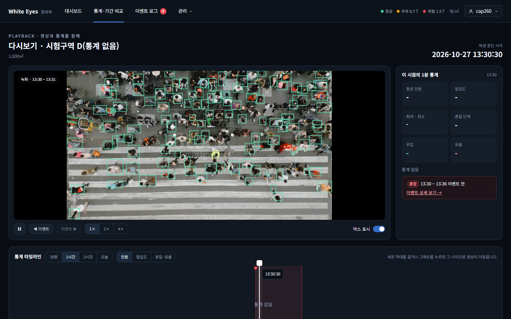

# 가동 첫 1분 이벤트의 발생 시점 영상 화면 확인 — 2026-10-27

spring #260(캠 가동 첫 1분 안에 생긴 이벤트의 '발생 시점 영상'이 '영상 없음'으로 나옴, FNC-A-043·040·047)의 SCR-A-011 이벤트 상세 창과 SCR-A-009 다시보기를 실제 브라우저(Playwright Chromium, 가로 1440)로 캡처했다. 명세는 상세 창이 FNC-A-043(zoneId, at=startedAt)으로 영상을 찾아 재생하고(SCR-A-011), `◀ 이벤트`가 이벤트 시작 시각의 영상을 보여 주는 것이다(SCR-A-009). 시안은 `design/png/`.

- 환경: WSL Docker(MySQL 8.4, 관리자 앱 컨테이너를 수정한 브랜치로 다시 빌드). 이슈의 자연 재현(구역을 79㎡로 줄여 가동 직후 이벤트 일으키기) 대신 **같은 상태를 DB에 직접 넣어** 확인했다: 구역 D의 녹화 1개(시작 13:30:27, 영상·좌표 파일은 더미), 혼잡 이벤트 1개(시작 13:30:00, 분 단위 내림). 확인 뒤 넣은 행과 시험용 관리자 계정(`cap260`)을 지웠다. 비밀번호·토큰은 캡처에 나오지 않는다.
- 브랜치: spring `feature/260-playback-first-minute`(dev `2c8e811` 기준). 같은 상태에서 수정 전 동작은 `PlaybackFindTest` 새 시험이 구현 전에 실패한 것으로 확인했다(404 `RECORDING_NOT_FOUND`). 수정 전 앱 캡처는 없다.
- 캡처는 페이지 전체(가로 1440)다.

| 화면·상태 | 시안 | 구현 |
|---|---|---|
| SCR-A-011: 이벤트(13:30:00 시작) 상세 창을 열면 발생 시점 영상이 녹화 첫 장면(13:30:27)부터 박스와 함께 재생 | [시안](../../design/png/SCR-A-011-event-detail.png) |  |
| SCR-A-009: `/admin/playback?zoneId=4&at=13:30:00`을 열면 영상이 나온다(재생 시각 13:30:27) | [시안](../../design/png/SCR-A-009-playback.png) |  |
| SCR-A-009: 분 중간 시각(13:30:10, 녹화 시작 전)은 예전처럼 '영상 없음' | [시안](../../design/png/SCR-A-009-playback.png) |  |
| SCR-A-009: 13:31:00에서 `◀ 이벤트`를 누르면 13:30:27로 이동해 영상이 나온다 | [시안](../../design/png/SCR-A-009-playback.png) |  |

## 확인한 것
- `GET /api/v1/playback?zoneId=4&at=…T13:30:00+09:00` → 200, `seekSec` 0, `startedAt` 13:30:27.
- 같은 API로 `at=13:30:10` → 404 `RECORDING_NOT_FOUND`('영상 없음'), `at=13:31:00` → 200, `seekSec` 33.0(기존 동작 그대로).
- 상세 창은 영상 칸에 영상이 설정되고 안내 문구가 없다. 다시보기 화면도 같다.

## 시안과 다른 점
- 확인 필요: 명세(FNC-A-043 처리 순서 2·3)는 `started_at ≤ at`인 녹화가 없으면 404라서, 이번 수정(분 시작 시각이면 그 1분 안에서 시작한 가장 이른 녹화의 처음으로)은 명세에 없는 동작이다. white-eyes-docs 수정은 사용자 허락 뒤에 PR로 올린다(spring PR 본문에 링크).
- 의도: 시험 데이터라 통계가 없어 이 시점의 1분 통계 칸은 '통계 없음'이고, 이벤트 띠도 '통계 없음'이다.
- 의도: 영상은 더미 영상이라 시안의 영상과 다르다.

## 확인하지 못한 것
- 수정 전 앱의 캡처(검증 불가: 이미 수정한 이미지로 교체했다. 수정 전 동작은 시험의 실패로 확인했다).
- 이슈 그대로의 자연 재현(79㎡ 구역을 그려 가동 직후 이벤트를 일으키는 절차)은 하지 않았다. 구역 넓이가 1000㎡인 로컬 데이터에서는 가동 직후 이벤트가 나지 않아 같은 상태를 직접 넣었다.
