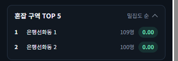

# 혼잡 구역 TOP 5 평균 인원 표시 화면 확인 — 2026-10-27

spring #244(대시보드 혼잡 구역 TOP 5의 값이 모두 0.00이라 순위가 구분되지 않음, FNC-C-030)의 SCR-C-003 통계 패널 '혼잡 구역 TOP 5'를 실제 브라우저(Chrome)로 캡처했다. 수정 뒤에는 한 줄에 구역 이름·평균 인원(`countAvg` 반올림)·밀집도가 나온다. 시안은 `design/png/`.

- 환경: 로컬 관리자 앱(bootRun, `local` 프로필) + 로컬 MySQL + 분석 서버. 대전광역시 중구 은행선화동 구역 2개에 더미 캠을 1대씩 가동했고, 1분 통계는 분석 서버가 더미 영상에서 만든 로컬 시험 데이터다. 계정·비밀번호는 캡처에 나오지 않는다.
- 브랜치: spring `feature/244-top-zones-count`, docs `docs/top-zones-count-244`.

| 화면·상태 | 시안 | 구현 |
|---|---|---|
| 관리자 앱 /admin/stats, 통계 패널 '혼잡 구역 TOP 5' 펼침: 은행선화동 1(109명 · 0.00), 은행선화동 2(100명 · 0.00) | [시안](../../design/png/SCR-C-003-stats-panel-all.png) |  |

## 확인한 것
- 순위마다 평균 인원이 밀집도 칩 앞에 나온다.
- 구역 면적이 46만~116만㎡로 커서 밀집도는 둘 다 0.00이지만 인원으로 순위를 구분할 수 있다. 순서는 밀집도 내림차순(통계 없는 구역 제외) 그대로다.
- 신고자(j75390)가 같은 화면을 보고 확인했다(2026-10-27).

## 시안과 다른 점
- 의도: 구역 이름·인원·값은 시험 데이터라 시안과 다르다.

## 확인하지 못한 것
- 사용자 앱 화면: 같은 common 코드를 쓰지만 이번에는 관리자 앱으로만 확인했다.
- 평균 인원이 없는(`countAvg` null) 구역: 통계가 있는 구역은 항상 값이 있어 시험 데이터로 만들지 못했다. 이때는 인원 없이 밀집도만 나온다.
