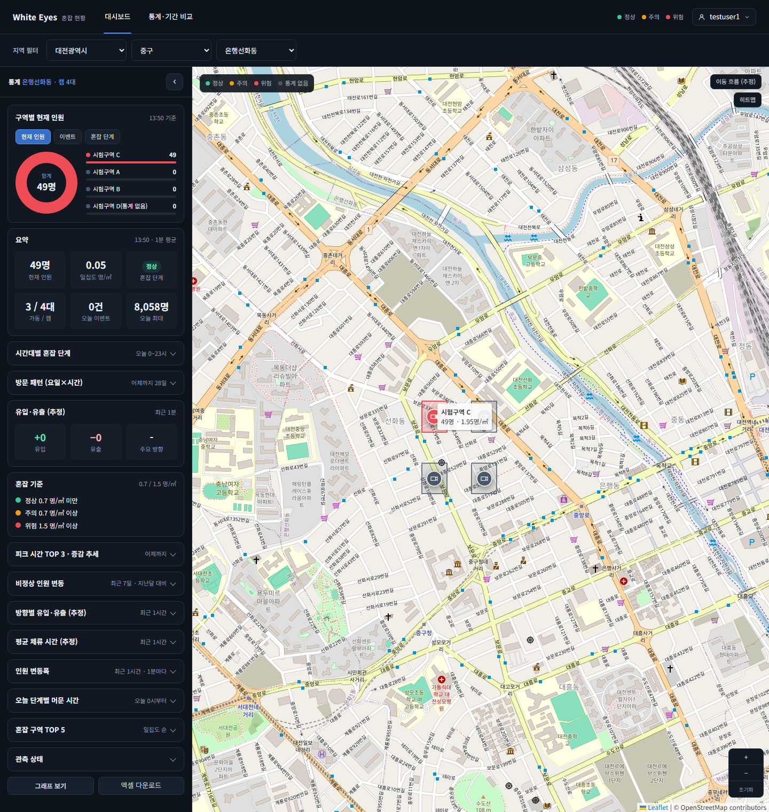
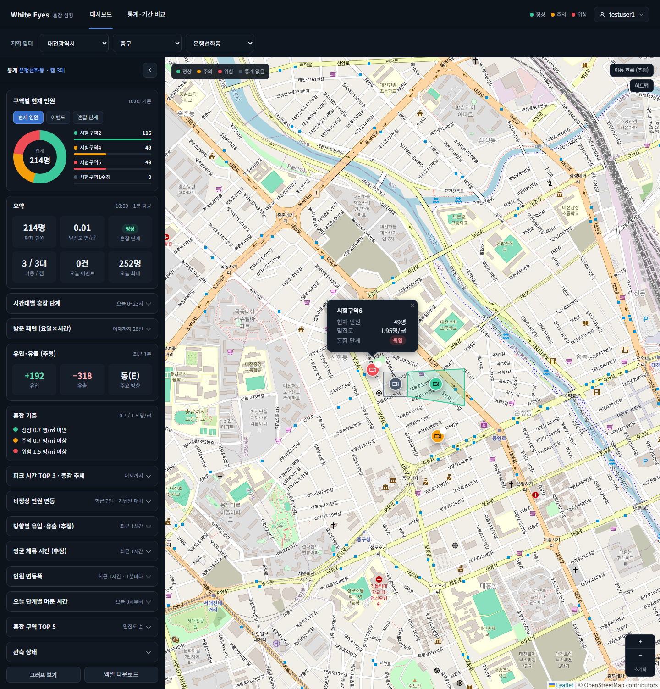
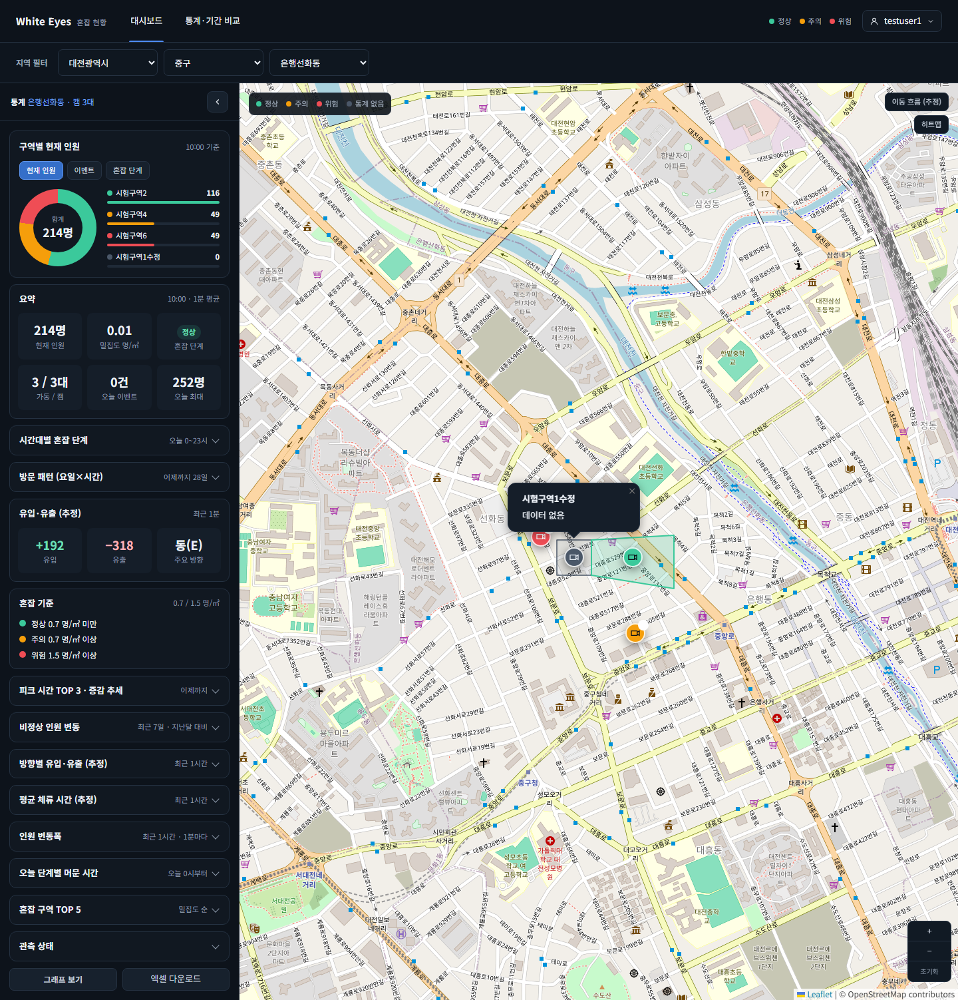

# 사용자 앱 구역 핀 클릭 팝업 화면 확인 — 2026-10-27

spring #259(사용자 앱 지도의 구역 핀을 눌러도 구역 정보 팝업이 열리지 않음, FNC-C-009)의 SCR-C-003 통계 메인 지도를 실제 브라우저(Playwright Chromium, 가로 1440)로 캡처했다. 명세(screens.md SCR-C-003 '지도 > 구역 핀')는 클릭하면 사용자 앱은 구역 정보 팝업(인원·밀집도·단계)을 연다. 시안은 `design/png/`.

- 환경: WSL Docker(MySQL 8.4, 사용자 앱·관리자 앱·분석 서버 컨테이너). 구역·1분 통계는 분석 서버가 더미 영상에서 만든 로컬 시험 데이터다. 화면의 `testuser1`은 시험용 가짜 계정이다. 비밀번호·토큰은 캡처에 나오지 않는다.
- 브랜치: spring `feature/259-user-zone-pin-popup`(dev `013d774` 기준). 수정 전 같은 절차에서 `.leaflet-popup`이 0개였다.
- 캡처는 가로 1440 화면이다. 01번은 툴팁이 닫히지 않도록 세로 1520으로 열어 한 화면으로 찍었다(핀에 마우스를 올린 채 찍음).

| 화면·상태 | 시안 | 구현 |
|---|---|---|
| 사용자 앱, 은행선화동: 구역 핀(위험)에 마우스를 올린 툴팁(이름, 인원 · 밀집도) | [시안](../../design/png/SCR-C-003-dashboard.png) |  |
| 사용자 앱: 같은 핀을 누르면 구역 정보 팝업(현재 인원 49명, 밀집도 1.95명/㎡, 혼잡 단계 위험) | [시안](../../design/png/SCR-C-003-dashboard.png) |  |
| 사용자 앱: 통계가 없는 구역 핀을 누르면 팝업에 이름과 '데이터 없음' | [시안](../../design/png/SCR-C-003-dashboard.png) |  |

## 확인한 것
- 핀 4개를 각각 눌러 팝업이 1개씩 열렸다. 통계가 있는 3개는 현재 인원·밀집도·혼잡 단계(정상·주의·위험 이름은 `/meta/levels`)가 나오고, 통계가 없는 1개는 '데이터 없음'이 나온다.
- 지도 빈 곳을 누르면 팝업이 닫힌다.
- 팝업을 연 채로 새 1분 통계 읽기(`/api/v1/map/status?unit=ZONE`)가 1번 일어났고, 그 뒤에도 같은 팝업이 열려 있었다.

## 시안과 다른 점
- 확인 필요: 명세는 툴팁에 구·동 이름도 넣는다고 적었지만 `GET /api/v1/map/status`의 구역 항목에 구·동이 없어 이름과 인원·밀집도만 나온다(API 변경이 필요해 #259 범위 밖으로 뒀다). `GET /map/status` 구역 항목에 `regionPath`를 더하는 명세 PR(#98)과 구현 이슈(white-eyes1/white-eyes-spring#271)를 올렸다.
- 의도: 시안에는 구역 정보 팝업이 없다. 구현은 명세 문구대로 인원·밀집도·단계를 보여준다.
- 의도: 지도 타일·구역 모양·캠 수는 시험 데이터와 실제 OSM 타일이라 시안과 다르다.

## 확인하지 못한 것
- 관리자 앱 핀 클릭(실시간 보기 창): 이 로컬 DB의 관리자 계정 비밀번호를 알 수 없어 로그인하지 못했다(검증 불가). 코드는 `onPinClick`이 있는 관리자 앱 경로를 바꾸지 않았다.
