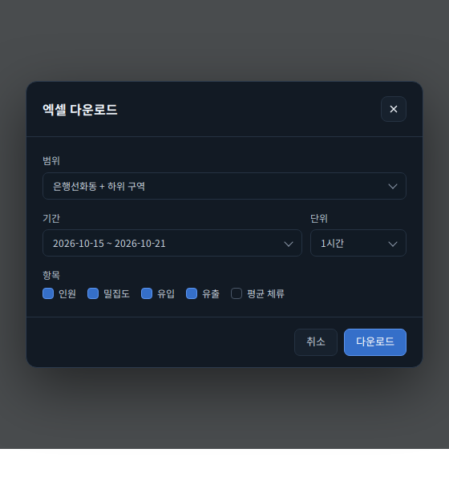
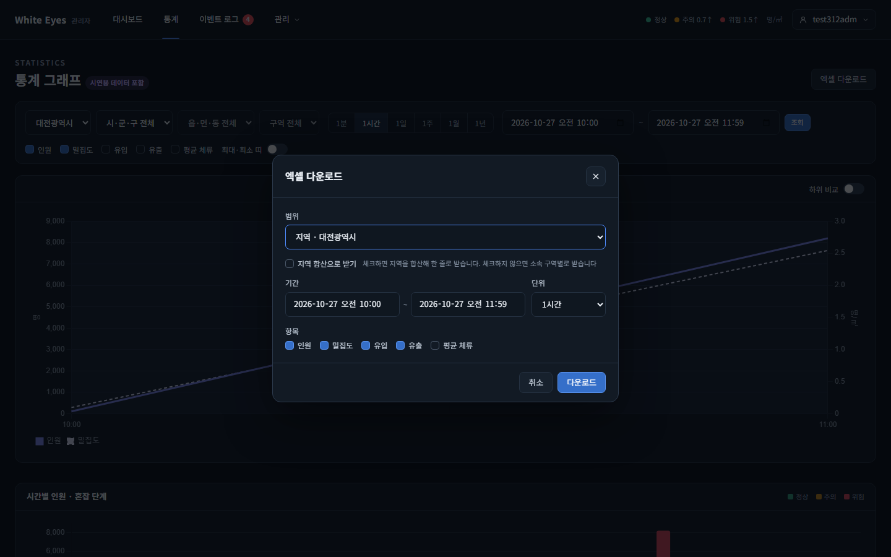
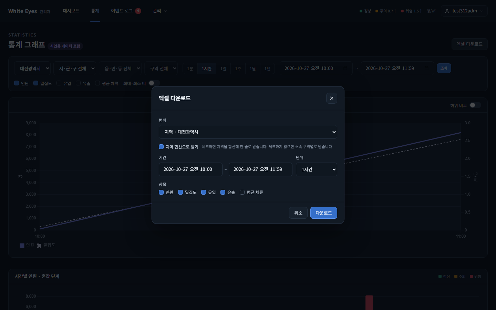
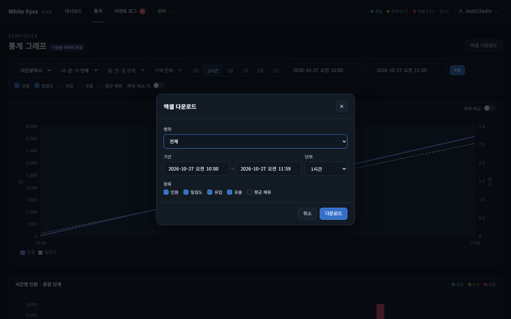

# 통계 엑셀 지역 선택 시 구역별 행 화면 확인 — 2026-10-28

spring #312(통계 엑셀에서 지역을 고르면 기본으로 구역별 행, FNC-C-023·SCR-C-006)의 엑셀 다운로드 창을 실제 브라우저(Playwright Chromium, 1440×900)로 캡처했다. 명세는 white-eyes-docs #326 브랜치(`docs/326-region-export-default-zone-rows`)의 SCR-C-006 범위 행(`지역이면 '지역 합산으로 받기' 체크(기본 해제)`)이고, 시안은 `design/png/SCR-C-006-excel.png`이다.

- 환경: WSL Docker(MySQL 8.4)에 spring `feature/312-region-export-zone-rows` 브랜치로 빌드한 관리자 앱을 띄우고 로그인한 `/admin/stats/graph`다. 시험용 계정과 시험 통계라 이름·값은 시안과 다르다. 비밀번호·토큰은 캡처에 나오지 않는다.
- 시안에는 '지역 합산으로 받기' 체크가 없다(시안은 `범위: 은행선화동 + 하위 구역` 한 줄). 같은 틀(범위·기간·단위·항목) 위에 체크 한 줄을 더했다.

| 상태 | 시안 | 구현 |
|---|---|---|
| 지역 선택(기본, 체크 해제) |  |  |
| 지역 선택 + '지역 합산으로 받기' 체크 | (시안 없음) |  |
| 범위 '전체'(체크 줄 숨김) | (시안 없음) |  |

## 내려받은 파일 확인(대전광역시, 1시간, 2026-10-27 10~12시, 인원 시트)
- 기본(체크 해제, 요청에 `sum` 없음): 구역 9개 × 시각 2개 = 18행. 칸마다 `대전광역시 | 중구 | 은행선화동 | 구역 이름`. 시각 10시 9행은 배경 `#d1d1d1`, 11시 9행은 `#ffffff`. 같은 시각 안에서 구역은 가나다순(`1구역`, `시험288 구역`, `시험구역 A`…`재현구역 260-3`).
- 합산 체크(`sum=true`): 시각마다 1행씩 2행, 시·군·구·읍·면·동·구역 칸은 `(지역 합산)`, 배경은 시각마다 `#d1d1d1`, `#ffffff`.
- 범위 '전체': 지역 기본과 같은 18행, 같은 정렬·배경색.

## 시안과 다른 점
- 의도: 범위가 지역일 때만 체크 줄이 나온다(`지역 합산으로 받기`, 기본 해제, 옆에 안내 문구). 구역·전체에서는 숨긴다.
- 확인 필요: 시안에 체크 줄이 없어 시안 갱신이 필요한지 리뷰어가 정한다.
- 의도: 기간 입력은 시안의 `2026-10-15 ~ 2026-10-21` 한 칸 대신 시작·끝 두 칸이다(이 PR 이전부터의 구현).

## 확인하지 못한 것
- 사용자 앱(8080) 화면 캡처는 하지 않았다. 같은 common 코드이고 사용자 앱 쪽은 통계 화면 테스트로만 확인했다.
